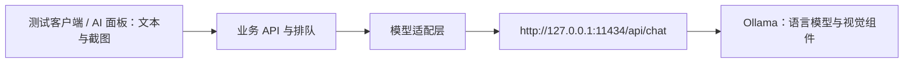

# S02 模型与推理部署

更新日期：2026-10-23  
文档版本：v0.4，增加开发机首次图文脚本实验  
验证状态：本机引擎／4B 已安装并校验，固定 PNG 与脚本生成已实测；预算、真实取消、完整 G1 及后续联合门槛未验收

本轮实际入口、执行范围和证据见第 8.2 节及 [阶段报告](../验证记录/B-20261023-代表性脚本预检.md)。第 3～7 节保留原部署设计／命令参考，不能将其中所有步骤视为已执行；实际唯一启动器改为 Python，长期托管尚未落地。

主会话对齐说明：整体实现按 [实施规划](../实施规划.md)。S01 已为 v0.4 图文方案，S04 已修订图片与联合预算草案，S05 首轮采用固定 PNG 文件的简易 C# Demo；文档对齐不表示 schema、预算和推理已验证。

实施归属：[B 线](../实现线B-模型能力与推理.md) 负责独立推理部署、profile、真实适配与验证；A 线通过公共接口接入。模型可先直连实验，最小实现就绪即安排小集成，能力和参数继续按证据迭代。

## 1. 本轮结论与实施顺序

本专项作为后续模型部署和调用实现的依据。用户本轮将需求改为可理解图片的多模态模型：先在当前开发电脑用 **Qwen3-VL 4B** 验证流程截图理解和基础代码能力，打通模型、业务 API、测试客户端及外网链路；之后迁移 RTX 5080 16GB，优先评估 **Qwen3-VL 8B**，更大模型按资源与实测再决定。

原 v0.2 的 Qwen2.5-Coder 3B／14B 文本模型路线退出当前实施主线；没有已经下载的模型需要迁移。Windows 原生 Ollama、目录布局、串行调度与本机回环访问继续沿用，增加视觉能力检查、真实图片调用、图像处理和图文联合预算。**本次变更不只是替换 model 字符串。**

### 1.1 用户已确认与工程默认值

| 事项 | 本轮结论 | 决策依据／验证状态 |
| --- | --- | --- |
| 输入能力 | 文本＋图片输入、文本输出；用于理解流程顺序与分支 | 用户本轮明确变更；不是要求生成图片或引入视频 |
| 首轮模型系列 | Qwen3-VL 4B | 用户本轮初步选定；替代此前文本模型系列 |
| 当前实施机器 | 本会话所在的开发电脑 | 用户于 2026-10-23 明确说明；不能继续把本机当成 5080 主机 |
| 实施顺序 | 开发机完成链路和基础测试，再迁移 5080 | 本轮用户明确确认 |
| 后续升级方向 | Qwen3-VL 8B 或更大 | 用户本轮明确方向；8B 优先、更大模型暂不冻结 |
| 文档职责 | 补齐部署细节，作为后续实现依据 | 本轮用户明确要求 |
| 推理引擎 | Windows 原生 Ollama，使用官方 AMD64 ZIP 包 | 本专项工程默认；不写成用户逐项确认或已经安装 |
| 开发机模型与参数 | 4B Instruct Q4_K_M，4K 上下文、单图、小用例、单请求生成 | 工程建议；4GB 显存可能需要 CPU 分担，不能保证加载或交互速度 |

本轮建议先选 **Instruct**，方便控制返回内容、生成长度和耗时；Thinking 留作后续对照，不默认启用。`qwen3-vl:4b`／`:8b` 不能代替明确的 Instruct＋量化标签。首版仍由一个 VL 模型承担看图和代码任务，不预先增加视觉模型＋代码模型的两次调用或 Agent 循环；看图与代码的评估分别计分，再判断是否需要拆分。

### 1.2 流程图输入的设计建议

纯文本模型可以理解用文字、边列表或 JSON 表达的顺序、条件和循环；本项目的缺口是现有接口不能提供这些关系。[S01 U07／第 6.4 节](01-模型能力与上下文.md) 已记录这一限制，所以引入截图和视觉模型有实际用途，不再重复假设已有流程拓扑导出接口。

建议每次输入由三部分组成：**用户需求与当前脚本＋真实工具／变量／输出目录＋流程截图及必要文字说明**。截图辅助识别可见节点、箭头、分支和循环，不替代 SDK、真实 ID、类型和不可见的业务条件。看不清的条件、隐藏子流程、交叉线归属和复位责任应明确列为未知；截图布局的上下左右不能直接当作执行顺序。

先使用清晰局部图验证；复杂工程在 5080 档位评估整体图＋局部图。将识别结果表达为节点、来源／目标、条件与未知项，便于与真实工具目录核对；这可以是独立能力用例，不表示每个业务任务强制先调用一次图解析模型。只有影响本次脚本的关键关系不清时才补充说明或截图。未来若能从工程文件取得可信结构，可增加结构化关系，不让图片成为唯一事实来源。

**跨专项依赖**：主会话已同步 S01 的首版图片要求及 S04 v0.4 图片／预算草案。旧模型字符串和 Qwen2 文本预算不再是当前实现依据；模型层先按第 6.5 节独立验证，业务链路仍需落实第 6.6 节并通过 G4。

### 1.3 职责和调用边界



- 本文件负责引擎、模型下载与存储、运行参数、内部 HTTP 调用、部署验证和迁移。
- [S01](01-模型能力与上下文.md) 负责提示词、真实 SDK／流程上下文、代码生成与修复规则；本文件的提示词只用于部署检查。
- [S04](04-服务端API与任务调度.md) 负责业务协议、用户认证、队列和取消状态；客户端不直接调用模型端口。
- [S03](03-公网接入.md) 只发布业务 API；开发机和 5080 主机的 `11434` 均只监听回环地址。
- [S06](06-联调与验收.md) 负责整体验收；本专项给出模型层可执行检查和证据要求。

## 2. 开发电脑的实际环境与资源选择

### 2.1 本轮已执行的只读检查

| 项目 | 2026-10-23 的实际结果 | 证据与限制 |
| --- | --- | --- |
| GPU | NVIDIA GeForce RTX 3050 4GB Laptop GPU | `nvidia-smi --query-gpu=name,memory.total,driver_version --format=csv,noheader` |
| 显存 | 总计 4096 MiB；一次采样已用 1000 MiB、空闲 2966 MiB | 空闲值会变化，不是可保证的推理预算 |
| NVIDIA 驱动 | 576.57 | 上述 `nvidia-smi` 输出；未验证 Ollama 实际加载 |
| 系统物理内存 | API 返回约 15.7 GiB，按 16GB 级开发机规划 | Windows `GlobalMemoryStatusEx`；不是当前空闲内存 |
| 系统／架构 | Windows NT 10.0，build 22621，AMD64 | 指定 Python 的 `sys.getwindowsversion()`、`platform.machine()` |
| Windows 名称 | 未准确核定显示名称 | 注册表 ProductName 为 Windows 10 Home China，build 为 22621；不据旧名称断言系统版本，实施时用 `winver` 留档 |
| D 盘／C 盘空闲 | 约 63.2 GiB／55.5 GiB | PowerShell `Get-PSDrive` 的当次采样 |
| Ollama | PATH 未找到；默认安装路径和默认模型目录未找到 | 不能排除其他自定义位置已有安装；实施前再查进程与端口 |
| 用户级环境变量 | `OLLAMA_MODELS`、`OLLAMA_HOST` 未设置 | 不代表其他进程没有自己的环境变量 |

WMI/CIM 的系统信息读取被当前工具环境拒绝，随后通过 `nvidia-smi`、注册表、Windows API 补充上述结果。该限制不是部署失败。当前没有模型性能数据。

### 2.2 模型档位

完整标签大小写照表使用，不使用省略量化的 `:3b`、`:14b` 或 `:latest`。

| 用途 | Ollama 完整标签 | 官方页面文件大小／显示 ID | 使用条件 |
| --- | --- | --- | --- |
| 开发机主验证 | `qwen3-vl:4b-instruct-q4_K_M` | 约 3.3GB；`84f7ed8042fa` | 语言权重之外还包含视觉 projector；4GB 显存很紧，先测单图 |
| 低资源兜底候选 | `qwen3-vl:2b-instruct-q4_K_M` | 约 1.9GB；`afc393e3572c` | 仅在 4B 无法运行时提出的备选，不自动替代用户的 4B 选型，也不拿它代表 4B 质量 |
| 5080 优先升级 | `qwen3-vl:8b-instruct-q4_K_M` | 约 6.2GB；`70e58e37beb1` | 优先验证 8K 图文上下文、单模型串行；仍需实际测量 |
| 更大模型边界 | `qwen3-vl:30b-a3b-instruct-q4_K_M`／`qwen3-vl:32b-instruct-q4_K_M` | 约 20GB／21GB | 不是 5080 16GB 上完整 GPU 驻留的默认升级；CPU 分担速度需单独评估 |

大小与显示 ID 为本轮查阅信息，下载后以完整 digest 和实际字节数锁定，不将页面 ID 当本机测试结果。来源：[4B](https://ollama.com/library/qwen3-vl:4b-instruct-q4_K_M)、[8B](https://ollama.com/library/qwen3-vl:8b-instruct-q4_K_M)、[2B](https://ollama.com/library/qwen3-vl:2b-instruct-q4_K_M)、[30B-A3B](https://ollama.com/library/qwen3-vl:30b-a3b-instruct-q4_K_M)、[32B](https://ollama.com/library/qwen3-vl:32b-instruct-q4_K_M)。MoE 的 A3B 表示激活规模，不能据此推断只需容纳 3B 权重。

文件大小不等于显存占用。图文推理还要容纳视觉编码、图像相关中间结果、KV cache、计算缓冲区和显示资源；Q4 标签不表示所有视觉组件也全为 4bit。本机之前一次采样仅约 2.9GiB 空闲，4B Q4 可能部分 CPU 推理、明显变慢，也可能图片加载失败；不要承诺“4B 一定能在 4GB 上全 GPU 运行”。可先验证接口与小图，实际质量和速度再到 5080 评估。建议引擎、4B 和报告至少预留 20GB；保留 4B、8B 及备份时至少 40GB，均为项目预算。

## 3. 下载来源、固定版本与目录

### 3.1 引擎包

本轮实施基线固定为 **Ollama v0.40.9，Windows AMD64 ZIP**。选择 ZIP 便于固定程序位置、保留版本和以后用独立进程托管，不依赖托盘程序启动。它仍是 Windows 原生运行，不需要 WSL、Docker、PyTorch 或通过 pip 安装 Ollama；本机已有 TensorRT／Python 环境不承担本基线的 GPU 推理。业务服务可独立选 Python 作为 HTTP 调用方，见 [实施规划第 0.5 节](../实施规划.md#05-服务端语言与推理引擎分别选择)，不因此再加载一份模型。

| 项目 | 固定值 |
| --- | --- |
| 官方发布页 | [v0.40.9](https://github.com/ollama/ollama/releases/tag/v0.40.9) |
| 发布附件证据 | [v0.40.9 完整附件列表](https://github.com/ollama/ollama/releases/expanded_assets/v0.40.9) |
| 下载 URL | `https://github.com/ollama/ollama/releases/download/v0.40.9/ollama-windows-amd64.zip` |
| 附件大小 | 页面约 1.48GB，下载时以实际文件为准 |
| 官方公布 SHA256 | `c35019c95679eae1cb28fda4732a7c97978b9fbcbd8adfb5cbcc8fe7c161ea0b` |

2026-10-23 已下载并核对上述 ZIP SHA256，本机 `/api/version` 为 0.40.9，真实 PNG 编码与图文请求已执行，结果见第 8.2 节。Qwen3-VL 模型页列出 0.12.7 为支持起点；不以版本大小替代实测。若更换版本须同步 URL、hash、profile 并重验。Windows 和 GPU 要求见 [Windows 官方说明](https://docs.ollama.com/windows)、[硬件列表](https://docs.ollama.com/gpu)。

### 3.2 开发机固定目录

以下为开发路径约定。引擎、模型、锁与报告现已创建；实际配置本轮读取 example 模板并相对仓库根解析路径，私人 development.json 尚未创建。运行数据统一放在 `.local`。

| 内容 | 开发机绝对路径 |
| --- | --- |
| 引擎 ZIP | `D:\github\AiServer\.local\downloads\ollama-v0.40.9-windows-amd64.zip` |
| 解压目录 | `D:\github\AiServer\.local\apps\ollama\v0.40.9` |
| 调用的程序 | `D:\github\AiServer\.local\apps\ollama\v0.40.9\ollama.exe` |
| 模型下载目录 | **`D:\github\AiServer\.local\ollama\models`** |
| 本地运行日志 | `D:\github\AiServer\.local\logs\ollama` |
| 引擎版本和模型锁定记录 | `D:\github\AiServer\.local\locks` |
| 当前实验配置 | `D:\github\AiServer\config\inference.development.example.json` |
| 当前唯一启动脚本 | `D:\github\AiServer\scripts\inference\Start-Ollama.py` |
| 实际阶段报告 | `D:\github\AiServer\docs\验证记录\B-20261023-代表性脚本预检.md` |

后续实施创建 `.gitignore` 时应排除 `.local/`；源码管理只保存配置模板、脚本和脱敏验证报告，不提交模型和二进制文件。已有 Git 忽略规则时追加合并，不覆盖。本工作目录本轮未检测到 Git 仓库，不能声称已设置忽略规则。

### 3.3 模型下载位置与调用标识

`ollama pull <标签>` 由 **Ollama 服务进程**下载模型。决定存储位置的是该进程启动时的 `OLLAMA_MODELS`，仅在另一个下载终端设置变量不能改变已运行服务的目录。先按第 5 节带正确变量启动，再执行 pull。

模型目录由 Ollama 管理，包含 `blobs`、`manifests`，当前版本还可能使用 `manifests-v2`。不是每个模型对应一个按模型名命名的 `.gguf` 文件夹；请求里的 `model` 填完整标签，不能填 Windows 文件路径。首次部署用清单、服务启动日志和指定目录中生成的文件确认实际位置，不能仅看下载终端的 `$env:OLLAMA_MODELS`。实现依据：[模型存储环境变量](https://github.com/ollama/ollama/blob/v0.40.9/envconfig/config.go)、[manifest 路径实现](https://github.com/ollama/ollama/blob/v0.40.9/manifest/paths.go)。

本方案直接使用 Ollama 模型库，不另行下载 Transformers 权重，不需要转 GGUF 或手写聊天模板。VL 模型 pull 必须取得模型清单引用的语言与视觉组件，不另外混配来源不同的 projector／mmproj。离线迁移停止写入后复制整个 models 目录，保留所有内部目录；只拷贝语言权重可能文本可用而图片失败。

## 4. 初始配置与上下文预算

### 4.1 开发配置的内容约定

下列 JSON 是原参数基线；实际已创建的 example 模板另外包含 ProfileId、图片处理版本和明确未验证的 Budget，并使用相对路径。当前启动器、实验和内部适配读取同一配置；正式私人配置后续由同模板生成，不重复硬编码参数。S04 接入时保持字段语义一致。

```json
{
  "Provider": "Ollama",
  "EngineVersion": "0.40.9",
  "ExecutablePath": "D:\\github\\AiServer\\.local\\apps\\ollama\\v0.40.9\\ollama.exe",
  "BaseUrl": "http://127.0.0.1:11434",
  "ModelsPath": "D:\\github\\AiServer\\.local\\ollama\\models",
  "Model": "qwen3-vl:4b-instruct-q4_K_M",
  "ExpectedQuantization": "Q4_K_M",
  "RequiredCapabilities": ["completion", "vision"],
  "ModelLockPath": "D:\\github\\AiServer\\.local\\locks\\model-development-vl4b.json",
  "NumCtx": 4096,
  "NumPredict": 1024,
  "MaxInputTokens": 2560,
  "ReservedTokens": 512,
  "Temperature": 0.7,
  "TopP": 0.8,
  "TopK": 20,
  "Seed": 42,
  "KeepAlive": "10m",
  "MaxLoadedModels": 1,
  "NumParallel": 1,
  "EngineMaxQueue": 1,
  "ConnectTimeoutSeconds": 5,
  "WarmupTimeoutSeconds": 180,
  "GenerateTimeoutSeconds": 600,
  "UnloadTimeoutSeconds": 30,
  "RecoveryGraceSeconds": 30,
  "ImagePolicy": {
    "MaxImages": 1,
    "MaxBytesPerImage": 3145728,
    "MaxLongEdge": 1280,
    "MaxPixelsPerImage": 786432,
    "AllowedFormats": ["png"]
  }
}
```

| 参数 | 开发机默认值的含义 |
| --- | --- |
| `NumCtx` | 文本、视觉输入与输出共享 4096 tokens；包含模板、system 和历史，不是允许输入 4096 再额外输出 1024 |
| `NumPredict` | 一次最多生成 1024 tokens，图理解用例可单独限制 512；这是部署小用例档位，不代表完整工业脚本预算已满足 |
| 输入与预留 | 2560 是模板＋文本＋视觉输入的总预算，预留 512，与输出合计 4096；不是给文本 2560 后再额外加图片 |
| 采样参数 | temperature 0.7、top_p 0.8、top_k 20 作为 Instruct 测试起点，固定 seed 42 方便比较；不同运行时不保证完全相同，也不是官方基准评测的完整复现配置 |
| `ImagePolicy` | 开发机一次最多 1 张 PNG，原始字节最多 3MiB、长边不超过 1280、像素总数不超过 786432；三项限制同时满足，只是项目测试限制，不保证视觉 token 或显存一定够 |
| `KeepAlive` | 开发机空闲 10 分钟后释放模型；有效请求会续期，不代表服务进程停止 |
| 单模型、单并行 | `MaxLoadedModels=1`、`NumParallel=1`；业务 API 承担用户可见排队 |
| `EngineMaxQueue` | Ollama 内部最多保留 1 个等待请求；不是约 5 位用户的业务队列容量 |
| 超时 | 连接 5 秒、预热 180 秒、单次执行 600 秒、卸载检查 30 秒；排队另算，600 秒是初始上限而非性能目标 |

采样起点参考 [Qwen3-VL 官方 Instruct 评估配置](https://github.com/QwenLM/Qwen3-VL#evaluation-reproduction)，参数是否适合本项目仍需实测。4K 同时放图片、真实 SDK、长原脚本和完整输出可能不够；S01 已记录旧 4K 预算与两份示例容量冲突。切换 VL 不会自动消除该问题，不截断原脚本冒充完整处理；到 5080 用 8K、必要时 16K 独立验证完整任务容量。

超预算应在推理前报错或按 S01 规则调整材料，不能静默截掉早期消息。视觉 token 与编码器处理后的尺寸／切块有关，不能用 PNG 文件大小、Base64 长度或原图像素直接充当精确计数。Qwen Transformers 示例的 `min_pixels`／`max_pixels` 也不能未经验证原样塞进 Ollama options。需要基于锁定的引擎、图像预处理和实际输入计数验证专用预算器；返回计数只用于事后核对。未完成前，仅允许受控小图的模型层实验，不宣称普通业务图片接入已就绪。

请求超预算、输出截断应分别标记，不自动增加上下文或无限续写。升到 8B 时先保留同一张预处理后图片和原参数对比，图片缩放、模型和上下文尽量分次改动。参数名称参考 [Modelfile 参数说明](https://docs.ollama.com/modelfile)，视觉预处理背景参考 [Qwen3-VL 官方用法](https://github.com/QwenLM/Qwen3-VL)。

### 4.2 服务进程环境变量

启动脚本把配置映射成以下**进程级变量**，不修改全局 CUDA／Python 配置，也不依赖用户变量永久生效：

| 环境变量 | 取值 |
| --- | --- |
| `OLLAMA_HOST` | `127.0.0.1:11434`，从 `BaseUrl` 得到 host 与 port |
| `OLLAMA_MODELS` | `ModelsPath` |
| `OLLAMA_CONTEXT_LENGTH` | `NumCtx`；请求仍显式带 `num_ctx` |
| `OLLAMA_NUM_PARALLEL` | `NumParallel` |
| `OLLAMA_MAX_LOADED_MODELS` | `MaxLoadedModels` |
| `OLLAMA_MAX_QUEUE` | `EngineMaxQueue` |
| `OLLAMA_KEEP_ALIVE` | `KeepAlive`；请求也显式带 `keep_alive` |
| `OLLAMA_NO_CLOUD` | `1`，本项目使用本地模型推理 |

其余先用版本默认值，不提前硬编码 GPU 层数、Flash Attention、KV cache 量化或 CUDA 设备编号。先测默认 GPU 加载，再据日志调整。配置修改后重启服务；只重开客户端不会更新引擎环境。依据：[固定版本实现](https://github.com/ollama/ollama/blob/v0.40.9/envconfig/config.go)、[官方配置 FAQ](https://docs.ollama.com/faq)。

## 5. 开发机部署操作——后续实施时按序执行

本节为原 PowerShell 部署示例，不代表逐段执行记录。本轮实际用指定 Python 解释器的安装／下载／启动脚本完成，差异与真实结果见第 8.2 节及报告；没有另装 Python 包或 CUDA Toolkit。

### 5.1 预检和准备目录

用 `winver` 留档，重新记录 GPU、驱动和磁盘。任务管理器中检查已有 Ollama／托盘程序；端口占用时先识别原进程，不随意杀进程。其他 GPU 程序可能占用显存，报告需说明测试时的后台负载。

```powershell
$ErrorActionPreference = 'Stop'
$projectRoot = 'D:\github\AiServer'
$paths = @(
    "$projectRoot\.local\downloads",
    "$projectRoot\.local\apps\ollama",
    "$projectRoot\.local\ollama\models",
    "$projectRoot\.local\logs\ollama",
    "$projectRoot\.local\locks",
    "$projectRoot\.local\inputs",
    "$projectRoot\config"
)
$paths | ForEach-Object { New-Item -ItemType Directory -Path $_ -Force | Out-Null }
& 'C:\Windows\System32\nvidia-smi.exe' --query-gpu=name,memory.total,memory.free,driver_version --format=csv,noheader
Get-PSDrive -Name C,D | Select-Object Name,Free
```

### 5.2 下载并校验固定版本

不使用一键远程执行安装脚本。解压保留完整依赖库，不单独拷贝 `ollama.exe`。

```powershell
$engineVersion = '0.40.9'
$archivePath = "$projectRoot\.local\downloads\ollama-v$engineVersion-windows-amd64.zip"
$engineDir = "$projectRoot\.local\apps\ollama\v$engineVersion"
$archiveUrl = "https://github.com/ollama/ollama/releases/download/v$engineVersion/ollama-windows-amd64.zip"
$expectedSha256 = 'c35019c95679eae1cb28fda4732a7c97978b9fbcbd8adfb5cbcc8fe7c161ea0b'

Invoke-WebRequest -Uri $archiveUrl -OutFile $archivePath -TimeoutSec 1800
$actualSha256 = (Get-FileHash -LiteralPath $archivePath -Algorithm SHA256).Hash.ToLowerInvariant()
if ($actualSha256 -ne $expectedSha256) { throw 'Ollama ZIP SHA256 不匹配，停止解压。' }
if (Test-Path -LiteralPath $engineDir) { throw '目标版本目录已存在，请先检查，避免覆盖。' }
Expand-Archive -LiteralPath $archivePath -DestinationPath $engineDir
$ollamaExe = Join-Path $engineDir 'ollama.exe'
if (-not (Test-Path -LiteralPath $ollamaExe)) { throw '未找到 ollama.exe，请检查包内结构。' }
```

保存 URL、hash 和包版本到报告。原讨论中 PowerShell 公网读取失败；本轮指定 Python 的 HTTPS 下载实际成功并完成 hash 校验，原生模型 pull 则出现分片停滞，采用官方同清单 blobs 的校验下载恢复。始终保留 TLS 验证，不换不明来源。具体脚本与证据见报告。

### 5.3 终端 A：加载配置并运行引擎

先将第 4.1 节 JSON 保存为 `config\inference.development.json`。这是后续实施要做的文件创建，本轮没有创建它。如已有托盘版，先退出并关闭其自动启动，避免争用端口。首次前台运行，保持终端打开。

```powershell
$ErrorActionPreference = 'Stop'
$cfg = Get-Content -Raw -Encoding UTF8 'D:\github\AiServer\config\inference.development.json' | ConvertFrom-Json
$engineUri = [Uri]$cfg.BaseUrl
if ($engineUri.Host -ne '127.0.0.1') { throw '本阶段只允许监听本机回环地址。' }
$env:OLLAMA_HOST = $engineUri.Authority
$env:OLLAMA_MODELS = $cfg.ModelsPath
$env:OLLAMA_CONTEXT_LENGTH = [string]$cfg.NumCtx
$env:OLLAMA_NUM_PARALLEL = [string]$cfg.NumParallel
$env:OLLAMA_MAX_LOADED_MODELS = [string]$cfg.MaxLoadedModels
$env:OLLAMA_MAX_QUEUE = [string]$cfg.EngineMaxQueue
$env:OLLAMA_KEEP_ALIVE = $cfg.KeepAlive
$env:OLLAMA_NO_CLOUD = '1'
& $cfg.ExecutablePath serve
```

日志应对应正确模型目录、监听地址和 GPU 检测。地址占用时停止本次启动、检查已有实例，不直接换端口掩盖冲突。服务启动只表示引擎可访问，还没证明模型已下载或能生成。

### 5.4 终端 B：下载模型并锁定身份

本终端 `OLLAMA_HOST` 让 CLI 指向终端 A；模型写入位置由终端 A 的 `OLLAMA_MODELS` 决定。

```powershell
$ErrorActionPreference = 'Stop'
$cfg = Get-Content -Raw -Encoding UTF8 'D:\github\AiServer\config\inference.development.json' | ConvertFrom-Json
$env:OLLAMA_HOST = $cfg.BaseUrl
$baseUrl = $cfg.BaseUrl.TrimEnd('/')

$serverVersion = Invoke-RestMethod -Uri "$baseUrl/api/version" -TimeoutSec 5
& $cfg.ExecutablePath --version
if ($serverVersion.version -ne $cfg.EngineVersion) { throw '服务端版本与配置不一致。' }
& $cfg.ExecutablePath pull $cfg.Model
if ($LASTEXITCODE -ne 0) { throw '模型下载失败。' }

$inventory = Invoke-RestMethod -Uri "$baseUrl/api/tags" -TimeoutSec 10
$entry = @($inventory.models | Where-Object { $_.name -eq $cfg.Model })
if ($entry.Count -ne 1) { throw '未找到唯一匹配的完整标签。' }
if ($entry[0].details.quantization_level -ne $cfg.ExpectedQuantization) { throw '量化类型与配置不符。' }
if ($entry[0].digest -notmatch '^(sha256:)?[0-9a-fA-F]{64}$') { throw '未取得完整 digest。' }
$showBody = @{ model = $cfg.Model } | ConvertTo-Json
$modelDetails = Invoke-RestMethod -Method Post -Uri "$baseUrl/api/show" `
    -ContentType 'application/json; charset=utf-8' -Body ([Text.Encoding]::UTF8.GetBytes($showBody)) -TimeoutSec 10
foreach ($capability in $cfg.RequiredCapabilities) {
    if ($modelDetails.capabilities -notcontains $capability) { throw "模型缺少所需能力：$capability" }
}

$lockRecord = [ordered]@{
    recorded_at = (Get-Date).ToUniversalTime().ToString('o')
    engine_version = $serverVersion.version
    model = $entry[0].name
    digest = $entry[0].digest
    size_bytes = $entry[0].size
    details = $entry[0].details
    capabilities = $modelDetails.capabilities
    image_policy = $cfg.ImagePolicy
}
if (Test-Path -LiteralPath $cfg.ModelLockPath) { throw '已有锁定记录，先核对差异，禁止直接覆盖。' }
$lockRecord | ConvertTo-Json -Depth 10 | Set-Content -Encoding UTF8 -LiteralPath $cfg.ModelLockPath
& $cfg.ExecutablePath show $cfg.Model
Get-ChildItem -LiteralPath $cfg.ModelsPath -Directory
```

检查 `show` 的参数规模、量化、Instruct、vision 能力和可取得的视觉组件信息，保存响应。锁定记录同时保存图片策略；视觉预处理或模板变更也应形成新的推理 profile，不只比语言权重。第一次 pull 需要联网，重复 pull 可能更新同名标签，因此**业务启动不自动 pull**。后续核对完整 digest；不同时先验证变更。依据：[官方 CLI](https://docs.ollama.com/cli)、[模型清单 API](https://docs.ollama.com/api/tags)、[模型详情 API](https://docs.ollama.com/api-reference/show-model-details)。

### 5.5 下载网络和代理

- 先使用正常网络；失败后记录阶段、域名、状态或错误，区分引擎 ZIP 下载与模型 pull。
- 需要代理时将实际 `HTTPS_PROXY` 传给**服务进程**，重启后重试；不编造固定代理端口，不把凭据写入公共配置。
- 本机 HTTP 应绕过代理，按客户端设置 `NO_PROXY=127.0.0.1,localhost` 或对专用本地 HttpClient 禁用代理。不要为 pull 新增 `HTTP_PROXY`；已有全局代理也需检查回环调用。
- 参考 [官方代理说明](https://docs.ollama.com/faq#how-do-i-use-ollama-behind-a-proxy)。离线运行不需要每次重新下载，但应先完成本地模型、版本和实际推理检查。

## 6. 模型如何调用

### 6.1 预热与就绪

仍在终端 B，使用已加载的 `$cfg` 和 `$baseUrl`：

```powershell
$warmupBody = @{
    model = $cfg.Model
    prompt = ''
    stream = $false
    keep_alive = $cfg.KeepAlive
    options = @{ num_ctx = $cfg.NumCtx }
} | ConvertTo-Json -Depth 10

$warmup = Invoke-RestMethod -Method Post -Uri "$baseUrl/api/generate" `
    -ContentType 'application/json; charset=utf-8' `
    -Body ([Text.Encoding]::UTF8.GetBytes($warmupBody)) -TimeoutSec $cfg.WarmupTimeoutSeconds
& $cfg.ExecutablePath ps
$running = Invoke-RestMethod -Uri "$baseUrl/api/ps" -TimeoutSec 5
$running.models | Select-Object name,size,size_vram,context_length
```

空 prompt 只用于基础加载，不能验证视觉编码器已成功工作。存活、文件身份、纯文字生成与实际图文生成分开检查；只有第 6.5 节带图成功且资源状态明确，才完成多模态部署检查。`/api/ps` 无模型可能仅为未加载或驻留到期。依据：[Generate API](https://docs.ollama.com/api/generate)、[运行中模型 API](https://docs.ollama.com/api/ps)、[版本路由](https://github.com/ollama/ollama/blob/v0.40.9/server/routes.go)。

### 6.2 最小聊天：PowerShell 可复现示例

模型通过 HTTP JSON 调用，不需要把文件读入 Python／C# 进程。以下验证 UTF-8、基础指令、C# 输出和统计字段，不执行返回代码。

```powershell
$chatBody = @{
    model = $cfg.Model
    messages = @(
        @{ role = 'system'; content = '你是 C# 编程助手。目标框架为 .NET Framework 4.7.2。不得假设存在未提供的业务 SDK。' },
        @{ role = 'user'; content = '只输出一个 C# 静态方法：输入 double[]，返回算术平均值；数组为 null 或长度为 0 时抛出 ArgumentException。不要使用第三方库。' }
    )
    stream = $false
    keep_alive = $cfg.KeepAlive
    options = @{
        num_ctx = $cfg.NumCtx
        num_predict = $cfg.NumPredict
        temperature = $cfg.Temperature
        top_p = $cfg.TopP
        top_k = $cfg.TopK
        seed = $cfg.Seed
    }
} | ConvertTo-Json -Depth 10

$timer = [Diagnostics.Stopwatch]::StartNew()
$reply = Invoke-RestMethod -Method Post -Uri "$baseUrl/api/chat" `
    -ContentType 'application/json; charset=utf-8' `
    -Body ([Text.Encoding]::UTF8.GetBytes($chatBody)) -TimeoutSec $cfg.GenerateTimeoutSeconds
$timer.Stop()
if ($reply.done -ne $true) { throw '未返回完整结束响应。' }
if ([string]::IsNullOrWhiteSpace($reply.message.content)) { throw '模型返回文本为空。' }
$reply.message.content

$tokensPerSecond = $null
if ($reply.eval_duration -gt 0) { $tokensPerSecond = [math]::Round($reply.eval_count / ($reply.eval_duration / 1e9), 2) }
[pscustomobject]@{
    wall_seconds = [math]::Round($timer.Elapsed.TotalSeconds, 2)
    done_reason = $reply.done_reason
    prompt_tokens = $reply.prompt_eval_count
    output_tokens = $reply.eval_count
    load_seconds = $reply.load_duration / 1e9
    generate_tokens_per_second = $tokensPerSecond
}
```

此用例通过不能写成工业脚本任务已通过；宿主实际 C# 语言版本仍未知，不能从 .NET Framework 4.7.2 推导编译器版本。

### 6.3 交给 S04 的内部调用契约

| 项目 | 本专项约定 |
| --- | --- |
| 方法／地址 | `POST {BaseUrl}/api/chat`，本机为 `http://127.0.0.1:11434/api/chat` |
| 编码 | `Content-Type: application/json; charset=utf-8`，文本按 UTF-8 处理 |
| 必带字段 | `model`、`messages`、`stream:false`、`keep_alive`、`options.num_ctx`、`num_predict`、`temperature`、`top_p`、`top_k`、`seed`；有图时加 user 消息内的 `images` |
| 上下文 | `messages` 显式传 system、必要历史、本轮 user；各用户独立组装，Ollama 不替业务维护用户会话 |
| 响应 | 一次返回完整 JSON，读取 `message.content`，不是 generate 接口的 `response` 字段 |
| 完成与截断 | HTTP 成功、`done=true`、文本非空；`done_reason=length` 标记截断。缺少原因且达到上限时保守标记待检查 |
| 统计 | 保存 model、done_reason、total_duration、load_duration、prompt_eval_count、prompt_eval_duration、eval_count、eval_duration；时长单位纳秒 |
| 参数来源 | 服务端配置；普通客户端不能覆盖模型、上下文或输出上限 |
| 图片内容 | Ollama 原生 REST 的 `messages[].images` 是原始图片字节的 Base64 字符串数组，不是本地路径、URL 或 data URI；无图任务可以省略 |
| 认证 | 用户认证在 S04；模型接口不公开，不开放跨域通配设置 |

API 默认可流式返回，必须显式设置 `stream:false` 才按普通完整 JSON 处理。后续加流式时另行实现 NDJSON 解析及取消验证。依据：[Chat API](https://docs.ollama.com/api/chat)。第一版不依赖 tool calling、JSON schema 输出或模型自行执行 C#。

服务端适配器复用异步 HTTP 客户端，连接和执行超时分别生效；用户取消和执行超时传播给当前 HTTP 请求。Python 候选对应 HTTPX／Ollama AsyncClient 和异步任务取消；C# 对应 HttpClient／CancellationToken，均须实测引擎收尾。进入 running 才开始执行计时，排队不计入 600 秒。业务响应和稳定错误码由 S04 定义，不能把引擎原始错误直接当业务协议。

### 6.4 异常、取消与恢复

| 现象 | 模型适配器要求 |
| --- | --- |
| 连接拒绝／连接超时 | 标记引擎不可用，检查存活；不自动下载或启动第二实例 |
| 404／模型不存在 | 查标签、实例、目录，不在用户任务中自动 pull |
| 400／参数错误 | 记录配置和错误，不连续重试相同请求 |
| 503／引擎繁忙 | 查是否有绕开业务调度的调用；S04 决定重新排队，不盲目增加内部队列 |
| OOM／加载失败／进程退出 | 当前任务失败并暂停新推理；检查资源与日志，按第 9 节调整 |
| 截断／空文本 | 分别标记不完整或响应无效，不记为完整代码生成成功 |
| 用户取消／执行超时 | 终止对应 HTTP 请求并进入取消／恢复检查；停止等待不等于 GPU 已释放 |

初始不自动重试已经发送的生成，避免超时后重复生成。本方案没有按业务任务 ID 调用的独立 `/cancel` 接口；取消依赖关闭／取消该 HTTP 请求，实际停止延迟必须实测。

`/api/ps` 只能看驻留，不能证明某请求已停，GPU 采样也只是辅助。取消后给引擎最多 `RecoveryGraceSeconds=30` 的观察期；**恢复实验未通过前不立即放行下一项**。无法确认恢复时标记引擎恢复中，开发机手动重启唯一实例并预热，5080 托管时通过同一管理入口恢复。重启会中断其他直接调用，业务调度应保证唯一活动任务。自动恢复和状态一致性交给 S04／S06 实现、验收。

### 6.5 实际流程截图调用示例

先准备一张已知正确关系的清晰 PNG，保存为 `D:\github\AiServer\.local\inputs\flow-01.png`；这是实施时准备的测试输入，本轮没有创建或读取截图。先测“识别流程”，与第 6.2 节的纯代码任务分开，避免图片上传失败被文本回答掩盖。以下在终端 B 执行：

```powershell
$imagePath = 'D:\github\AiServer\.local\inputs\flow-01.png'
$imageFile = Get-Item -LiteralPath $imagePath
if ($cfg.ImagePolicy.MaxImages -lt 1) { throw '配置未允许图片。' }
if ($imageFile.Length -gt $cfg.ImagePolicy.MaxBytesPerImage) { throw 'PNG 字节数超限。' }
Add-Type -AssemblyName System.Drawing
$picture = [Drawing.Image]::FromFile($imageFile.FullName)
try {
    if ($picture.RawFormat.Guid -ne [Drawing.Imaging.ImageFormat]::Png.Guid) { throw '输入必须是真实 PNG。' }
    if ([math]::Max($picture.Width, $picture.Height) -gt $cfg.ImagePolicy.MaxLongEdge -or
        ([long]$picture.Width * $picture.Height) -gt $cfg.ImagePolicy.MaxPixelsPerImage) {
        throw '图片尺寸超限，请准备清晰的局部图；不能仅压缩文件字节数。'
    }
} finally { $picture.Dispose() }
$imageBase64 = [Convert]::ToBase64String([IO.File]::ReadAllBytes($imageFile.FullName))

$visionBody = @{
    model = $cfg.Model
    messages = @(
        @{ role = 'system'; content = '你是流程图分析助手。依据可见节点和箭头描述关系；看不清或没有显示的条件标为未知，不凭节点位置猜执行顺序。' },
        @{
            role = 'user'
            content = '识别图中的节点和有向连线，按来源节点、目标节点、分支条件列出；指出起点、汇合、回路和看不清的位置。本轮不生成代码。'
            images = @($imageBase64)
        }
    )
    stream = $false
    keep_alive = $cfg.KeepAlive
    options = @{
        num_ctx = $cfg.NumCtx
        num_predict = 512
        temperature = $cfg.Temperature
        top_p = $cfg.TopP
        top_k = $cfg.TopK
        seed = $cfg.Seed
    }
} | ConvertTo-Json -Depth 10

$visionReply = Invoke-RestMethod -Method Post -Uri "$baseUrl/api/chat" `
    -ContentType 'application/json; charset=utf-8' `
    -Body ([Text.Encoding]::UTF8.GetBytes($visionBody)) -TimeoutSec $cfg.GenerateTimeoutSeconds
if ($visionReply.done -ne $true -or [string]::IsNullOrWhiteSpace($visionReply.message.content)) { throw '图文响应无效。' }
if ($visionReply.done_reason -eq 'length') { throw '图理解输出被截断，本次不能判定通过。' }
$visionReply.message.content
```

REST 字段依据：[Ollama Vision API](https://docs.ollama.com/capabilities/vision)。此处 `images` 是 user 消息的同级字段，不放在 `content` 字符串或 `options` 中；也不要将 OpenAI 兼容接口的 `image_url` 对象直接套用到 Ollama 原生接口。SDK 能接受路径，不代表原生 REST 也能访问客户端磁盘路径。

必须人工对照已知图检查箭头方向、条件和回路；得到一段自信描述不等于理解正确。再用“相同节点文字、改变一条箭头／分支条件”的对照图检查输出是否随图改变，确认模型确实使用图片。首次含图推理可能额外初始化视觉组件，要独立记录冷／热耗时与峰值。

### 6.6 业务接口与图片处理的落地要求

以下是 S04／S05 的新增需求，**不是现有 v1 已实现的字段**。业务协议采用新版本还是兼容扩展，由 S04 明确；完成前可以直连模型做实验，不能把 Base64 塞入现有 `instruction`／`context` 字符串冒充视觉输入。

| 环节 | 实施要求 |
| --- | --- |
| 客户端来源 | 截取或选择当前工程流程图；显示将发送的图片并关联工程／脚本修订、采集时间，不默认发送整个桌面；图文材料尽量来自同一工程状态 |
| 数据搭配 | 保留真实工具 ID／名称／类型／输出目录、当前脚本和需求；图片只补可见关系，不能覆盖明确的接口事实 |
| 解码限制 | 按原始字节、格式、像素、长边和数量共同校验；先限制编码正文，再进行有界解码，不能只按 Base64 字符串长度判断图片是否安全可用 |
| 初始正文上限 | 建议图文请求总正文 5MiB，单图原始 3MiB；Base64 约增大至原来的 4/3，业务 API／代理限制要一起调整；这是新协议建议，不覆盖现有 v1 限额 |
| 图像质量 | 优先 PNG 保留文字和细线，不依赖反复 JPEG 压缩；不能为省资源静默缩小到节点名不可读。整体图可先做总览；关键局部作为单独测试或在 8B 档位增加图片数 |
| 预处理身份 | 记录原图和实际发送图片的 hash、原始／处理后尺寸、裁剪范围及规则版本；不凭清理缓存或模型记忆认定已看过上一张图 |
| 历史与幂等 | 图片内容 hash、顺序、文字和有效处理策略纳入任务快照／幂等语义；仅同文件名不同图片不能复用旧结果。需要历史截图时显式携带并累计预算 |
| 预算 | 旧 Qwen2 文本模板＋UTF-8 字节上界方法不能覆盖 Qwen3-VL 视觉输入；重新核对模板／renderer、视觉处理和联合 token，不能把图片当零 token |
| 隔离与保存 | 附件与任务归属一致，保留／删除期限由 S04 明确并与任务材料同步；日志不记录 Base64。轮询只回状态，不反复下载原图 |
| 不可见信息 | 分支表达式、隐藏子流程、运行时节点状态、相机或串口时序不能从截图猜测；在相关任务中补充文字或清晰局部 |

首版仍可每任务只调用一次 VL：同一个请求包含图、文字目录、SDK 和当前脚本。若未来分成“看图生成流程结构”和“代码生成”，需独立确定中间结果来源／版本、额外排队、预算和取消，不在本轮悄悄增加第二次调用。

## 7. 日常操作与后续托管

### 7.1 开发阶段

- 先启动终端 A，再做版本／锁定记录检查和预热，最后启动业务 API；重新开机后沿用此顺序。
- 模型未就绪时业务 API 可返回基础存活，但不能宣布生成可用；健康轮询不要反复生成文本占用队列或不断保活。
- 无活动任务时执行 `& $cfg.ExecutablePath stop $cfg.Model` 释放模型，随后 30 秒内轮询 `/api/ps` 确认消失；它不停止 HTTP 引擎。
- 停止引擎前先停止业务提交并结束／取消活动任务，再在终端 A 按 `Ctrl+C`；确认进程退出、端口停止服务。`ollama rm` 是删除模型引用，不是停止命令。
- 重启无需重新下载；再次核对版本、目录、digest 并预热。

### 7.2 启动脚本实施要求

本轮实际实现为 `scripts/inference/Start-Ollama.py`：配置只进入子进程环境，检查回环／端口，启动唯一 `ollama.exe serve` 并等待退出，记录所启动 PID；Windows PowerShell 文件执行策略阻止了原入口，因此未更改系统策略而改用指定 Python。实际由调用方隐藏启动并分流 stdout／stderr。以下长期日志轮转及托管要求尚未全部实现，不能标记托管通过；原 `.ps1` 路径是未采用的设计草案。

当前唯一入口为 `scripts\inference\Start-Ollama.py`，参数 `--config <路径>`，默认读取开发 example 模板。它映射第 4.2 节的进程级变量、拒绝已有监听，等待唯一子进程退出并传递退出码。不要再创建并行的 `.ps1` 拉起入口；启动器等待退出不等于长期托管已验收。

stdout、stderr 分别写到 `.local\logs\ollama`，按启动时间命名；每日轮转或分片，单文件上限 20MB、保留 14 天。记录 PID、版本、模型配置和目录，不记录完整业务提示词。实现时显式处理日志与退出；ZIP 模式不能假定写入安装版的 `%LOCALAPPDATA%\Ollama\server.log`。

当前启动器已实际运行；仍需补停止／重启和长期托管检查。JSON 使用 UTF-8 并显式读取编码。若以后增加 PowerShell 辅助脚本，含中文且供 5.1 执行时才使用 UTF-8 BOM；当前 Python 入口不依赖全局放宽执行策略。

### 7.3 5080 长期托管

迁移后先前台验收，再通过 Windows 任务计划程序托管同一脚本。不直接把 ZIP 程序注册为 Windows Service，它并未因此实现服务控制协议。

| 项目 | 后续创建任务 `AiServer-Ollama` 的配置 |
| --- | --- |
| 触发器 | 系统启动后延迟 30 秒 |
| 账户 | 目标主机固定运行账户，可读引擎、可写模型／日志／锁定目录；不依赖开发账户的环境变量 |
| 登录 | 不论是否登录都运行；凭据由 Windows 任务计划程序管理，不写入仓库 |
| 程序 | 目标机部署时核定的 Python 绝对路径，尚未检查，不复制开发机路径作为已验值 |
| 参数 | `"D:\AiServer\scripts\inference\Start-Ollama.py" --config "D:\AiServer\config\inference.production.json"`，目标配置／账户尚待验证 |
| 起始目录 | `D:\AiServer` |
| 实例／失败 | 已运行不再启动；失败后每 1 分钟重启，最多 3 次；持续失败记录故障并停止接收新任务 |
| 持续运行 | 取消运行时长限制；不依赖托盘登录启动，不因空闲或电池条件自动停止 |

目标账户须能访问经核定的 Python 解释器和各目录；不得为部署全局放宽系统策略。关停、取消后恢复与任务重启使用同一入口，避免任务和业务服务各自拉起引擎。必须实测重启、无人登录恢复、日志和预热，通过前不能标记长期托管完成。

## 8. 验证清单与实际记录

### 8.1 后续必须执行的检查

| 编号 | 操作 | 通过条件／记录 |
| --- | --- | --- |
| T01 环境版本 | winver、GPU／驱动、ZIP hash、CLI、`/api/version` | 固定版本一致，目录和日志可核对 |
| T02 模型身份 | pull、tags、show、锁定记录 | 参数规模／量化正确，完整 digest，文件写入指定目录 |
| T03 预热加载 | 第 6.1 节、ollama ps、nvidia-smi | 上下文 4096；记录 CPU／GPU 分担，纯文本预热不算视觉加载通过 |
| T04 最小聊天 | 第 6.2 节 | UTF-8 正常、完整非空；人工核对平均值和空数组要求，保存响应与耗时 |
| T05 缺少接口 | 要求使用“当前流程 SDK 读取工具变量”，不提供 SDK | 检查是否指出接口缺失并询问；编造 SDK 记为能力问题，不是部署失败 |
| T06 冷热耗时 | 无活动任务时 stop、确认卸载；相同请求 1 次冷、至少 2 次热 | 冷调用前不预热；记录加载、输入处理、生成和总耗时，说明提示词缓存影响 |
| T07 资源上下文 | 生成期间逐秒采样显存；测接近输入预算的请求 | 保存峰值、token 数、GPU 占比、OOM／CPU 分担、截断，不只测 hello |
| T08 取消超时 | 已开始生成后，分两次测试用户取消与短执行超时 | 记录停止延迟，无残留影响下一项；失败按恢复流程暂停并重启 |
| T09 顺序调用 | S04 提交两项并取消排队项，只向引擎发一个活动请求 | 可见排队在业务层；不与未停止的上一项重叠 |
| T10 重启复用 | 停止后重启、用既有模型、不 pull | 身份不变，预热与聊天通过；可断开外网验证本地推理 |
| T11 图像链路 | 第 6.5 节、vision 能力与视觉组件检查 | 真实图片可输入；改变箭头的对照图改变回答；不能用纯文本响应代替 |
| T12 流程识别 | 顺序、条件分支／汇合、循环／回边、交叉连线、小字局部等代表图 | 分别统计节点文字／目录匹配、有向边、条件与回路；关键箭头错误不能用描述流畅抵消 |
| T13 图文负载 | 分别测小图、接近图片上限、图＋代码；执行取消、超预算和重启 | 记录视觉冷／热耗时、峰值、输入计数、CPU 分担／OOM；确认没有静默丢图或截掉脚本 |
| T14 代码能力 | 分别测已知图解释、无图 C#、带图＋真实 SDK 生成 | 区分看图错误、绑定错误、语法错误和业务错误；有能力编译后再报告真实编译结果 |

只取消尚未发出的 Task 不能算推理取消通过。非流式模式看不到首 token，第一版记录完整响应时间；需要首 token 延迟时另加流式测量。

T07 在另一终端采样，生成结束后按 `Ctrl+C`：

```powershell
& 'C:\Windows\System32\nvidia-smi.exe' --query-gpu=timestamp,memory.used,memory.total,utilization.gpu --format=csv -l 1
```

部署通过指版本／身份／视觉能力可复现、图文可调用、资源状态清楚、故障可定位。建议先准备约 20 张带正确节点／边／条件的小图，覆盖 T12，并在同图、同预处理、同任务下比较 4B 与 8B；正式质量目标由 S01／S06 冻结。若部分 CPU 推理，可继续小规模验证，但标记全 GPU 目标未通过，不能据其速度预测 5080，也不为等待时间编造合格线。

### 8.2 报告和当前状态

执行后创建第 3.2 节报告：记录日期、机器类型、驱动／内存、引擎来源与 hash、配置快照、完整 digest、各 T 编号结果、必要请求／响应、显存采样和修复。原始证据可保存在 `.local`，报告链接必要的脱敏内容；不默认记录真实业务代码和完整提示词。

| 事项 | 本轮状态 |
| --- | --- |
| 项目阅读 | 已读约定入口、实施规划、B、S01／S02／S04／S06 |
| T01／T02 身份 | ZIP hash、CLI／服务 0.40.9、4B 完整 digest、Q4_K_M、vision、模型目录已核对；模型锁在 `.local/locks/`。winver UI 截图未做 |
| 部署 | 引擎、语言权重、视觉组件已安装；example 配置及 Python 唯一启动器已创建。原生 pull 停滞后以官方 manifest／blobs 校验恢复，再原生 pull 核对成功 |
| T03／T06／T07 部分 | 4096 上下文；14/37 层 GPU，有 CPU 分担；一次模型未加载调用及一次重复，另两次反馈；采样、冷热与容量均见报告。未完成两次热调用或全面容量边界测试 |
| T04／T05／T10 | 独立平均值文字用例、缺 SDK 澄清、推理后重启／断网复用未执行，不由图文任务代替 |
| T11／T14 部分 | 768×256 固定 PNG 实际编码；最终顺序正确、完整代码经模拟 SDK 编译并过 10 用例。无箭头对照图，无真实用户截图／SDK／宿主编译或业务验收 |
| T08／T09／T13 | 真实取消、超时、下一任务恢复及 API 排队未执行；Mock 关闭流测试不能替代。最终正常卸载成功；普通图文预算仍未校准 |
| 5080、8B／更大模型、托管 | 未执行，G1／G4／G5／G6 均未整体通过 |

本轮原始材料、全部调用与失败诊断集中在 [B 阶段报告](../验证记录/B-20261023-代表性脚本预检.md)；不在本表重复维护全部数值。当前本机引擎保留回环运行，模型已正常卸载释放显存。

## 9. 常见失败与调整顺序

| 现象 | 优先检查 | 下一步 |
| --- | --- | --- |
| ZIP 无法下载 | 附件地址、代理、TLS、磁盘 | 人工下载同包并校验，不换不明来源 |
| pull 后找不到模型 | CLI host、监听进程、服务目录、完整标签 | 指向正确实例；在正确目录 pull 或完整离线迁移 |
| 服务版本不符 | 是否连接旧托盘版／启动旧路径 | 停止已识别的旧实例，再从固定路径启动 |
| 4B VL OOM | 空闲显存、视觉组件、图像分辨率、并行、上下文 | 减少占用、改清晰局部图；可单独测试 2048 上下文／输入 1024／输出 512／预留 512，但视觉仍可能装不下；不静默删图 |
| 文本可用、图片失败 | vision 能力、projector 是否完整、格式、实际 images 字段、视觉资源 | 以真实图文请求重测；不能回退纯文字后仍报“多模态成功” |
| 全部 CPU | GPU 检测、驱动、ZIP 依赖、休眠后状态 | 重启引擎；有兼容证据再换驱动／引擎，不先重装整套 CUDA |
| 截断 | done_reason、输出计数、输入长度 | 标记不完整；较长脚本单独分档并协调预算 |
| 太慢 | CPU 分担、视觉冷启动、图片大小、输入长、后台负载 | 同图同参数比较；本机不足时把质量／速度主评估放到 5080，2B 只能另作候选兜底 |
| 取消后阻塞 | 是否真的开始生成、连接是否取消、日志、后续调用 | 保持恢复中、重启唯一实例、预热；修复后重测 |

每次只改一个主要变量，记录原值、新值和理由。低资源降档是兜底，不能用它声称默认 4K 已通过。

## 10. 迁移 5080 与更换 8B／更大模型

### 10.1 先迁移同一个 4B VL 基线

1. 检查目标 Windows、5080 16GB、驱动、系统内存和磁盘；不复制开发机检查结果。建议至少 32GB 系统内存和 40GB 空闲磁盘作为项目预算，不写成已知硬件。
2. 目标项目根约定 `D:\AiServer`，保持 `.local` 相对布局；没有 D 盘则统一替换根目录和所有绝对路径并记录，不能只改 BaseUrl。
3. 复制源码／模板、相同引擎包、锁定记录。默认目标机重新 pull 同标签，再对比完整 digest；标签变化则不能当同基线，改用验证过的整个 models 目录离线复制。
4. 离线复制先停止两端推理和下载，确认绝对源／目标路径，完整复制所有模型目录；不使用会删除目标额外文件的镜像同步。复制后核对身份与关键文件 hash，确认运行账户权限。
5. 保持 4B、4K、相同图片与生成参数重做适用测试，区分迁移可用与硬件提速，必须包含视觉冷启动和含图取消。同机运行业务 API 和 Ollama 时，`BaseUrl` 仍为 `http://127.0.0.1:11434`；客户端改连目标业务 API，外网入口由 S03 提供。
6. 通过后按第 7.3 节托管，验证无人登录／重启恢复；保留原版本与模型基线回退。

### 10.2 5080 优先评估 Qwen3-VL 8B Instruct Q4_K_M

不要求当前开发机先跑 8B。目标配置已加载、`OLLAMA_HOST` 已指向目标实例时下载：

```powershell
& $cfg.ExecutablePath pull 'qwen3-vl:8b-instruct-q4_K_M'
```

`$cfg` 必须来自目标机，不能沿用开发机路径。文件可与 4B 共存，运行仍限一个模型；暂停新任务、等待活动任务结束、卸载 4B，再验证 8B。检查 vision 能力和完整视觉组件，不能只检查语言权重量化。

新建 `inference.production-vl8b.json` 和独立锁定记录，不覆盖 4B。先用相同 4K、同图和固定任务比较模型；通过后再测试扩展档位，不同时改变模型、图片和上下文：

| 参数 | 8B 扩展测试档位 |
| --- | --- |
| `Model` / `ExpectedQuantization` | `qwen3-vl:8b-instruct-q4_K_M` / `Q4_K_M` |
| `NumCtx` | 8192 |
| 联合输入／输出／预留 | 5632 / 2048 / 512 tokens；输入同时包含图片、模板、文字和历史 |
| 图像 | 先保持开发机单图策略；资源与识别通过后独立评估两图（整体＋局部）和更高分辨率，不默认放开限制 |
| `KeepAlive` | `-1`，目标主机专用推理时保持加载；有其他显存负载则重新评估 |
| 并行／加载数／内部队列 | 继续为 1，不因 16GB 就直接增加并发 |
| 超时 | 初始沿用开发配置，实测后调整，不承诺相同速度 |

比较图理解、代码质量、编造接口、截断、视觉冷／热耗时、峰值、取消与恢复。8B Q4 约 6.2GB 文件不代表运行只占 6.2GB，实际资源必须测；失败先退原图与 4K。8K 装不下完整 SDK／原脚本／输出时，可以单独测 16K：联合输入 11776、输出 4096、预留 512；不在资源测试前承诺满足完整工业脚本任务。

此处“换模型不改客户端”以**图文业务协议已经在 S04／S05 落实**为前提；当前从文本 v1 迁移图文接口仍需要协议工作。8B 验证通过后切换服务端配置；失败则卸载、恢复 4B 配置／锁定记录、做文本与真实图片检查，不立即删除旧模型或引擎。

### 10.3 对更大模型的建议

Qwen3-VL 当前官方系列在 8B 之后有 30B-A3B MoE、32B 等档位，不能照搬旧 Coder 系列的 14B 命名。Ollama Q4 包约 20GB／21GB，已经超过 5080 16GB 显存；结合视觉与缓存开销，不能作为全 GPU 驻留的默认升级。A3B 激活规模不等于全部权重只有 3B。

若 8B 在真实图和代码任务上不足，再根据失败归因决定：增加清晰局部和业务信息、评估 Thinking 对照、改善上下文与编译反馈，或使用更大显存硬件。CPU 分担或远端推理也属于备选，但分别有速度或部署边界变化，用户尚未选定。不要为了“更大”先堆双模型常驻或改变本机优先的实施顺序。

## 11. 模型授权记录

当前 Qwen3-VL 4B／8B Instruct 官方模型卡均标注 Apache License 2.0，Ollama 对应标签也提供 Apache 许可信息。来源：[4B 官方模型卡](https://huggingface.co/Qwen/Qwen3-VL-4B-Instruct)、[8B 官方模型卡](https://huggingface.co/Qwen/Qwen3-VL-8B-Instruct)。交付时按实际下载版本保存适用许可、版权和 NOTICE；量化标签不代替完整许可材料。

旧 Qwen2.5-Coder 3B 的 Qwen Research License 限制属于已退出主线的模型，不能套用到本轮 VL；若未来重新引入该代码模型，再单独核对其许可。本轮为官方资料核实，没有实施商业交付或完成具体交付方式的授权审查。

## 12. 后续实施交付物与回传主会话摘要

### 12.1 实施交付顺序

1. 按第 3～5 节创建目录、固定引擎、配置和模型锁定记录，前台启动。
2. 先做纯文字基线，再做真实图片、流程识别与资源测试，执行 T01～T08、T10～T14 的适用部分，创建真实报告。
3. 当前已落到 `Start-Ollama.py`，后续补长期日志／托管并重验；向 S04 交第 6.3／6.6 节依据，P0 落 schema、校准实际联合预算后，再做 T09 及含图取消恢复联调。
4. S05 首轮 Demo 用固定 PNG 文件提交，在开发机打通 API、客户端和外网；正式面板后续增加截图选择／预览。S01 整理质量用例并评估完整脚本预算。
5. 迁移 5080 的 4B 基线、验证托管，之后评估 8B 及上下文／图片扩展，保留回退；更大模型不提前冻结。

只有文件实际创建、进程启动和验收后才改成完成。当前 Python 启动与实验始终使用项目指定的绝对解释器，不将业务语言候选或长期托管记为用户确认。

### 12.2 回传主会话摘要

- **本次结论**：本机 Windows Ollama 0.40.9 与锁定 4B Q4_K_M 已部署并完成一项固定图文脚本实验；具体路径、下载恢复、身份和资源见第 8.2 节及报告。已有可复用内部适配，不另建模型业务服务。
- **决策状态与用户确认依据**：4B／后续 8B 方向与开发机先验证顺序不变。用户追加要求少量材料、一项任务、简化验证；Python、v2 prompt、两次反馈和采样参数为本轮实现／实验，不升级为用户确认的正式产品选型。
- **已核实资料／已执行测试**：ZIP 和模型组件 hash、完整 digest／模板／vision／目录；真实 PNG 编码、4096 上下文、冷／重复耗时、4 次调用、GPU 与 CPU 分担；最终短脚本模拟编译／10 用例通过，保留所有失败。完整数据只维护在 [阶段报告](../验证记录/B-20261023-代表性脚本预检.md)。
- **未验证和待决策事项**：普通联合预算未校准，第二次反馈输入超过 2560 限额；真实取消／超时／恢复、箭头对照、SDK／宿主／业务、公网与 5080 托管均未通过。不能以正常卸载、Mock 取消或短代码成功替代这些门槛。
- **对其他专项影响**：B 的具体模块、所需依赖、生命周期、未就绪预算和 A 公共类型映射已在 B 线文件交接。A 仍须拒绝 `INPUT_BUDGET_UNVERIFIED`；无公共契约／工程文件变更，无新增业务任务循环。
- **建议主方案更新项（D 编号）**：D01／D03 可更新开发机小型部署事实；D02／D08 与 G1／G4／G5 保留未整体验收。主方案／主进度由主会话据报告汇总，B 未修改。
- **下一步**：缩短冗余材料并完成实际计数／预算依据，和 A 定义公共接缝后先受控接通；再补真实取消与真实 SDK 任务。5080、8B 与长期托管后置，不因本机 CPU 分担提前否定目标机。
