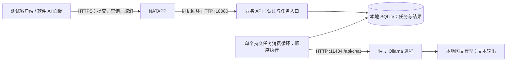
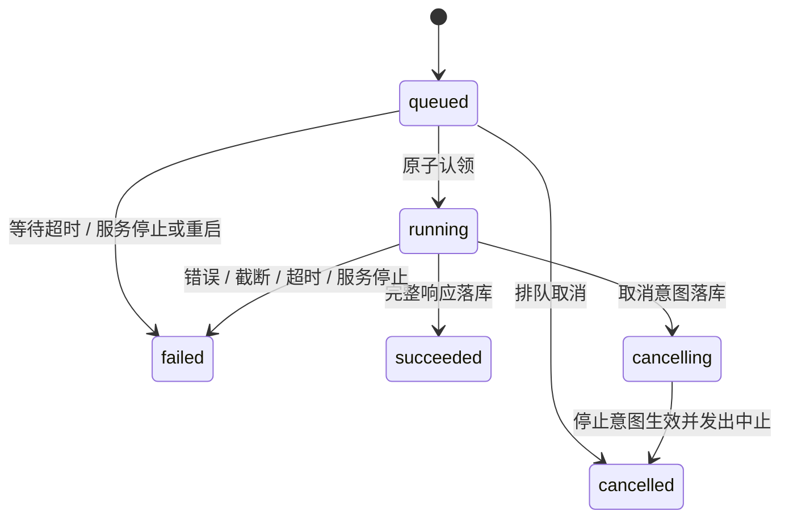

> **历史专项设计／证据**：统一后的正式实现以 [项目进度](../项目进度.md)、[运维](../正式工程运维.md) 和 `contracts/api/v1` 为准。旧分线归属、未实现状态与精确图文预算前置已被当前工程方案取代；原用户需求和当时实测证据仍保留。

# S04 服务端 API 与任务调度

更新日期：2026-10-23
文档版本：v0.5，A-1／A-2 本机最小交付；保留目标设计与未验证边界
验证状态：Fake＋真实 API／SQLite／C# 本机闭环已测试；完整 G2、真实模型、公网与宿主未验收

本轮主会话根据 S01～S05 收敛结果同步修订本文件；整体依赖与目录见 [实施规划](../实施规划.md)，验收门槛见 [S06](06-联调与验收.md)。机器契约已落 contracts/api/v1 和 contracts/examples；实际范围见第 1.3 节，不代表公网发布或真实模型预算已验证。

双线执行：本专项业务部分由 [A 线](../实现线A-客户端服务端与公网.md) 实现；本文件涉及的真实生成、PromptBuilder 和联合预算由 [B 线](../实现线B-模型能力与推理.md) 实现在同一服务项目内。A 维护公共抽象与项目装配，B 交付真实实现；不增加第二套模型业务服务。

## 1. 本轮结论、依据和实施范围

建议首版采用 **一个业务服务进程＋一个后台任务消费循环＋SQLite，通过本机 HTTP 调用 Ollama**。约 5 位用户共用一个推理执行位，业务层负责排队，客户端提交后轮询。无需拆成多个业务服务，也无需额外部署队列或数据库服务器。

**服务端语言待定，当前优先建议 Python＋FastAPI，C#／ASP.NET Core Minimal API 保留为备选。** 之前默认 C# 是工程建议，不能从客户端 C# 推导出服务端必须 C#。比较、状态及目录统一见 [实施规划第 0.5／5 节](../实施规划.md#05-服务端语言与推理引擎分别选择)。.NET Framework 4.7.2 客户端只交换 HTTP／JSON，不必与服务端使用相同语言或运行时。

本文件给出明确工程默认值，供评审及后续实现，减少实现者临时决策。**工程默认不等于用户逐项确认，也不等于已实测。** 本轮按优先建议使用 Python＋FastAPI 落地 Fake 原型；下文保留目标设计，未列入第 1.3 节证据的条目不能当作已实现。

### 1.1 已确认与本轮建议

| 事项 | 状态与依据 |
| --- | --- |
| 小型项目，功能满足前提下保持代码与依赖简洁 | 用户本轮明确要求 |
| 取消、完成、超时按常见 Agent 对话行为处理 | 用户于 2026-10-23 明确要求；产品语义见第 7.4 节，底层停止能力仍需实测 |
| 初期约 5 位用户，可以排队 | 主方案 R04／R05，用户既有确认 |
| Ollama 可作为推理平台，需要确认方式与限制 | 用户本轮允许；不是对下文每个参数的逐项批准 |
| 开发机先验证 Qwen3-VL 4B 图文，再迁移 5080 并评估 8B／更大 | 沿用 [S02](02-模型与推理部署.md) 用户已确认路线；旧 Coder 3B／14B 退出主线 |
| NATAPP VIP-1 月付＋平台二级域名＋HTTPS | 沿用 [S03](03-公网接入.md) 已确认路线，不重新选入口 |
| 服务端语言／框架 | 用户提出 Python／C++ 比较；Python＋FastAPI 为主会话优先建议，尚未确认；旧 Minimal API 仅为备选 |
| SQLite、FIFO、限额、保留周期和协议字段 | 本专项工程默认，供本轮评审及后续实现；不随语言候选变化自动改语义 |
| 模型质量、性能、取消延迟、外网稳定性 | 均未验证，不能据方案推断已达标 |

建议先读第 2～4 节了解架构和 Ollama，再读第 5～9 节实施协议、调度和持久化，第 12～15 节安排开发、验收和识别风险。主方案、主进度尚未汇总 S02／S03 最新状态时，具体部署事实按对应专项读取。本轮只维护 S04，通过文末摘要交接。

### 1.2 首版边界

首版交付：用户令牌、异步任务、归属隔离、有界排队、查询和取消、幂等重试、结果保存与清理、重启后的明确失败、模拟模型、日志和基本运维。

每个任务只做一次模型调用，返回待人工检查的文本。澄清、修改和编译反馈都可作为新任务提交。服务端不运行生成的 C#，不连接相机／串口，不自动修改流程，不承诺自动编译修复。S01／S05 后续完善内容规则和宿主接入时，复用同一任务协议。

### 1.3 A-1／A-2 实际交付（2026-10-23）

A 工作目录 D:\github\AiServer-A／line-a，B 保持 D:\github\AiServer／line-b。公共契约独立提交 272b22b。运行／配置／管理见 [server README](../../server/README.md)，A 编号覆盖与限制见 [阶段报告](../验证记录/G0-G2-A-Fake-20261023.md)。

| 范围 | 本轮实际情况 |
| --- | --- |
| 外部契约 | JSON Schema＋文本／PNG／就绪／状态／结果／错误样例，运行时从唯一契约校验 |
| API／存储 | FastAPI、SQLite WAL/FULL、线程中的短事务／独立连接、单实例锁、单消费循环，先入库再 202 |
| 认证与任务 | token 仅存 SHA256；归属、幂等、容量、查回／列表、停止／超时、终态保护与重启恢复标记 |
| 图片 | Pillow 11.0.0 verify＋load，不缩放，真实字节 hash／接收发送记录／正文清理；合成图不证明看图 |
| Fake | 延迟、取消／晚到、空／截断／协议／连接失败；ready／结果明确 Fake，token 计数为空；Production 禁止启用 |
| 内部接口 | inference/contracts.py 的 TaskInput／Profile／PreparedInput／Budget／Provider；原样执行准备快照；ready 取预算能力与 profile 交集 |
| 管理 | user-add、token-create／revoke、user-disable、离线 recovery-confirm；未交付 backup |
| 实测 | 20 个集成测试；C# net8.0 真回环 HTTP 的文本／PNG、查回／停止、恢复状态读旧结果；4 次 Fake 最大活动数 1 |
| 未完成 | 完整 G2 竞争／故障／备份／清理边界、日志轮转／限流、长期托管；真实 VL／预算／取消、公网与宿主 |

上述采用是工程默认，不改写 D10 的用户确认状态。依赖原环境已存在，没有安装／升级；版本和来源见 [第三方引用](../第三方引用.md)。

## 2. 最小架构、依赖和代码组织



业务 API 与后台任务在同一可执行程序内，Ollama 和 NATAPP 各保持独立进程。SQLite 文件直接嵌入使用，不安装数据库服务。API 绑定 `http://127.0.0.1:18080`，模型仍为 `http://127.0.0.1:11434`，均不发布到路由器。

### 2.1 技术依赖预算

| 项目 | 首版取舍 | 作用 |
| --- | --- | --- |
| Python＋FastAPI／Uvicorn／Pydantic | Fake 原型已采用；原环境版本与锁见第 1.3 节 | HTTP、JSON 校验、路由、配置与生命周期；实际版本需适配指定解释器 |
| SQLite 驱动 | 先评估标准库 sqlite3；如需异步封装再引入相应包 | 参数化 SQL、事务、备份；避免阻塞事件循环，连接与线程归属明确 |
| 异步 HTTP 客户端 | HTTPX AsyncClient 或官方 Ollama AsyncClient 选其一 | 复用连接、图文请求、截止时间、取消与错误映射；统一归入适配层 |
| 图片校验／解码组件 | 图文实现时评估并登记适用于 Windows 的现成组件 | 有界校验真实 PNG；不因旧版“唯一额外包”限制而手写完整图片解码器 |
| Windows 托管 | 选定 Python 方案后验证进程包装或任务计划；正式长期方式另行固定 | 唯一进程入口、重启、环境／目录权限与停机；不套用 .NET WindowsServices 包 |
| 测试工具包 | 仅测试项目 | HTTP 集成、竞争条件和故障注入验证，不随服务发布 |
| ORM、外部消息队列、定时调度平台、AI 编排框架 | 首版不引入 | 少量明确 SQL 和一个工作循环即可 |

候选依据：[FastAPI lifespan](https://fastapi.tiangolo.com/advanced/events/)、[Uvicorn worker 进程](https://fastapi.tiangolo.com/deployment/server-workers/)、[Python sqlite3](https://docs.python.org/3/library/sqlite3.html)、[Ollama Python 异步客户端](https://github.com/ollama/ollama-python)。首轮一个应用进程、一个消费循环；任务先入库再返回，不能仅靠请求结束后的 BackgroundTasks 保证重启恢复。异步 HTTP 不代表数据库自动异步，也不代表一次可并行生成多个任务。

C# 备选仍可用 ASP.NET Core Minimal API＋BackgroundService＋Microsoft.Data.Sqlite；若最终选择它，再固定受支持的 SDK／包及 WindowsServices 依赖。[Minimal API](https://learn.microsoft.com/en-us/aspnet/core/fundamentals/minimal-apis?view=aspnetcore-10.0)、[Hosted services](https://learn.microsoft.com/en-us/aspnet/core/fundamentals/host/hosted-services?view=aspnetcore-10.0)

### 2.2 拟建代码结构

拟建目录只维护在 [实施规划第 5 节](../实施规划.md#5-统一项目与目录规划)，本轮已创建 server A 模块、C# Demo 与契约；实际路径见 server README，其余仍为目标规划。A 维护服务装配／api／jobs／storage／operations、Fake、依赖和公共抽象；B 维护 context 与真实 Ollama 适配及对应测试。

先用一个业务服务包和对应测试，只在模型、预算和存储边界建立小接口，便于模拟故障和替换。不以承诺总代码行数来省略并发与恢复逻辑。不要求先建服务 csproj，也不为 A／B 分别建立业务服务器。

## 3. GitHub 开源设计与代码怎么参考

可以参考，优先选官方、小范围且职责清楚的实现。内存后台队列不能直接等同可靠任务 API；幂等、用户归属、持久化和取消竞争仍需明确实现。

下表保留此前 C# 候选的资料核对范围，作为备选和调度设计参考；其中“迁移到 .NET／使用官方包”等动作仅在选定 C# 后适用，不是当前 Python 候选的依赖清单。Python 具体依赖、生命周期与官方入口见第 2.1 节，实施时再固定版本并检查相应源码。

| 来源与已核对范围 | 可借鉴内容 | 本项目采用方式 |
| --- | --- | --- |
| [dotnet/AspNetCore.Docs 后台任务示例入口](https://github.com/dotnet/AspNetCore.Docs/tree/main/aspnetcore/fundamentals/host/hosted-services/samples/)；已读关联官方文档内队列示例 | BackgroundService、顺序消费、有界容量、停止信号 | 参考生命周期；队列事实放 SQLite，不保存委托。入口有旧版示例，实现时迁移到 .NET 10；未宣称每个示例文件均已逐行核对 |
| [Microsoft.Data.Sqlite 源码](https://github.com/dotnet/efcore/tree/main/src/Microsoft.Data.Sqlite.Core)；已核对连接类入口与事务／备份文档 | 连接、事务、备份和错误处理 | 直接用官方包，不复制驱动，也不因此引入 EF Core ORM |
| [Ollama v0.40.9 routes.go](https://github.com/ollama/ollama/blob/v0.40.9/server/routes.go)；已核对聊天请求 context 传递 | 取消路径和协议 | 用于理解和定位；调用公开 HTTP API，不改 Ollama 源码 |
| [jamesmh/coravel](https://github.com/jamesmh/coravel)；已读 README | 轻量任务组织和维护思路 | 队列默认在内存；本项目仍需任务表，首版不增加这层依赖 |
| [HangfireIO/Hangfire](https://github.com/HangfireIO/Hangfire)；已读 README | 持久任务、重试、运维功能对照 | 将来确需完整任务设施时评估；单模型与取消语义仍需自定义，首版不引入整套设施 |

配置保持 JSON＋环境变量＋启动时类型／范围校验，不引入配置中心。Python 候选用相应校验实现；若选 C#，可用 [.NET Options 模式](https://learn.microsoft.com/en-us/aspnet/core/fundamentals/configuration/options?view=aspnetcore-10.0)。下文 JSON 字段是配置草案，不强制绑定某种语言。

实施时在 `docs/第三方引用.md` 登记实际包版本、上游 URL、固定 tag／commit 和复制范围。直接复制代码时保留上游要求的版权与许可声明，不能把所有 GitHub 代码视为可任意复制。[Microsoft 示例代码许可](https://github.com/dotnet/AspNetCore.Docs/blob/main/LICENSE-CODE)、[Sqlite 驱动所在仓库许可](https://github.com/dotnet/efcore/blob/main/LICENSE.txt)、[Ollama 许可](https://github.com/ollama/ollama/blob/v0.40.9/LICENSE)。模型权重授权仍由 S02 负责，与引擎授权分开。

## 4. Ollama 的具体使用方式和限制

### 4.1 与 S02 对齐的内部调用

沿用 S02 固定的 Windows AMD64 ZIP、引擎版本和模型锁定记录，不复制下载步骤和 SHA256。实施前再读 S02；若其版本变动，本节适配与取消实验一起复验。

| 项目 | 首版规定 |
| --- | --- |
| 业务生成 | `POST http://127.0.0.1:11434/api/chat` |
| 形式 | 复用专用 HttpClient；UTF-8 JSON；`stream:false`；读 `message.content`；本机连接禁用代理和自动重定向，不挂自动生成重试策略 |
| 开发模型 | 读取 S02 的 Qwen3-VL 4B Instruct Q4_K_M profile；校验完整 digest 和 vision 能力，不只看标签 |
| 请求参数 | 全部读取 S02 配置，含上下文、输出、temperature／top_p／top_k／seed／keep_alive；不在本文件另设一份不同采样值 |
| 图片 | 将本协议 images 中已验证的实际 PNG 字节映射为本轮 user 消息的 `images` Base64 数组；无图可省略 |
| 引擎并发 | `OLLAMA_NUM_PARALLEL=1`、`OLLAMA_MAX_LOADED_MODELS=1`、`OLLAMA_MAX_QUEUE=1`，由 S02 启动脚本设置 |
| 本地模式 | S02 的 `OLLAMA_NO_CLOUD=1` 和模型目录；业务请求不调用云模型、不自动 pull |
| 超时 | 连接 5 秒、预热 180 秒、执行 600 秒、恢复观察 30 秒，来自 S02 |
| 用户状态 | 由业务服务管理用户、任务和消息；Ollama 不管理本项目会话 |

示意请求，system 和 user 内容实际由业务服务构造，不接受客户端指定 system 角色：

```json
{
  "model": "qwen3-vl:4b-instruct-q4_K_M",
  "messages": [
    { "role": "system", "content": "服务端版本化的 C# 生成规则" },
    { "role": "user", "content": "需求、当前脚本、选定的流程与 SDK 上下文" }
  ],
  "stream": false,
  "keep_alive": "10m",
  "options": { "num_ctx": 4096, "num_predict": 1024, "temperature": 0.7, "top_p": 0.8, "top_k": 20, "seed": 42 }
}
```

以上是无图短请求示例，真实参数来自配置；带图 user 消息另加 `images`。完整 JSON 必须显式 `stream:false`，默认流式响应不能用普通完整 JSON 解析器处理。首版内部和外部均不依赖逐字输出。[Chat API](https://docs.ollama.com/api/chat)、[Vision REST](https://docs.ollama.com/capabilities/vision)

### 4.2 它提供什么，业务服务还要做什么

- Ollama 提供模型加载和推理，可留驻减少加载；keep_alive 是驻留时间，不是执行超时。
- 引擎队列没有本项目的持久 jobId、用户权限和业务位置。业务队列只放 SQLite，一次只送一个生成请求；内部队列设小以暴露绕过调度的调用。[FAQ](https://docs.ollama.com/faq)
- 标签可能更新，业务启动不自动 pull；版本、digest、模板与参数变化都要记录，不静默替换运行条件。
- HTTP 成功只说明推理响应；脚本可编译、接口存在、业务正确和设备安全分别验证。
- 4B 的图文理解与完整工业脚本质量没有实测证据，开发机速度也不能外推到 5080。

### 4.3 上下文预算：首版不能留下空白

S02 开发档位是联合输入 2560＋输出 1024＋预留 512＝4096 tokens。联合输入包含 system、实际模板、文字、SDK、代码、历史及视觉内容，不是在文字预算之外再加图片。正文传输大小与模型上下文容量分开校验。

原 v0.3 针对 Qwen2 文本模板的 UTF-8 字节上界算法退出当前实现基线，不能将它直接用于 Qwen3-VL，也不能令图片 token 为 0。Ollama 存在输入裁剪路径，成功响应并不能证明完整保留图文：[固定版本 prompt.go](https://github.com/ollama/ollama/blob/v0.40.9/server/prompt.go)。

当前实施要求：

1. S01 提供材料组织和禁止静默删减的规则；S02 提供实际模型／renderer、图片处理和计数核对依据；S04 的可替换 InputBudget 统一校验。
2. 将预算方法、版本、模型 digest、模板 hash、图片处理策略绑定到 profile，验证文本／图片及组合边界。不能仅因 Hugging Face processor 可计数就假设与锁定 Ollama 完全一致。
3. `prompt_eval_count` 只作事后核对；普通图文提交需要发送前可核实的联合预算方法或经验证的保守上界。图片字节数、像素和 Base64 长度均不能直接冒充视觉 token 数。
4. 预算超过上限为 `422 CONTEXT_TOO_LARGE`，不执行模型；相应输入类型的预算器尚未验证为 `503 INPUT_BUDGET_UNVERIFIED`。ready 明示 `acceptedInputTypes`，不得把不支持图片的状态写成图文就绪。
5. 预算器未就绪时，API／Fake 可继续实现；模型层仅进行 S02 的受控小图实验并如实标记。普通图文业务链路须等 G4 证据后验收，不能用“先跑成功再看 tokens”替代约束。

需要一个可复现的校准任务，不在文档中编造精确视觉 token 公式。4K／1024 仅是开发小用例档位；完整 SDK、原脚本和完整输出的容量单列验收，不能通过缩成方法／diff 或截原代码规避。

### 4.4 完成、截断和错误

仅 HTTP 成功、`done=true`、文本非空、结构合法且没有长度截断，才可 succeeded。`done_reason=length` 为 failed／OUTPUT_TRUNCATED，保留部分文本、isComplete=false；缺少结束原因且输出达到上限时同样保守处理。空文本为 MODEL_EMPTY_OUTPUT，无效 JSON／缺必需结束标记为 MODEL_PROTOCOL_ERROR。

保存模型名、结束原因、输入／输出 tokens 和阶段统计；duration 按纳秒读入 64 位整数，展示时转换，不能误当毫秒。外部不透传原始异常或文件路径。模型不存在、配置错、繁忙、OOM／退出、超时分别映射业务错误，不一律重试，也不在用户任务中下载或换模型。[Ollama 错误格式](https://docs.ollama.com/api/errors)

引擎响应体同样有界，首版最多读取 1 MiB，超过为 MODEL_PROTOCOL_ERROR；不能让异常实例返回无限正文。采用 ResponseHeadersRead 后逐段计数读取，整个读取过程仍受任务截止时间与取消令牌约束。

业务失败与资源是否可释放分别判断：可信响应明确 done=true 且响应体读取完毕时，即使文本截断／为空，仍可认定本次请求已结束、释放执行位。参数或模型缺失的明确拒绝转为配置暂停；503 繁忙提示可能有绕过调度的调用，应暂停排查。主动取消／超时按第 4.5 节自动收尾；异常断连、无有效结束标记、OOM／退出按故障恢复，不能仅按 HTTP 错误码假定资源空闲。

### 4.5 取消限制和恢复

本方案没有按业务 jobId 调用的 Ollama `/cancel`。工作循环把停止意图传播给本轮 HTTP 请求和响应体读取，取消时关闭本轮响应／请求并完成客户端收尾。Python 候选需验证异步任务取消、HTTP 连接和引擎停止的完整路径；C# 对应 CancellationToken 与 SendAsync。固定版本聊天实现将请求 context 传给推理，是预期可中止的依据，**不能代替目标机器停止实验**。[固定版本聊天实现](https://github.com/ollama/ollama/blob/v0.40.9/server/routes.go)

`/api/ps` 只显示加载的模型，没有按请求的活动／取消确认字段；驻留不表示仍生成，列表正常也不证明上一项已停止。[运行中模型 API](https://docs.ollama.com/api/ps)

正常停止采用对话产品的自动收尾：取消意图入库后停止接纳本轮新输出、触发 HTTP 取消，任务尽快转 cancelled，资源收尾独立进行。执行位暂为 draining，可在容量内接受新任务排队，完成收尾后自动执行下一项，不把重启引擎作为每次停止的步骤。

自动收尾策略须先通过 S02 T08／T09：固定引擎、模型和参数下验证取消传递、本地请求与连接结束、下一项无旧输出混入且推理不重叠，再登记允许使用该策略的版本。运行时沿用这一已验证路径，并保持引擎单并行、单模型和工作循环单消费者；HTTP 取消返回不冒充按请求的 GPU 停止确认。实验没通过的组合不能作为正式取消能力交付，也不以单纯等待固定秒数作为验证。模型／引擎变更后重新验证。

超过 S02 的 30 秒恢复观察期仍不能完成已验证的收尾，或出现异常、实例重启／身份变更时，才转 recovering，暂停执行和新提交并告知服务暂不可用；原任务保持 cancelled 或超时失败，不重新变成运行中。异常时人工恢复：

1. 停止 API；通过 S02 唯一托管入口停止引擎，确认原进程退出，再启动、核对版本／digest并预热。
2. API 停止期间执行 S02 最小聊天检查并留档。
3. 操作员用本机 `recovery-confirm` 管理子命令登记证据／说明，清除持久恢复标记，再启动 API。命令只作人工恢复确认，不宣称能自动证明 GPU 空闲。
4. API 重新校验模型、预算器和数据库后才接任务。

正常运行取消时与任务更新一起写入临时恢复标记，防止收尾中崩溃后误放行；已验证路径成功收尾后条件清除本项标记。异常恢复锁只能按上述步骤解除，单独重启 API、看到 ps 正常或等待 30 秒不能解除。确认命令须在残留任务已归档后执行；如果首次启动才发现残留，先启动 API 归档并进入 recovering，再停 API 完成恢复。

普通用户只看到停止／超时以及下一项排队，不操作 recovery-confirm 或服务重启。后台异常恢复由维护者处理；API 不按进程名结束任意 Ollama，不与计划任务争相启动第二实例。此处只参考常见对话行为，不新增 Agent SDK 运行依赖。

## 5. 对外 API 契约 v1

### 5.1 公共规则

| 项目 | 规定 |
| --- | --- |
| 根路径 | `/api/v1`；公网 BaseUrl 为 S03 实际 HTTPS 域名 |
| 编码 | UTF-8 JSON，属性 camelCase，枚举小写字符串；不自动改写代码换行 |
| 时间 | ISO 8601 UTC，例如 `2026-10-23T08:00:00Z`，客户端按本地时区显示 |
| 标识 | jobId、clientRequestId 为 UUID；客户端发送前生成并本地保存 clientRequestId |
| 认证 | 除基础 health 外均为 `Authorization: Bearer <业务令牌>`，不是 NATAPP authtoken |
| 缓存 | 认证接口 `Cache-Control: no-store`；URL 不携带 token |
| 请求容量 | JSON 总正文硬上限 5242880 字节（5MiB），读入／解析前限制，包括无 Content-Length 的请求；文本材料合计仍限 131072 字节，字段自身上限继续有效；不接受请求压缩或 multipart 上传 |
| 兼容 | 当前尚未发布，直接将草案 v1 对齐图文，不并存两套旧协议；发布后拒绝未知／重复请求字段，响应允许新增字段，破坏性变更再用新版本 |
| 断线 | HTTP 断开不自动取消已接受任务，取消接口才改变业务取消意图 |

### 5.2 接口表

| 方法与路径 | 正常响应 | 内容 |
| --- | --- | --- |
| `GET /api/v1/health` | 200 | 免认证，仅 `{"status":"ok"}`，证明 API 存活 |
| `GET /api/v1/ready` | 200／503 | 需认证，返回存储、调度与模型准备状态 |
| `POST /api/v1/jobs` | 202 新建；200 幂等命中 | 接受任务，Location 为相对任务路径 |
| `GET /api/v1/jobs/{jobId}` | 200 | 状态、位置、计时和安全错误，不重复带大结果 |
| `GET /api/v1/jobs/{jobId}/result` | 200 | 终态结果／诊断；非终态 409 JOB_NOT_FINISHED |
| `POST /api/v1/jobs/{jobId}/cancel` | 200／202 | 排队取消立即完成为 200，运行取消接受为 202；终态重复调用为 200 并返回原状态 |
| `GET /api/v1/jobs/by-request/{clientRequestId}` | 200 | 按当前用户的提交编号查回，解决 POST 响应丢失 |
| `GET /api/v1/jobs?limit=20&beforeSequence=...` | 200 | 当前用户任务摘要，按内部 sequence 倒序；limit 1～50，不带代码正文 |

按 ID／编号查询、结果和取消均在 SQL 中带当前 userId；不存在与属于别人统一 404 JOB_NOT_FOUND。列表仅含自己的任务，不设公网全员任务面板。UUID 不能替代权限检查。

ready 的 schedulerState 为 starting／available／busy／draining／recovering／paused／stopping。available／busy／正常 draining 且数据库、身份、预算器检查正常时为 200；其余为 503。返回 canAcceptJobs、reasonCode、observedAt、recommendedPollSeconds=3、inferenceProvider；busy 或 draining 且有容量时仍可接受排队。draining 仅是当前进程知道归属、正在按已验证路径收尾的短暂状态，不自动豁免启动时的持久恢复标记。驻留到期可在执行位内重新加载，不能只因 ps 为空判失败。health／ready 自身不触发生成或加载。

补充 `acceptedInputTypes`：例如已验证纯文字时为 `["text"]`，图文预算及真实适配均就绪后才含 `"image"`；模型声明 vision 不足以单独启用该项。Fake 的就绪必须明示 `inferenceProvider=Fake`，不作为真实输入能力证据。

### 5.3 提交请求

```json
{
  "clientRequestId": "416417b5-e936-4cde-b0df-969281936318",
  "operation": "create",
  "instruction": "写一个返回 double 数组平均值的方法，空数组时说明处理方式。",
  "currentCode": null,
  "context": {
    "schemaVersion": 1,
    "projectId": "demo-project",
    "scriptId": "demo-script",
    "snapshotRevision": "local-17",
    "targetFramework": ".NETFramework,Version=v4.7.2",
    "csharpLanguageVersion": null,
    "sdkContractVersion": null,
    "sdkReferenceText": "此测试只用标准库，不调用宿主 SDK。",
    "flowContextText": "无设备访问。"
  },
  "history": [],
  "images": [],
  "parentJobId": null
}
```

| 字段 | 校验／语义 |
| --- | --- |
| clientRequestId | 必填 UUID，唯一范围为 userId；同一次提交重试沿用 |
| operation | create／modify／explain；modify 必须提供非空 currentCode；修复先用 modify＋编译错误材料表达 |
| instruction | 必填非空，最多 8192 UTF-8 字节；不代表模型预算之外可额外增加这些字节 |
| currentCode | 可空，最多 65536 UTF-8 字节；仍需通过模型预算 |
| context | 必填，schemaVersion=1；未知版本填 null，不能让模型猜 |
| projectId／scriptId／snapshotRevision | 可空，非空各不超过 128 字符；用于来源核对，不作权限依据；正式集成修改时必须提供 |
| targetFramework | 必填，首版只接受 `.NETFramework,Version=v4.7.2`；其他框架需另行扩展支持 |
| csharpLanguageVersion／sdkContractVersion | 可空，非空各不超过 128 字符；按真实宿主填写 |
| sdkReferenceText／flowContextText | 可空，各最多 32768 UTF-8 字节；首版承载短 SDK／元数据快照，后续结构化工具绑定由 S01 定义 schemaVersion 2 |
| history | 缺省为空，最多 4 条 `{role,content}`；role 仅 user／assistant，content 合计最多 16384 UTF-8 字节；全部计入预算 |
| images | 缺省为空；开发档最多 1 张实际 PNG；字段和生命周期见第 5.6 节，不能在普通文本里放 Base64 冒充图片 |
| parentJobId | 可空，只关联同用户可查到的任务；不自动读取或拼接父任务内容 |

字段限额仅保护传输与内存，文本材料合计限 128KiB，含图片编码的正文总计限 5MiB；模型预算另验。拒绝客户端提交模型名、外部 URL、服务器文件路径、system、采样参数、任务超时和任意工具调用。不按客户端 projectId 从服务器磁盘取文件，不抓取外部 URL。

多轮由客户端显式提交必要历史和当前脚本，服务器不维护无限聊天。固定规则与不可信业务材料分开构造；历史 assistant 也只是材料，不能提升为系统权限。SDK／历史／代码为空仍可做标准库验证，但宿主脚本生成必须按 S01 明示资料缺失。

### 5.4 提交、状态和结果示例

新建 **事务提交后**返回 202：

```json
{
  "jobId": "196867e2-2b19-4a06-9fcf-8f34427840a1",
  "clientRequestId": "416417b5-e936-4cde-b0df-969281936318",
  "status": "queued",
  "replayed": false,
  "pollAfterSeconds": 3
}
```

状态示例：

```json
{
  "jobId": "196867e2-2b19-4a06-9fcf-8f34427840a1",
  "status": "queued",
  "createdAt": "2026-10-23T08:00:00Z",
  "startedAt": null,
  "finishedAt": null,
  "queue": { "waitingAhead": 2, "activeAhead": 1, "position": 3, "isPaused": false },
  "timing": { "queueMs": 12000, "executionMs": null },
  "schedulerState": "busy",
  "pollAfterSeconds": 3,
  "resultAvailable": false,
  "payloadExpiresAt": null,
  "error": null
}
```

waitingAhead 为较早 sequence 且仍 queued 的任务数；activeAhead 是占执行位的非终态普通任务数，取 0／1；position=waitingAhead+1 仅为等待队列名次，不包括运行项。运行后 queue=null。旧项已终态但仍收尾时 activeAhead=0、schedulerState=draining、isPaused=true；异常恢复也通过 schedulerState／isPaused 表示，不冒充用户任务。计时规则：queued 的 queueMs 持续增加；开始后固定为 startedAt-createdAt，executionMs 随执行增加、终态固定；未开始就结束的 queueMs=finishedAt-createdAt、executionMs=null。输出计时优先使用单调时钟，持久时间仍保存 UTC。

排队数是查询时快照，不展示别人身份／内容，不承诺预计完成时间或百分比。列表响应为 `{items:[任务摘要],nextBeforeSequence:null或整数}`；摘要含 sequence、jobId、clientRequestId、status、createdAt、finishedAt、errorCode、resultAvailable。翻页游标用最后一项 sequence，不能作为跨用户访问凭据。

终态结果示例：

```json
{
  "jobId": "196867e2-2b19-4a06-9fcf-8f34427840a1",
  "status": "succeeded",
  "output": { "text": "模型返回的完整文本", "isComplete": true, "kind": "unclassified" },
  "validation": { "metadata": "not_run", "compilation": "not_run", "business": "not_run" },
  "source": { "projectId": "demo-project", "scriptId": "demo-script", "snapshotRevision": "local-17", "currentCodeSha256": null },
  "generation": { "profileId": "dev-qwen3vl4b-v1", "promptVersion": "s01-bootstrap-vl-v1", "inputTokens": 240, "outputTokens": 180, "finishReason": "stop" },
  "error": null,
  "payloadExpiresAt": "2026-10-30T08:01:00Z"
}
```

首版 kind=unclassified，保留模型原文，不靠代码围栏提取就标记完整脚本；可能返回解释／澄清。S01 定义可验证结构后再加 code／questions／bindings。succeeded 只表示完整文本推理结束，三个 validation 固定 not_run。取消／超时保留停止前已实际接收的文本，标 isComplete=false；不追加停止后的晚到正文。非流式首版通常在中止前没有文本，此时 output=null，不为保留部分内容新增流式实现。currentCodeSha256 为收到的原代码 UTF-8 SHA256，不改换行；空代码时 null。

### 5.5 错误与轮询

非 2xx 使用统一格式：

```json
{
  "error": {
    "code": "CONTEXT_TOO_LARGE",
    "message": "当前模型输入预算不足，请缩减历史或上下文。",
    "retryable": false,
    "details": { "field": "context", "budgetMethod": "已验证的 profile 预算器标识", "limitTokens": 2560 }
  },
  "traceId": "请求追踪编号"
}
```

| HTTP | 错误码／用途 |
| --- | --- |
| 400／415 | INVALID_REQUEST／UNSUPPORTED_MEDIA_TYPE，字段、JSON 或媒体类型不合法 |
| 401 | UNAUTHORIZED，无效、过期或撤销 token，不区分账号是否存在 |
| 404 | JOB_NOT_FOUND，含归属不符 |
| 409 | IDEMPOTENCY_CONFLICT、JOB_NOT_FINISHED |
| 410 | RESULT_EXPIRED，正文已清，墓碑仍保留 |
| 413／422 | REQUEST_TOO_LARGE／CONTEXT_TOO_LARGE |
| 415／422 | IMAGE_INVALID／IMAGE_LIMIT_EXCEEDED，真实格式或数量、尺寸、字节限制不符 |
| 429 | USER_JOB_LIMIT、QUEUE_FULL、RATE_LIMITED，附 Retry-After |
| 503 | SERVICE_NOT_READY、ENGINE_RECOVERING、STORAGE_UNAVAILABLE、INPUT_BUDGET_UNVERIFIED，未接受新任务 |
| 500 | INTERNAL_ERROR，仅通用描述和 traceId |

执行失败写在任务 error.code，例如 MODEL_UNAVAILABLE／MODEL_BUSY／MODEL_CONFIG_ERROR／MODEL_OOM／EXECUTION_TIMEOUT／OUTPUT_TRUNCATED／SERVER_RESTARTED／QUEUE_TIMEOUT。查询存在任务仍 HTTP 200；不能因模型失败让查询接口返回笼统 500。

状态接口的 error 与结果接口采用相同安全 error 对象；非终态／成功／用户主动取消时为 null。错误 details 仅给限额／校验字段，不给原始引擎异常。取消返回 `{jobId,status,cancelAccepted,inferenceStopConfirmed,schedulerState}`；已终态成功项 cancelAccepted=false，保留原状态；重复取消原 cancelled 项为幂等成功。inferenceStopConfirmed 为技术诊断的 true／false／null：排队取消为 null，未逐请求确认的运行取消为 false；它不决定界面能否显示已停止，也不单独要求人工恢复，调度按第 4.5 节已验证策略处理。

客户端有非终态任务才每约 3 秒轮询并加随机抖动，终态后取结果一次并停止。查询／健康等短 HTTP 超时 15 秒；含图提交单独建议 120 秒，服务端仍在接收、校验并持久化后立即返回任务标识，不等待模型生成。复用 HttpClient／连接；失败按 3／6／12／30 秒退避，遵从 Retry-After。上传截止时间、排队等待、推理执行是三种计时；代理接收限制必须一起测试，不能只改客户端超时。

### 5.6 图片协议与生命周期（最小传输已实现）

首版直接在 JSON 中携带 `images`，不新增上传服务或对象存储。每项候选字段为 `imageId`、`mediaType`、`dataBase64`、`capturedAt`、`snapshotRevision`；类型、可空规则和样例已落实为唯一 schema；真实预算与模型映射待联合验证。source 的工程／脚本关联沿用 context；快照未知可如实留空，不能伪造当前来源。

- `mediaType` 首版仅 `image/png`；`dataBase64` 是实际图片原始字节的编码，不是 data URI、路径或 URL。服务端自行验证真实格式，不信任后缀或客户端声明。
- 初始限制读取 S02 ImagePolicy：数量、单图字节、长边、总像素共同有效；先限制正文和编码大小，再做有界格式／尺寸检查和解码，拒绝损坏图片。文本合计和总 JSON 限制分别执行。
- 首版不静默裁剪／缩放；超限要求准备清晰局部图。记录实际接收和实际送入引擎的 hash／尺寸；未变换时二者相同，处理策略可登记为 pass-through-png-v1。将来改变预处理应改变 profile 并重测。
- 客户端顺序与图片字节内容参与业务请求 hash；服务端计算解码字节 SHA256，不以文件名识别图片。同键同名但图片改变为幂等冲突；等价 JSON 排版不产生新任务。
- 请求 hash 保留业务输入身份；已接受任务的 profile／处理策略作为不可变有效快照保存。重试原键返回原任务，不能因服务器当前配置变化而重新推理或重算成新任务。
- 历史截图不从 parentJobId 自动读取。本轮需要哪张图就显式提供并计入全任务图片／token 限额；首轮总计仍为 1 张。
- 简化存储可将 Base64 保存在 job_payloads 的规范请求中，与图像 hash、处理记录一起按正文周期清除；备份也包含这些材料。日志、状态轮询和结果查询不重复返回原图。相同用户／任务归属规则同样适用于图片。
- 预算器、实际视觉映射、图片幂等／清理、跨网上传、含图取消均需 S06 的 G4／G3 证据。接口中有 images 字段不能独立证明视觉能力达标。

## 6. 幂等、断线和重新提交

幂等键为 **(userId,clientRequestId)**，不再加第二套请求头键。相同编号、相同业务内容返回原 jobId；相同编号内容不同为 409。文字哪怕只改一处也算不同内容。

1. 限制和校验 JSON，拒绝重复属性；history 缺省规范为空数组，可空字段为 null，UUID 统一格式。代码和需求不 trim、不改换行。
2. 业务字段不含 clientRequestId，采用确定性序列化后 SHA256：字段顺序固定、嵌套对象排序固定、数组顺序保留；保存 hashVersion。不能 hash 原始 JSON，否则空白和属性顺序造成冲突。
3. 认证后先查键并比 hash；命中时即使队列满或引擎 recovering，仍返回原任务，不重复预算或推理。响应为提交响应结构，replayed=true、status 为当前状态。
4. 新任务通过预算和就绪后，同一短写事务中复查幂等键、用户 enabled、恢复／收尾状态、用户限额和容量，再插入 queued；正常 draining 可接收排队，recovering 拒绝。服务停机与入库也必须通过同一短控制门协调，避免停止后仍接受。唯一约束兜底并发；竞争失败读回原键并比 hash，不转成 500。
5. 提交后独立于 HTTP 连接。响应丢失时客户端原编号查 by-request；404 时仍用原编号重试 POST，查到任务则继续查状态／结果。
6. 用户改内容或明确重做失败项时产生新编号，可附 parentJobId。服务不自动重试已发出的生成，避免超时后重复计算。

by-request 返回与状态接口相同的任务状态，另含 clientRequestId；客户端知道 jobId 后调用常规查询。父任务关联在入库事务内做归属检查，不会隐式带入已过期正文。

保证的是业务任务记录不重复，不能承诺 GPU 跨崩溃恰好执行一次。模型可能算完但结果未落库，重启后仍记 SERVER_RESTARTED，由用户决定重做。

## 7. 状态机、执行位和取消竞争

### 7.1 状态与转换



终态 succeeded／failed／cancelled 不回退。意外退出后残留 queued／running 统一 failed／SERVER_RESTARTED；已经持久记录用户停止意图的 cancelling 归档为 cancelled，保留停止原因。以上均不证明旧推理已停止，有活动／收尾残留就进入恢复检查。原终态保持不变。

任务状态与执行位状态分开：任务可 failed／cancelled，执行位仍短暂 draining，异常才 recovering。禁止 finally 无条件启动下一项，也不让普通用户等待后台收尾才看到已停止。

### 7.2 默认约束

| 项目 | 工程默认 |
| --- | --- |
| 实例／活动推理 | 一个 API 实例、一个执行位；持有数据目录独占文件锁，第二实例拒绝启动 |
| 公平性 | 全局 FIFO，按入库 sequence 升序，不靠可能回拨的系统时钟 |
| 每用户未完成 | 最多 2 项，计算 queued／running／cancelling |
| 全局未完成 | 最多 10 项，包含运行／取消中；有 1 项运行时最多 9 项等待 |
| 最大等待 | 入队后 30 分钟，超时 failed／QUEUE_TIMEOUT；恢复暂停也继续计时 |
| 控制检查 | 空闲约 1 秒查库；提交／取消可唤醒，信号丢失不影响正确性 |
| 执行 | 进入 running 后 600 秒总上限，含必要冷加载；启动预热另为 180 秒 |
| 自动重试 | 0；模型 busy／网络超时／异常先报告 |

FIFO＋每人 2 项适合当前规模，不等于按人轮转；若实测有人长期占队列，再改每人 1 项或轮转。HTTP 工作线程与模型执行位不同，不要把 API 全部串行化。

### 7.3 工作循环算法

1. 获取独占锁，校验配置、迁移／检查数据库，处理残留，再核对模型与预算器。恢复未过只提供健康、查询和取消，拒绝新任务，不认领旧任务。
2. 每轮先批处理 queued 等待超时；执行位 available 时短写事务选最小 sequence，条件 queued→running，记 startedAt／profileId。取消碰撞由数据库条件更新决定顺序。
3. 提交事务后才调用模型。网络、预热、生成和备份不能放事务内；一个工作循环认领，不让每个 HTTP 请求 Task.Run 抢 GPU。
4. 生成期间每秒或信号到达检查取消和截止时间，HTTP 查询不受阻。可用 Task.WhenAny 组织生成与控制等待；真正中止使用同一 CancellationToken。HttpClient 的默认 100 秒超时应关闭或显式调整，由该任务的 600 秒令牌统一控制，并对连接单独设 5 秒。
5. 回写带 status 和 stopReason 条件；正文、统计、终态同事务。写失败先暂停调度，原结果留内存，最多重试保存 3 次、间隔 1 秒，每次仍受 3 秒数据库锁等待限制；持续失败则记录存储故障并停止服务，由下次启动修正残留，不重新调用模型，不能只在内存报告成功。
6. 完整协议结束可释放执行位，业务截断失败不必重启模型。主动取消／执行超时先按第 4.5 节 draining 自动收尾，失败才 recovering；无法解释的已发送后断连仍作为故障处理。明确未发出的连接拒绝失败并暂停就绪，连通／身份恢复后可接新任务，不重试原项。

唤醒仅降低约 1 秒延迟。SQLite 是任务和取消事实来源，不另存决定是否执行的内存队列。维护扫描可在同一 worker 的控制周期中执行，清理／备份不能阻塞取消监控。

### 7.4 按常见 Agent 对话处理取消、完成和超时

**用户已确认采用常见对话体验**：停止当前一轮，保留已有内容，随后可继续提问；正常完成、主动停止和超时分别展示。不假定各产品有统一的竞态协议，下表是本项目的具体映射。

| 场景 | 用户看到的行为 | 服务端处理 |
| --- | --- | --- |
| 正常完成 | 本轮回答完成 | 完整响应持久化后 succeeded；代码正确性仍单独验证 |
| 排队时点停止 | 已停止 | queued→cancelled，从队列移除，不调用模型 |
| 生成时点停止 | 点击后暂停本轮更新，短暂显示正在停止；服务接受后显示已停止 | running→cancelling，持久写 stopReason=user_cancel 和临时恢复标记；立即通知取消，尽快 cancelled，不等待 GPU 收尾的 30 秒才结束界面状态 |
| 已有部分回答时停止 | 保留已收到的内容，标记本轮已停止／内容不完整 | 仅保留停止前内容，isComplete=false；非流式没有已收内容则 output=null |
| 已完成后再点停止 | 保持已完成和原回答 | 终态不变，不撤回成功结果；重复停止本身已停止的任务幂等成功 |
| 达到执行时限 | 本轮超时，可重试或继续提问 | failed／EXECUTION_TIMEOUT，取消底层请求；已有内容标不完整，不伪装完成、不无限自动重试 |
| 停止／超时后又收到旧响应 | 本轮不再新增内容，新一轮不被旧结果覆盖 | 丢弃晚到输出；仅允许它提供资源收尾诊断，不改原终态 |
| 继续提问／重新生成 | 发起新一轮，可沿用必要历史 | 新 jobId／clientRequestId，可引用 parentJobId；旧任务不复活，后台未收尾时新项排队 |

点击停止只立即冻结本轮显示；取消请求丢失时仍须按原 jobId 重试／查回，不能仅关闭轮询就宣称服务已停止。普通网络断开仍按第 6 节查回，不隐式等同用户停止。

实现只保留必要的原子规则：已经提交的终态不可改；未终态时第一个成功记录的停止原因生效；取消被接受后，晚到完成不能把它改成成功。完成若已提交就保持完成，超时若已提交就保持超时。用带旧状态／stopReason 条件的更新实现，不新增复杂优先级或补偿事务。用户禁用复用停止逻辑、原因另记。

正常收尾自动继续队列，人工恢复仅用于异常，详见第 4.5 节。若已完整接收可信 done=true，可直接结束收尾；否则使用通过 T08／T09 的适配器策略，仅条件清除本 job 对应的临时恢复标记，不清除其他故障。

参考依据：Vercel AI SDK 提供 stop／abort 和中止后部分内容保存，Claude Agent SDK 提供 interrupt，并要求处理旧轮缓冲消息后再读下一轮。本项目采用这些交互思路，保留自己的异步任务与 Ollama 适配，不安装这些 SDK。[停止与部分结果](https://ai-sdk.dev/docs/advanced/stopping-streams)、[停止与重新生成](https://ai-sdk.dev/docs/ai-sdk-ui/chatbot)、[interrupt 与旧轮消息](https://code.claude.com/docs/en/agent-sdk/python)

## 8. SQLite 结构、事务和数据生命周期

### 8.1 存储与目录

开发数据为 `D:\github\AiServer\.local\server`，与 S02 模型目录分开；5080 数据路径配置化。数据库放本机磁盘，不放网络共享／同步网盘。WAL 依赖同机访问和伴随文件。[SQLite WAL](https://www.sqlite.org/wal.html)

使用参数化 SQL，不引入 ORM。每次短操作独立打开、及时释放连接，不跨请求共用一个非线程安全连接。数据库启用 WAL；每个连接启用 foreign_keys，使用 synchronous=FULL，锁等待约 3 秒。限额检查和写入放同一立即写事务；锁超时为可重试存储错误，不丢弃写入。[事务与并发](https://learn.microsoft.com/en-us/dotnet/standard/data/sqlite/transactions)

SQLite 同时只有一个写入者，Microsoft.Data.Sqlite 异步方法实际也会同步执行；采用短 SQL，不能靠方法名加 Async 解决长事务阻塞。[异步限制](https://learn.microsoft.com/en-us/dotnet/standard/data/sqlite/async)

### 8.2 首版逻辑结构

下表作为 `001_initial.sql` 迁移依据；时间统一 UTC Unix 毫秒，API 转 ISO 8601。迁移按 PRAGMA user_version 管理，升级前备份，不自动降级。

| 表 | 列与约束 |
| --- | --- |
| users | user_id TEXT PRIMARY KEY、display_name、enabled INTEGER、created_at_ms；userId 稳定，不因换 token 改变 |
| api_keys | key_id TEXT PRIMARY KEY、user_id 外键、token_sha256 BLOB、created_at_ms、可空 expires_at_ms／revoked_at_ms；不存原始 token |
| jobs | sequence INTEGER PRIMARY KEY AUTOINCREMENT、job_id TEXT UNIQUE NOT NULL、user_id 外键、client_request_id、request_hash、hash_version、operation、status、stop_reason、inference_stop_confirmed 可空布尔、created_at_ms／started_at_ms／finished_at_ms、profile_id、error_code、payload_expires_at_ms／payload_purged_at_ms／tombstone_expires_at_ms；唯一 (user_id,client_request_id) |
| job_payloads | job_id TEXT PRIMARY KEY 外键、request_json、effective_settings_json、output_json、metrics_json；与任务分表以便清正文保留幂等 |
| job_events | 自增 id、job_id 外键、UTC 时间、事件类型、可空前后状态和安全 reason；不记每次轮询 |
| service_state | 单行 id=1、recovery_required INTEGER、recovery_reason、可空 recovery_job_id、updated_at_ms、可空 recovered_at_ms／recovery_note；持久记录恢复要求与人工确认；recovery_job_id 仅诊断关联，不因任务清理自动解除恢复 |

必填标识、hash、status、profile_id、创建时间均 NOT NULL；开始／结束与过期时间按状态可空。正文 request_json／effective_settings_json 入库必填，output_json／metrics_json 在生成前可空。布尔和 status 加 CHECK。索引为 (status,sequence)、(user_id,sequence)、(status,created_at_ms)。最终删除墓碑时级联 payload／events，不级联删除用户。

request_json 保存规范业务快照；effective_settings_json 保存模型 digest、模板 hash、提示词版本和正文、预算方式、实际参数，不含凭据。profileId 对应该组不可变设置，提交时写入，执行前核对；不因重查变动。source 可从 request_json 形成，正文清理后不再返回源码关联细节。

新建 jobs＋payload＋事件同事务，终态＋output／metrics＋事件同事务，运行取消／超时＋临时恢复标记同事务；正常收尾后条件清除，异常则保留。running 时直接崩溃，即使未写恢复标记，下次也从残留活动状态推断恢复要求。

### 8.3 保留、过期与清理

| 内容 | 默认 |
| --- | --- |
| 完整需求、代码、上下文、提示词、输出与详细统计 | 终态后 7 天；非终态不因创建时间久而删除 |
| 任务墓碑、幂等 hash、最终状态与安全事件 | 自终态起 30 天 |
| 应用日志 | 14 天，按日／20 MiB 轮转，总量最多 200 MiB |
| 备份 | 升级前或排障需要时人工执行，不自动产生长期正文备份 |

每小时及启动后清理，每批最多 100 项，避免大事务；失败记录并重试。正文期限到后删除 job_payloads、标记 payload_purged_at。状态接口仍可查墓碑，resultAvailable=false；result=410；原 clientRequestId 仍返回原任务，不偷偷重新生成。

30 天后可删墓碑。**幂等保证窗口为 30 天**，客户端不得重放超过窗口的旧提交，主动重做生成新编号。墓碑删除后列表无该项，by-request 为 404，不承诺无限历史。过期时间按 finishedAt 计算，任务一旦终态不因重复查询延长。

删行不等于磁盘、WAL、旧备份不可恢复擦除。首版边界是访问权限和主机／磁盘保护，不宣传数据库加密或安全擦除。零保存、长期审计或更严格材料隔离属于正式使用前的产品决策。

### 8.4 备份与故障

本轮尚未交付 backup。Python 目标实现采用 sqlite3.Connection.backup，之后 quick_check 并记录 schema 版本。首版运维约定先停止 API 再备份，简化写入协调；不得运行中只复制主 db 就视为完整备份。[官方备份 API](https://learn.microsoft.com/en-us/dotnet/standard/data/sqlite/backup)

磁盘不足、写入失败或损坏时拒绝新任务、暂停调度，不创建空库覆盖，不无备份破坏性修复。已算完而未持久化的结果不能报告成功。恢复旧备份可能丢失最近任务与幂等记录，需说明丢失窗口；恢复后非终态按重启规则失败，恢复要求不得绕过。

## 9. 配置、身份和安全边界

### 9.1 参数来源与配置示例

S02 的 `config/inference.development.json` 是引擎与推理参数唯一来源，API 读取它，不在 server.json 再复制 NumCtx／NumPredict。生产使用对应 inference 配置，业务服务和 S02 启动脚本指向同一文件。

本轮唯一实际模板为 [config/server.example.json](../../config/server.example.json)，使用 snake_case 字段；Settings 校验及 AISERVER_ 覆盖见 server README。当前仅允许 Development/Fake；A-4 接入时才装配 B 的实际 profile，不把模型参数复制进业务配置。

加载顺序为模板默认→明确指定本地配置→AISERVER_ 前缀环境变量。启动校验绝对路径、限额关系、正数、输入＋输出＋预留预算、模型锁和模板预算器、回环监听与允许 Host。错误则不接任务，不静默退回未知默认值。

首版不热重载。模型／提示词／限额修改前暂停用户提交，等非终态清空或明确取消，停止服务、改配置再启动；强行重启会失败未完成任务。无需实现队列中多种配置复杂共存。每项保存配置快照，令牌不进快照。promptVersion 由提示词文件版本与 hash 登记，不使用随意可变文件名冒充固定版本。

### 9.2 令牌与管理命令

每人独立随机 API token，例如 `ais_<keyId>_<randomSecret>`，secret 用加密安全随机数至少 32 字节。数据库只保存 SHA256，固定时间比较；不允许姓名／简单口令充当 token。认证后得到 userId，不相信正文用户标识。

可执行程序提供本机 user-add／token-create／token-revoke／user-disable／backup／recovery-confirm 子命令，无需公网注册、JWT 刷新或管理网页。管理子命令不启动 HTTP／worker，只对有数据目录权限的操作员开放，并使用绝对配置路径。token-create 仅当次显示原文，输出不得进入日志／报告。换 keyId 不换 userId，可继续访问本人历史。

每次认证检查 enabled、撤销和有效期，不长期缓存旧凭据。撤销某个 token 阻止后续访问，已接受任务继续；禁用用户时事务取消其 queued、给 running 写 cancelling／user_disabled 和恢复标记，worker 通常约 1 秒检查，另受数据库锁等待与系统调度影响，不提供硬实时保证；重启仍按异常恢复规则。启用用户不恢复旧任务。

用户／token 管理可用短事务与 API 同时操作。backup 和 recovery-confirm 必须获取 API 同一独占锁，API 活动时拒绝；recovery-confirm 还检查无非终态、恢复说明非空，并保留时间与说明，不允许清空真实任务来“恢复”。服务／数据／日志目录限运行账户与维护者访问。

首轮 Demo 按 S05 在运行时提供测试凭据；持久化时再落实受保护存储，不将“已确认简易 Demo”扩大为已确定凭据 UI。用户端不用 NATAPP 客户端、不分发隧道 token。凭据遗失后换新 token 访问同 userId 历史。

### 9.3 入口和应用保护

- TLS 按 S03 在 NATAPP 终止，平台处于传输信任链。不能宣称只有客户端和本机能看到脚本；研发材料要符合该边界，不可接受第三方入口接触代码时需调整 S03。
- 回环 HTTP 不盲目做 HTTPS 重定向，不根据 Request.IsHttps 拒绝合法隧道流量；公网 HTTPS 通过入口验收。转发头不能作身份，可信代理来源须经 S03 核实。
- 允许 Host 配置为本地地址与实际公网域名，不开任意 Origin CORS；桌面 HTTP 客户端不需要 CORS。Host 列表按实际转发行为验收，不照猜测配置。
- 初始每用户最多 120 请求／分钟、提交最多 6／分钟，无等待限流队列，另受任务容量约束；认证失败全局 60／分钟、health 全局 60／分钟，抑制日志刷屏。这些是可调工程默认，不盲信未知来源 X-Forwarded-For 的 IP。
- 禁止请求／响应正文和 Authorization 日志，异常脱敏；记录 traceId、jobId、userId、状态、错误码和耗时。使用框架日志抽象，文件轮转由小型本地输出器实现；不能以控制台输出冒充保留策略已完成。
- 业务材料和模型输出均为不可信文本，不进 SQL 拼接、文件路径、shell 或自动执行；SQL 全参数化，模型没有服务器命令工具。

## 10. 启动、停机和恢复

### 10.1 启动顺序

1. 按 S02 启动唯一 Ollama，核对版本、模型 digest、模板和目录，完成必要预热。
2. API 持有独占锁，校验配置／数据库，迁移并处理残留：queued／running 归档重启失败，已有停止意图的 cancelling 归档 cancelled；原 running／cancelling 或遗留临时标记均触发恢复检查。
3. recovery_required 存在时保持 recovering，执行第 4.5 节人工恢复，不能因为残留已改 failed 就清锁。只有 queued 残留且无恢复标记时，不需据此推断引擎仍忙。
4. 无未解决恢复项时检查版本、模型身份和预算器，通过后 ready=200。启动预热和任务冷加载占用同一个执行位，不与任务同时进行。
5. 再按 S03 验证 NATAPP 和真实外网。连接器提前启动也不能改变 API 就绪状态。

运行中每 10 秒最多一次轻量存活／身份检查，不生成文本；断连后重核身份。digest 改变则暂停，已有结果仍可查。首次实际部署必须完成 S02 验证，不能只凭端口可达接任务。只丢外网不取消本机任务，客户端恢复后查回。

### 10.2 停机和意外退出

正常停机先 ready=503、拒绝新任务并停止认领；queued 标 failed／SERVICE_STOPPED，running 中止 HTTP 并标 failed／SERVICE_STOPPED；已入库用户取消意图优先为 cancelled。未知推理状态保存 recovery_required。

总预算 45 秒，其中最多约 30 秒中止观察，余下写状态和关库。收尾用独立受限 token，不能直接复用已取消的停机 token；预算内未落库则下次启动修正，不承诺优雅停机必然完成。

API 崩溃可能留下仍计算的 Ollama。把旧任务改失败与允许新推理是两回事，主动重启也不意味着队列继续。后台 worker 未处理异常应记录并退出服务，让托管可发现；不能留下 health 正常却永久无消费者的假活状态。

### 10.3 长期托管

本轮为 Python 前台原型，没有服务注册或无人登录测试。后续验证 Python 进程包装／任务计划、受限账户、绝对路径、停机预算和有限重启；不套用旧 .NET WindowsServices 发布步骤。

Ollama／NATAPP 各用 S02／S03 唯一入口，API 不接管其安装或重启。组合托管恢复仍待 A-3／G6 实测。

## 11. 其他专项的稳定边界

| 专项 | 本文提供／需要的内容 |
| --- | --- |
| S01 | 版本化 SDK／真实目录／完整脚本和截图；按其已确认规则先预览、显式应用，图文材料不代替隐藏业务事实；输出分类和自动反馈独立分期 |
| S02 | 读取其 inference 配置与模型锁，共验模板预算、截断、T08／T09；用其唯一入口恢复引擎 |
| S03 | 对齐 18080／免认证 health／Bearer／3 秒轮询／15 秒查询／120 秒提交，新增 5MiB 正文的真实上传测试；手册参数同步但平台上限未实测 |
| S05 | 发送前保存请求编号；状态／结果分开取；断线查回；按第 7.4 节显示停止／超时并允许新一轮排队，隔离旧输出；提交来源版本，应用前核对 hash |
| S06 | 按第 13 节分层验收，不合并文档核查、Fake、GPU 与设备验证 |

正式集成应用结果前比较 snapshotRevision 和当前脚本 hash；变化则重新生成或人工合并，不能用排队后的旧结果直接覆盖新脚本。服务端回传来源，宿主判断当前工程状态并负责应用与撤销。

## 12. 分阶段实现清单

| 阶段 | 交付 | 退出条件 |
| --- | --- | --- |
| A：API＋Fake | 一个服务项目、配置、SQLite 迁移、令牌管理、提交／状态／结果／查回／列表／取消 | Fake 全链路、用户归属和基础重启测试通过 |
| B：可靠调度 | 持久 FIFO、事务限额、竞争规则、超时、恢复锁、清理、备份、日志 | 第 13 节不依赖模型的故障与竞争测试通过 |
| C：真实 Ollama | S02 适配、身份、模板预算器、完整／截断响应、取消恢复 | S02 部署及 S04 预算／串行／真实取消验证通过，限制有记录 |
| D：公网与托管 | S03 本机到外网、连接复用、5 用户、Windows Service、开机恢复 | 对应记录通过；正常停止自动收尾，异常人工恢复可重复 |
| E：宿主能力 | S01 真实上下文，S05 应用／回退、编译反馈 | 按真实编译器和任务验收，不以 API 成功代替 |

FakeClient 至少支持：延迟成功、感知取消、忽略取消并晚到成功、超时、空文本、截断、协议错误和连接失败。只在 Development／测试启用；ready 显示 Fake，正式配置禁止误启。测试不运行模型返回代码。

实施前合并 `.gitignore`，排除 .local、数据库／WAL、日志和原始 token。锁定 SDK／NuGet，生成配置模板、管理命令帮助和运维说明。本轮按用户要求建立共享历史和 A／B 独立工作目录，有提交及本机验证，没有公网或系统服务部署。

## 13. 验收用例与证据要求

下表是目标矩阵，已执行子集见第 1.3 节及阶段报告，无证据的项目仍未执行；本轮不把完整 G2 标为通过。关键竞争测试用可控 Fake 屏障确定顺序，不能只靠手动同时点按钮。

v0.2／v0.3 的既有静态检查不代表下表用例已执行。v0.4 已在文档中对齐 VL 模型、图片及上传限制，旧文本预算算法退役；机器 schema 已交付；真实图文预算与引擎仍未在本线接通／验证。

| 编号 | 操作 | 必须满足 |
| --- | --- | --- |
| A01 | 无效／过期／撤销 token，跨用户查／取消／取结果 | 401／404，无正文和用户存在信息泄漏 |
| A02 | 5 用户各提交 2 项，第 11 项或某人第 3 项 | 全局最多 10、每人最多 2；429；最多一个模型调用 |
| A03 | 同键并发、改 JSON 空白／属性顺序、同键改正文 | 一 jobId、一模型调用；内容冲突为 409 |
| A04 | 入库后丢 POST 响应、查询超时、隧道重连 | 原编号查回，任务继续，不重复推理 |
| A05 | 取消中间 queued，与认领碰撞 | 取消胜出永不执行；认领胜出走运行取消；位置更新 |
| A06 | 控制完成／停止／超时先后并重复点击停止 | 完成不撤回，已接受停止不被晚到改成功，超时原因不被覆盖 |
| A07 | 正常中止与忽略取消的 Fake，分别晚到成功 | 迅速显示已停止、仅保留此前内容；正常收尾自动继续，超时收尾才转异常恢复，无旧输出串轮 |
| A08 | 空闲／queued／running／cancelling 时重启，Ollama 继续 | 残留 SERVER_RESTARTED，疑似旧推理不直接放行 |
| A09 | 正常停止后提交新一轮，再注入收尾故障并人工恢复 | 新项可排队并自动继续；只有故障需人工，唯一实例且不凭 ps 清锁 |
| A10 | 缩短等待阈值，恢复暂停期间也超时 | 正确 QUEUE_TIMEOUT，查询可用，不永久排队 |
| A11 | 请求体边界、分块超限、重复属性、未知字段 | 明确 4xx，读入有界，不忽略错误 |
| A12 | 中文／代码／emoji／组合字符与联合预算边界 | 传输无损，拒绝时无推理；核对当前 profile 的真实计数／已验证上界，未校准不启用 |
| A13 | 空文本、done 缺失、length、错误 JSON／断连／OOM／503 | 稳定错误，截断不成功，不自动重发 |
| A14 | 真正生成后取消，另测执行超时 | 记录引擎停止延迟与后续调用；仅取消未发送 Task 不算通过 |
| A15 | 持有 SQLite 写锁、模拟磁盘／结果写入失败 | 有限等待，无虚假 202／succeeded，不二次推理 |
| A16 | 正文过期、墓碑仍在、再过墓碑期限 | result=410，窗口内键不复用，窗口后行为明确 |
| A17 | WAL 备份恢复、迁移前备份、损坏库 | 数据可核对，不漏 WAL，不静默重建空库 |
| A18 | 第二 API 实例、绕过调度直接调用模型 | 独占锁有效，意外繁忙可定位，不扩大内队列掩盖 |
| A19 | 更新模型／模板、错误配置、生产误配 Fake | 拒绝就绪，旧结果仍可查，不静默换模型 |
| A20 | NATAPP 下 5 用户轮询，测连接与流量 | 复用连接、退避、终态不反复下载正文 |
| A21 | 无人登录开机，分别停止／恢复模型、API、隧道 | 状态分层，任务不永久 running，重启不绕过恢复锁 |
| A22 | 应用结果前改当前脚本／流程版本 | S05 不无提示覆盖，验证不冒充编译通过 |
| A23 | 检查日志、备份、仓库、异常响应和限流 | 无 token／Authorization／正文泄漏，轮转和配额有效 |
| A24 | 5 用户短任务，再用实际长脚本 | 分别报告排队、冷加载、生成、预算拒绝和截断，不提前承诺速度／长度 |
| A25 | 单图／正文／像素边界、伪 PNG、坏 Base64、损坏图 | 明确拒绝、解码有界，不发送模型；Fake 不代替真实 decoder |
| A26 | 同键改图、同名不同字节、图片顺序、正文过期 | 幂等身份正确、归属隔离、图像材料同步清除，不在轮询中重复返回 |
| A27 | 真实图文映射、改变箭头的对照图、图＋代码 | 原生 images 确实收到图片；联合预算和视觉结果各自验收 |
| A28 | 图片预算未校准／profile 或处理策略改变 | ready 能力与拒绝一致，不退用旧 Qwen2 算法或静默丢图 |

A01～A13、A15～A19、A25～A26、A28 可大量使用 Fake／临时数据库自动化，实际 decoder 和预算实现另需真实组件测试；A14、A20～A24、A27 需要真实引擎、入口或宿主。超时测试可缩短阈值，但报告列出正式配置，不能把 5 秒 Fake 当作 600 秒真实模型停止证明。总体验收按 S06 的 G 编号归集，不重复定义另一套完成口径。

## 14. 风险、代价和升级触发条件

| 风险 | 影响与当前处理 | 何时改设计 |
| --- | --- | --- |
| 4K 输入／1024 输出偏小 | 长代码与 SDK 装不下或截断，主动报错，先短样例 | 代表任务频繁拒绝／截断后完善分词／上下文，再评估模型；不能只调 HTTP 大小 |
| VL 联合预算未校准／模板不匹配 | 普通图文尚不能启用；先受控模型实验、按锁定处理验证 | G4 前完成预算依据，换模型／模板／图处理重新校准，不复用旧字节算法 |
| 无按任务停止确认接口 | 正常停止按已验证路径自动收尾；30 秒内未完成才异常恢复，用户不负责重启 | T08／T09 未通过则停止能力不验收；反复失败时改适配／托管或评估引擎 |
| 单执行位与慢任务 | 排队可达数十分钟，限额和等待超时保障可解释 | 先限制任务长度／改善硬件，多 GPU／多模型时才加多 worker |
| 单机／单库故障点 | 睡眠、断电、磁盘满可停服，未完成任务需重做 | 有持续可用／多副本需求再考虑外部数据库与任务设施 |
| 模型质量未知 | 服务稳定仍可生成错误接口／逻辑，不自动执行，验证分层 | S01／S06 不达标时调整模型或缩小范围 |
| 工程快照过期 | 排队期间脚本已变，来源版本与 hash、应用前检查 | 自动合并、多脚本操作另行设计 |
| 工业代码与上下文泄漏 | 正文存 7 天，NATAPP 在传输信任链，权限与少日志保护 | 正式材料不允许此保留／信任时先改入口、加密和存储 |
| 手写任务逻辑错误 | 少依赖仍有复杂性，条件更新、事务和竞争测试 | 自动重试、多节点、复杂定时任务增加后再评估成熟库 |
| 更新／配置漂移 | 标签不等于固定模型，升级可改变模板／取消 | 锁版本、digest，升级做针对性回归，不启动自动升级 |
| 有限保留与幂等 | 7 天后无正文，30 天后不能查旧键，旧备份会回退记录 | 长期追溯时调整存储与隐私策略，并告知客户端 |
| 过度追求零依赖 | 易省掉可靠性／运维 | 保留必要库和测试，不自写 HTTP 服务器、数据库或密码学 |

写客户端前最应稳定：任务／结果分离、幂等键、归属隔离、终态不可回退、恢复锁、上下文版本和应用前快照核对。这些变化影响两端和数据库；轮询、限额和保留天数可通过配置调整。

## 15. 待评审与实施前条件

已给可实施默认，不把每项都变成重复确认；用户后续指出不符预期的业务取舍即可。未获明确确认的仍记工程建议。

| 事项 | 当前默认／要求 | 性质 |
| --- | --- | --- |
| 技术栈 | Python＋FastAPI 优先建议，C# Minimal API 备选；SQLite／单服务／单生成位不变 | 语言未定案，用户提出比较；状态按主方案 D10，比较与目录按实施规划 |
| 数据保存 | 正文 7 天、墓碑 30 天；正式材料先落实保密要求 | 需知悉的产品取舍 |
| 取消、完成、超时 | 按第 7.4 节常见对话行为；正常停止自动收尾，人工仅异常兜底 | 用户已确认产品方向；具体 SDK 不引入，Ollama 停止／续轮仍需实测 |
| 长脚本 | 先短样例，不承诺 4K／1024 容纳完整示例 | 用代表样例验证，不用主观承诺 |
| 提示词／SDK | bootstrap 和标准库用例先行；正式生成补 S01 与宿主资料 | 不阻塞 API／Fake，阻塞正式能力结论 |
| 实际模板与版本 | S02 引擎、digest、VL 模板、联合预算校验；实际语言运行时／依赖与 SDK 锁定 | 普通真实业务请求前完成；受控小图校准可先独立进行 |
| 实际公网域名 | 使用 S03 已选路线，执行时填值并更新 Host | 不阻塞本机 API，阻塞外网验收 |

本轮创建本机临时测试用户／令牌并验证 Fake；未购买、安装包、注册服务、下载模型或公网部署；不重复询问已确认入口／实施顺序，不把新方案冒充逐项定案。

## 16. 回传主会话摘要

- 结论：A-1 唯一契约和 A-2 最小 Fake 闭环已交付；完整 G2 尚未整体通过。
- 状态：原型采用优先建议 Python＋FastAPI，C# Demo net8.0 为工程默认，不登记为最终用户选型。
- 实测：20 个测试通过；C# 0 警告／错误；真回环 HTTP smoke 4 次 Fake、最大活动数 1；证据见第 1.3 节。
- 未验证：真实 VL、联合预算、GPU 停止、NATAPP、长期托管、宿主。B 进度不由本报告推断。
- 接口：独立提交 272b22b，B 可保留实验类并增加包装；ready 能力与拒绝一致。S03 以认证 Fake 为基础，先补持续内测保护。
- 主会话待汇总：D05／D08 实施证据、D09 双目录、D10 工程采用状态；未直接修改主方案／总进度。
- 下一步：A-3 补完整可靠性和运维，再验公网；B 最小包装可用时先本机兼容 smoke，后联合 G4。
