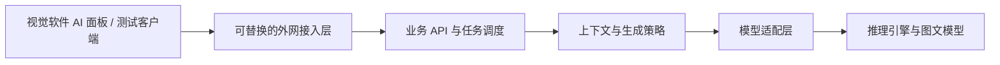

# AI C# 脚本助手主方案

更新日期：2026-10-23  
文档状态：v0.4，已汇总 S01～S05，按 A／B 双线组织；服务端语言独立评估  
维护职责：主会话

## 1. 项目目标

在类似 VisionMaster 的流程图式视觉检测软件中，为已有 C# 脚本工具增加 AI 助手。工程师描述需求，由 AI 生成或修改符合软件接口约束的脚本。

本文件维护总体共识和选型状态。具体参数、接口草案、方案对比和验证步骤分别维护在专项文档，避免在这里重复展开。

实现边界、先后顺序和拟建目录见 [实施规划](实施规划.md)；验收统一见 [S06](专项/06-联调与验收.md)。本轮同步专项已记录的用户确认，不将工程默认伪记为逐项确认，也不表示已经开始开发或部署。

本轮根据用户提出的两部分方向组织两个实现会话：A 覆盖客户端／业务服务／公网，B 覆盖模型能力／推理部署／调用。两线独立验证、尽早小集成，分别维护 [A 进度](实现线A-客户端服务端与公网.md)、[B 进度](实现线B-模型能力与推理.md)，主会话汇总总进度。

## 2. 已确认需求与现状

以下信息来自用户明确说明，尚不等于已在当前机器上实测。

| 编号 | 用户已确认内容 |
| --- | --- |
| R01 | 现有软件采用流程图式工具编排，C# 脚本本身是流程中的一个工具，可通过固定接口读写工具变量和全局变量。 |
| R02 | 现有脚本宿主目标框架是 .NET Framework 4.7.2。实际编译器和 C# 语言版本尚未提供。 |
| R03 | Windows＋RTX 5080 16GB 仍为目标服务器；用户已在 S01／S02 将首版改为文本＋图片输入、文本输出，以流程截图补充顺序与分支。原纯文本路线退出主线。 |
| R04 | 初期约 5 位用户，使用各自电脑通过外网访问；用户编程水平不同，包含不会写 C# 的基础工程师。 |
| R05 | 可以接受排队，需要清晰的排队和任务状态提示。 |
| R06 | 用户希望在 C# 工具内增加 AI 助手面板。工具已有获取当前流程工具 ID、名称、变量和类型的接口。 |
| R07 | 实际任务范围参考仓库根目录的两个脚本示例，包含检测计算，也包含串口通信和流程状态控制。 |
| R08 | 普通宽带下，用户已在 S03 选择首轮 NATAPP VIP-1 月付 Web 隧道＋平台二级域名＋HTTPS；主机与首批用户在中国大陆，Windows 11 x64、管理员权限已确认；尚未购买、开通或测试。 |
| R09 | 用户在 S02 已改为当前开发机先用 Qwen3-VL 4B 验证，再迁移 5080 并评估 8B 或更大；原 Coder 3B 不再是首轮模型。实际量化、参数、预算与性能仍是工程基线和待验证项。 |
| R10 | 将模型能力与上下文规则、服务器部署与客户端调用拆开讨论和测试；当前优先收敛部署与调用方案。 |
| R11 | 当前会话作为主进度会话；专项话题在不同会话展开，形成一个主方案和多个专项文档。 |
| R12 | 开发机先完成小用例链路再迁移 5080；S02 已记录开发机 RTX 3050 Laptop 4GB、约 16GB RAM 的部分只读检查。不能将该硬件结果当成 5080 检查。 |
| R13 | S01 记录用户要求完整遍历接口可获取的工具／变量／输出数据；接口目前不提供执行顺序和分支等流程结构，不能宣称已有拓扑导出能力。 |
| R14 | S01 记录用户允许修改当前脚本全部内容，要求交付完整脚本；结果先在对话预览，用户主动要求后才覆盖工作面板脚本。权限不扩展到自动修改其他节点或执行设备。 |
| R15 | S05 记录用户确认首阶段为简易 C# 脚本 Demo，先测连接和基础能力，后接完整 C# 工具；WinForms／WPF 和 Demo 运行时未被用户固定。 |
| R16 | S04 记录用户要求小型项目保持简洁，停止／完成／超时采用常见对话行为；具体状态映射、依赖、限额和保留周期仍为工程设计。 |
| R17 | 用户本轮提出按 A／B 两个大部分在两个会话中分步实现，以文档和实际测试持续同步与优化；本轮据此调整实施组织，未启动代码或创建会话。 |

## 3. 总体设计原则

以下原则依据已确认产品方向和当前工程建议；具体实现仍按各专项验证：

- 客户端提供业务需求、当前代码、真实数据目录和必要截图；业务服务组织上下文，截图不能替代真实 ID／类型和不可见业务规则。
- 客户端调用业务 API，业务 API 通过模型适配层访问推理引擎，使模型和公网入口均可独立替换。
- AI 主要参与脚本编写和修改；保存后的脚本由现有 C# 工具执行。是否支持其他运行中 AI 场景另行定义。
- 对新手用户优先展示来源、假设、澄清和验证结果；返回完整脚本，先预览，用户主动应用，源版本变化时不能静默覆盖。
- 将生成、编译检查、业务验证分开标识，避免将“生成结束”或“编译通过”表示为“业务已验证正确”。
- 实现分工与产品架构分开：A／B 是两个工作线，最终为客户端和服务端两端；B 的生成策略／预算／适配归入服务内部模块，Ollama 是独立运行依赖，不额外增加模型业务 API。
- 最小公共契约足以开工即可，参数和策略随实际测试迭代；影响另一线的变更同步契约、样例、文档和对应验证。各线阶段通过后仍需联合验收。

## 4. 当前候选架构

本表是既有讨论的建议摘要，不代表用户已批准选型，也不代表已经安装实现。

| 范围 | 当前讨论建议 | 权威细节位置 |
| --- | --- | --- |
| 推理部署 | 开发机 Qwen3-VL 4B，迁移同基线后再比较 8B；Windows 原生 Ollama、Instruct Q4 和参数为工程默认 | [S02](专项/02-模型与推理部署.md) |
| 公网接入 | 首轮 NATAPP 路线已选，手册已写；长期自建入口不作为当前前置 | [S03](专项/03-公网接入.md) |
| 服务端 | 一个业务进程＋SQLite＋单生成执行位；语言待定，当前优先建议 Python＋FastAPI，C# 备选；图文协议与预算规则独立于语言 | [S04](专项/04-服务端API与任务调度.md)、[语言比较](实施规划.md#05-服务端语言与推理引擎分别选择) |
| 测试客户端 | 简易 C# Demo 先行，真实宿主和完整面板后置；不先建设复杂组件体系 | [S05](专项/05-测试客户端与软件集成.md) |
| 模型能力 | 固定图文工作流基线，真实目录＋截图＋SDK；完整代码与诊断反馈对照，未选 Agent 框架 | [S01](专项/01-模型能力与上下文.md) |
| 验证 | Fake、真实模型、公网、能力与宿主分别验收；执行位恢复和图文容量列为硬接缝 | [S06](专项/06-联调与验收.md) |

## 5. 总体决策登记

“用户确认”和“实测验证”是不同维度。专项中已获用户明确确认的结论，由主会话同步收录，无需为同一结论重复询问。

| 决策编号 | 事项 | 当前状态 | 负责专项 |
| --- | --- | --- | --- |
| D01 | 首轮 Qwen3-VL 4B，后续 8B／更大方向 | 专项已记录用户确认；替代旧 Coder 3B，未推理实测 | S02 |
| D02 | Instruct Q4、开发单图 4K、小输出和后续档位 | S02 v0.3 工程默认；联合预算、资源和完整代码容量待验证 | S02 |
| D03 | 原生 Windows Ollama 与唯一托管入口 | S02 实施基线建议；无 WSL 前置，未安装 | S02 |
| D04 | NATAPP VIP-1 月付＋平台二级域名＋HTTPS | 专项已记录用户确认；未采购、开通、部署或外网实测 | S03 |
| D05 | 单服务＋SQLite、异步任务、停止恢复、保留周期 | 产品停止语义已确认；技术、限额和图片协议为工程草案，P0 落 schema | S04 |
| D06 | 简易 C# Demo，随后完整工具集成 | 路线已确认；Demo 运行时与实现细节待落地 | S05 |
| D07 | 当前脚本全内容修改，完整交付、先预览、显式应用 | S01 U02／U03／U05 已确认；编译、回退和源版本检查待实现 | S01、S05 |
| D08 | 全量数据发现、截图语义、图文预算与反馈 | 数据和截图方向已确认；具体协议／预算器／修复次数仍待验证 | S01、S04 |
| D09 | 双线实现、产品两端、公共边界与文件归属 | 用户本轮提出双线方向，主会话按此整理工程方案；同仓库模块协作，尚未创建代码项目 | 主会话、A、B |
| D10 | 服务端实现语言与框架 | 用户提出比较 Python／C++；主会话优先建议 Python＋FastAPI，C# 保留为候选，未记为用户确认；推理引擎继续独立选择 | 主会话、S04、S02 |

## 6. 建议实施阶段

| 阶段 | 交付物 | 进入下一阶段的依据 |
| --- | --- | --- |
| M0：需求与文档组织 | 主方案、专项文档、进度和交接规范 | 现有共识和未决问题有明确归属 |
| M1：实施契约 | 综合 S01～S05、图文 API 草案、目录与验收门槛，实施时形成 schema／样例 | P0／G0，当前文档完成但契约文件尚未创建 |
| M2：开发机最小链路 | 真实模型预检与 API＋Fake／Demo 分线，公网 Fake、真实 VL 分别打通 | P1A／P1B／P2／P3，对应 G1～G4 |
| M3：能力与容量 | 固定图、SDK／脚本任务、反馈对照及真实验证限制 | P4／G5，不把资源受限小用例当完整能力 |
| M4：5080 迁移与升级 | 同 4B 复验，再独立比较 8B、上下文、图片策略与长期托管 | P5／G6，必要回退和取消重测 |
| M5：正式软件集成 | 元数据、截图、真实编译、预览／应用／回退及完整业务终验 | P6／G7，真实任务和 SDK 可核对 |

工作包之间可独立验证的部分、必要共同实现和启动条件见 [实施规划](实施规划.md)。S06 从 P0 开始参与，不留到所有代码写完才补测试。阶段状态、下一步和实际验证记录见 [项目进度](项目进度.md)。

上述 M／P 阶段保留作为追踪，不要求开六个实现会话。A 主推 P0／P1B／P2 和宿主；B 主推 P1A／P4 和模型迁移；P3／P5／最终联调共同完成。正式项目数与运行依赖的区别见实施规划第 0.4 节。

## 7. 依赖与重要未知项

- 入口已选择，实际订单、域名和平台上传限制尚未落实；不重复选型，按 S03 实施时核实。
- 当前 VL 权重与引擎授权记录交由 S02；旧 Coder 3B 的授权限制不套用到当前 VL。
- .NET Framework 版本不能替代实际编译器信息；现有编译检查接口、SDK 定义和集合读写语义尚未取得。
- 开发机部分只读环境检查已有专项记录；5080 未做环境与性能实测。模型／硬件／图片处理变更须重验预算和取消。
- 真实截图和标注、SDK 签名／程序集、宿主源码与实际编译器仍缺；不阻塞 Fake 链路，但阻塞相应真实能力验收。
- VL 联合预算算法与真实完整代码容量是当前最大技术未证项；不能沿用旧文本字节预算或仅凭 4B／8B 名称宣布可用。
