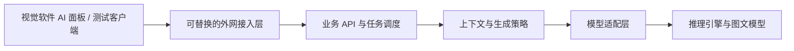

# AI C# 脚本助手主方案

更新日期：2026-10-23  
文档状态：v1.0，统一工程实施；Python＋FastAPI 已确认，A/B 成果已合入  
维护职责：主会话

## 1. 项目目标

在类似 VisionMaster 的流程图式视觉检测软件中，为已有 C# 脚本工具增加 AI 助手。工程师描述需求，由 AI 生成或修改符合软件接口约束的脚本。

本文件维护总体共识和选型状态。具体参数、接口草案、方案对比和验证步骤分别维护在专项文档，避免在这里重复展开。

实施采用 [五阶段规划](实施规划.md)，运行事实以 [项目进度](项目进度.md) 和源码为准，操作统一见 [正式工程运维](正式工程运维.md)。

用户本轮已要求停止分别建设验证工程：以 `D:\github\AiServer` 统一 A 的服务／Demo 和 B 的模型模块，使用 Python＋FastAPI；先当前开发机，后迁移 5080。客户端暂保留解耦 Demo，完整宿主后续实施。历史专项中未实现状态与严格预算前置已被当前实现取代。

## 2. 已确认需求与现状

以下信息来自用户明确说明，尚不等于已在当前机器上实测。

| 编号 | 用户已确认内容 |
| --- | --- |
| R01 | 现有软件采用流程图式工具编排，C# 脚本本身是流程中的一个工具，可通过固定接口读写工具变量和全局变量。 |
| R02 | 现有脚本宿主目标框架是 .NET Framework 4.7.2。实际编译器和 C# 语言版本尚未提供。 |
| R03 | Windows＋RTX 5080 16GB 仍为目标服务器；用户已在 S01／S02 将首版改为文本＋图片输入、文本输出，以流程截图补充顺序与分支。原纯文本路线退出主线。 |
| R04 | 初期约 5 位用户，使用各自电脑通过外网访问；用户编程水平不同，包含不会写 C# 的基础工程师。 |
| R05 | 可以接受排队，需要清晰的排队和任务状态提示。 |
| R06 | 用户希望在 C# 工具内增加 AI 助手面板。工具已有获取当前流程工具 ID、名称、变量和类型的接口。 |
| R07 | 实际任务范围参考仓库根目录的两个脚本示例，包含检测计算，也包含串口通信和流程状态控制。 |
| R08 | 普通宽带下，用户已在 S03 选择首轮 NATAPP VIP-1 月付 Web 隧道＋平台二级域名＋HTTPS；主机与首批用户在中国大陆，Windows 11 x64、管理员权限已确认；隧道已购买，用户提供并绑定 Web 域名 szzj.nat200.top，HTTPS 健康及认证已可用；完整公网验收以项目进度为准。 |
| R09 | 用户在 S02 已改为当前开发机先用 Qwen3-VL 4B 验证，再迁移 5080 并评估 8B 或更大；原 Coder 3B 不再是首轮模型。当前 4B Q4_K_M 已安装，真实图文任务已运行；具体能力和目标机性能仍按证据区分。 |
| R10 | 将模型能力与上下文规则、服务器部署与客户端调用拆开讨论和测试；当前优先收敛部署与调用方案。 |
| R11 | 当前会话作为主进度会话；专项话题在不同会话展开，形成一个主方案和多个专项文档。 |
| R12 | 开发机先完成小用例链路再迁移 5080；S02 已记录开发机 RTX 3050 Laptop 4GB、约 16GB RAM 的部分只读检查。不能将该硬件结果当成 5080 检查。 |
| R13 | S01 记录用户要求完整遍历接口可获取的工具／变量／输出数据；接口目前不提供执行顺序和分支等流程结构，不能宣称已有拓扑导出能力。 |
| R14 | S01 记录用户允许修改当前脚本全部内容，要求交付完整脚本；结果先在对话预览，用户主动要求后才覆盖工作面板脚本。权限不扩展到自动修改其他节点或执行设备。 |
| R15 | S05 记录用户确认首阶段为简易 C# 脚本 Demo，先测连接和基础能力，后接完整 C# 工具；WinForms／WPF 和 Demo 运行时未被用户固定。 |
| R16 | S04 记录用户要求小型项目保持简洁，停止／完成／超时采用常见对话行为；具体状态映射、依赖、限额和保留周期仍为工程设计。 |
| R17 | 此前 A/B 分别实现；用户本轮明确改为一个正式工程，A/B 历史保留。 |

## 3. 总体设计原则

以下原则依据已确认产品方向和当前工程建议；具体实现仍按各专项验证：

- 客户端提供业务需求、当前代码、真实数据目录和必要截图；业务服务组织上下文，截图不能替代真实 ID／类型和不可见业务规则。
- 客户端调用业务 API，业务 API 通过模型适配层访问推理引擎，使模型和公网入口均可独立替换。
- AI 主要参与脚本编写和修改；保存后的脚本由现有 C# 工具执行。是否支持其他运行中 AI 场景另行定义。
- 对新手用户优先展示来源、假设、澄清和验证结果；返回完整脚本，先预览，用户主动应用，源版本变化时不能静默覆盖。
- 将生成、编译检查、业务验证分开标识，避免将“生成结束”或“编译通过”表示为“业务已验证正确”。
- 实现分工与产品架构分开：A／B 是两个工作线，最终为客户端和服务端两端；B 的生成策略／预算／适配归入服务内部模块，Ollama 是独立运行依赖，不额外增加模型业务 API。
- 最小公共契约足以开工即可，参数和策略随实际测试迭代；影响另一线的变更同步契约、样例、文档和对应验证。各线阶段通过后仍需联合验收。

## 4. 正式架构

当前正式交付为 Python 业务服务、独立 Ollama 引擎与 C# Demo；各项实际状态见项目进度，旧专项保留设计依据。

| 范围 | 当前讨论建议 | 权威细节位置 |
| --- | --- | --- |
| 推理部署 | 开发机 Qwen3-VL 4B，迁移同基线后再比较 8B；Windows 原生 Ollama、Instruct Q4 和参数为工程默认 | [S02](专项/02-模型与推理部署.md) |
| 公网接入 | 首轮 NATAPP 路线已选，手册已写；长期自建入口不作为当前前置 | [S03](专项/03-公网接入.md) |
| 服务端 | 已采用 Python＋FastAPI、SQLite、单业务进程和单生成执行位；内部调用真实 Ollama | [正式工程运维](正式工程运维.md) |
| 测试客户端 | 简易 C# Demo 先行，真实宿主和完整面板后置；不先建设复杂组件体系 | [S05](专项/05-测试客户端与软件集成.md) |
| 模型能力 | 固定图文工作流基线，真实目录＋截图＋SDK；完整代码与诊断反馈对照，未选 Agent 框架 | [S01](专项/01-模型能力与上下文.md) |
| 验证 | Fake、真实模型、公网、能力与宿主分别验收；执行位恢复和图文容量列为硬接缝 | [S06](专项/06-联调与验收.md) |

## 5. 总体决策登记

| 事项 | 已确认决策与当前状态 |
|---|---|
| D01／D02 模型与容量 | 已部署 Qwen3-VL 4B Q4_K_M；当前 4K 开发档位，保守估算＋禁止引擎裁剪／移位，估算与实测分列；精确计数后续优化 |
| D03 推理部署 | Windows 原生 Ollama 0.40.9，API 唯一托管进程树；不同时运行旧启动器 |
| D04 公网 | NATAPP 隧道已购，用户已绑定 szzj.nat200.top；HTTPS 健康及认证可用，旧标识地址退出主线 |
| D05 服务 | FastAPI＋SQLite＋单 worker／单生成位；任务、幂等、取消恢复及运维已实现，实际检查边界见进度 |
| D06 客户端 | 当前为 C# net8 控制台 Demo，HTTP／文件／交互解耦；完整客户端与 net472 宿主后续接入 |
| D07 脚本权限 | 交付完整脚本、先预览、显式应用；Demo 不执行代码，真实编译／应用／回退待宿主资料 |
| D08 上下文 | 图文与 SDK／真实变量目录，来源与版本可追踪；资料未齐继续标未验证 |
| D09 工程组织 | 一个工程 `D:\github\AiServer`，A 合入 B，历史 A 工作目录保留；不继续分线迭代 |
| D10 技术栈 | 用户明确采用 Python＋FastAPI；不再保留 C#／C++ 业务服务选型未决状态 |
| D11 多轮与修复 | 沿用独立任务＋显式历史／反馈／parentJobId；不加入完整会话管理和自动编译循环 |

## 6. 实施与依赖

五阶段为统一工程、真实模型、服务可靠性、公网接入、5080 部署。详见 [实施规划](实施规划.md)，真实完成情况只维护在 [项目进度](项目进度.md)。

真实 SDK、工具变量导出、流程截图、完整脚本模板和宿主实际编译器尚未整理，不阻塞正式服务与 Demo。当前数据接口不能导出顺序和分支，截图不替代真实 ID 和类型。

公网使用 szzj.nat200.top；5080 待提供访问方式、目录和运行账户。开发机检查不证明目标机、无人登录托管或设备正确性；后续升级模型和上下文继续在同一工程完成。
