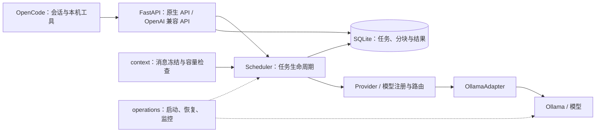
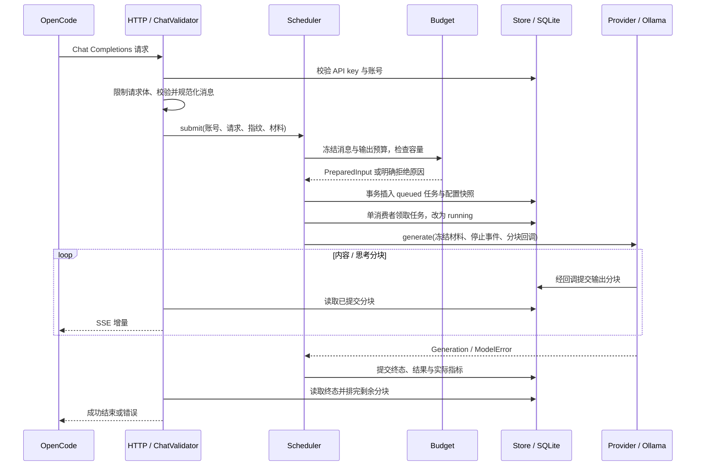
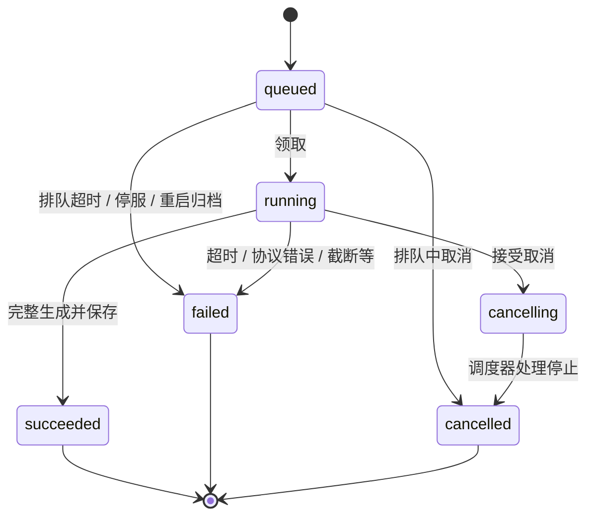

# AiServer 代码与软件工程导读

这份文档面向准备长期维护 AiServer 的项目所有者：先建立整体认识，再理解代码如何协作，最后能判断一次改动会影响哪里。它解释当前实现中的工程知识，不记录运行步骤、发布验收或模型性能；这些内容分别查[正式工程运维](正式工程运维.md)、[项目进度](项目进度.md)和[接口文档](../contracts/api/v1/README.md)。开发过程中的经验另见[初版开发与部署复盘](初版开发与部署复盘.md)。

阅读基线：2026-10-29 工作区，软件版本来自 `server/pyproject.toml`，为 0.9.11。以下描述以源码为依据；“建议”“代价”和“适用性判断”是工程分析，不代表原作者留下的设计决策记录。

2026-10-30的0.9.12扩展仍沿用同一多模型注册与单生成位。三款新增模型由`pinned_model_install.py`固定来源、预检后追加注册；Gemma 26B的本地清单为固定Q3权重配套原生renderer／parser。`inference/thinking.py`区分布尔开关与命名等级，提交前验证、入队时冻结，能力字段驱动OpenCode variants；不把GPT-OSS的low等同关闭思考。精确字段见接口文档，安装步骤见运维文档。下文规模统计保留上述阅读基线，不作为新版文件数。

## 1. 先认识这个软件的本质

AiServer 是一个带持久化任务管理的模型推理服务。它把客户端请求转换为受控的推理任务，负责账号隔离、容量检查、排队、生成、输出保存、取消、恢复和运行观测。

整个产品的责任分布如下：

| 部分 | 负责什么 | 本仓库中的关系 |
|---|---|---|
| OpenCode | 组织用户需求、会话历史与项目材料，管理本机文件和命令工具 | 外部客户端；本仓库维护接入脚本 |
| AiServer | 接收和验证请求，管理推理任务及结果 | 服务端核心源码 |
| Ollama | 加载模型，执行推理，返回内容、工具调用和实际计数 | 外部引擎，由 AiServer 适配和按配置托管 |
| 模型文件、模板与 tokenizer | 决定推理内容及消息的实际分词形式 | 外部模型资产，以身份与哈希校验约束 |
| NATAPP | 提供网络连接通道 | 外部进程，由服务托管模块管理 |
| 本地管理器 | 管理服务、账号、配置、备份和监控展示 | 仓库内的 Tk 界面与操作桥接脚本 |

因此，日常维护的主要对象是**请求和资源的协调规则**。学习重点包括任务状态、数据一致性、网络协议和进程生命周期；模型内部的神经网络实现位于引擎及其上游。

从代码组织上，可以将它理解为“模块化单体”：一套服务代码、一个 API 服务进程，内部按职责拆成模块。正式入口使用一个 Uvicorn worker；引擎与隧道是独立的子进程。这里的“单体”描述应用的组织方式，不代表整个产品只有一个操作系统进程。



图中箭头表达主要协作关系，不是完整 Python import 图。核心特点是：两套 API 共用一套任务系统，多模型共用一个生成位。

## 2. 代码规模与模块地图

静态统计以下目录中的 `.py` 文件，物理行数包含空行、注释和文档字符串；排除缓存，不计 SQL、JSON、CMD 和文档。

| 范围 | Python 文件数 | 物理行数 | 如何理解 |
|---|---:|---:|---|
| `server/src/aiserver/` | 38 | 4,188 | 在线服务核心，适合优先学习 |
| `scripts/` | 50 | 8,405 | 管理、接入、安装准备、评测与发布工具 |
| `server/tests/` | 34 | 6,072 | 自动化回归与测试辅助代码 |

`server/tests/` 中静态识别到 218 个 `test_` 函数；参数化会展开更多用例，这个数字不是测试执行数量，也不是覆盖率。代码行数帮助安排阅读精力，不能单独证明代码质量。

### 2.1 在线服务的职责划分

下表是维护时应掌握的职责边界。完整入口索引同时见[服务端说明](../server/README.md)。

| 模块 | 代表代码 | 主要问题 | 修改时应守住的边界 |
|---|---|---|---|
| 应用装配 | [`app.py:create_app`](../server/src/aiserver/app.py) | 各对象怎样创建、连接与关闭？ | 让生命周期与依赖关系清楚可见 |
| HTTP 接口 | [`api/validation.py:RequestValidator`](../server/src/aiserver/api/validation.py)、[`api/openai.py:ChatValidator`](../server/src/aiserver/api/openai.py) | 外部输入是否合法，怎样转换为内部请求？ | 协议细节在入口处转换 |
| 流式传输 | [`api/streaming.py:InferenceStream`](../server/src/aiserver/api/streaming.py) | 如何增量发送、限制慢连接、处理断线？ | 连接结束必须通知任务系统 |
| 任务调度 | [`jobs/scheduler.py:Scheduler`](../server/src/aiserver/jobs/scheduler.py) | 何时接收、执行、停止、恢复？ | 保持单生成位与状态转换规则 |
| 持久化 | [`storage/db.py:Store`](../server/src/aiserver/storage/db.py) | 状态和输出怎样可靠保存？ | 关键判断与状态写入处于同一事务 |
| 消息与容量 | [`context/prompt_builder.py:prepare_messages`](../server/src/aiserver/context/prompt_builder.py)、[`context/window_budget.py`](../server/src/aiserver/context/window_budget.py) | 实际发送什么，是否容纳得下？ | 计数与生成使用同一份冻结材料 |
| 推理集成 | [`inference/runtime.py:RealProvider`](../server/src/aiserver/inference/runtime.py)、[`inference/ollama.py:OllamaAdapter`](../server/src/aiserver/inference/ollama.py) | 如何调用引擎、验证结果、统一错误？ | 引擎协议与公共协议分开 |
| 多模型路由 | [`inference/registry.py:ModelBackends`](../server/src/aiserver/inference/registry.py) | 请求应使用哪份模型配置？ | 共享引擎进程时协调切换与计数 |
| 服务基础设施 | [`operations/service.py:serve`](../server/src/aiserver/operations/service.py)、[`operations/engine.py:ManagedEngine`](../server/src/aiserver/operations/engine.py) | 谁拥有进程，怎样启动、恢复和收尾？ | 只操作能确认归属的进程 |
| 观测 | [`operations/monitoring.py:Monitor`](../server/src/aiserver/operations/monitoring.py) | 服务在做什么，时间花在哪里？ | 观测异常尽量隔离，保留元数据边界 |
| 配置 | [`settings.py:Settings`](../server/src/aiserver/settings.py)、[`inference/configuration.py`](../server/src/aiserver/inference/configuration.py) | 设置是否合法，最终哪些参数生效？ | 配置来源、校验和覆盖顺序明确 |

### 2.2 工具代码也是工程的一部分

`scripts/server/` 是管理员入口。`Run.py` 与 `Manage.py` 转到包内入口；`ServerManager.py` 提供界面；`ManagerActions.py` 执行操作并承载服务宿主；`manager_support.py` 提供配置检查、原子写入等支撑。

`scripts/client/` 是 OpenCode 接入层。它探测账号和模型能力，生成连接配置，使用 Windows DPAPI 保存独立密钥，再为 OpenCode 构造启动环境。它也包含连接与本地工具检查。

`scripts/inference/` 是引擎和模型准备工具；`scripts/validation/` 是契约检查、容量检查及评测工具；`scripts/deployment/` 是发布文件清单与更新包工具。它们与在线推理代码有不同的执行入口，阅读某项功能时应先判断它发生在请求期间、启动期间，还是管理员操作期间。

`contracts/` 是客户端与服务端的约定；`config/` 的公开模板描述可交付的配置形状。`.local/` 中的模型、密钥、数据库、日志和生成产物不属于理解源码的起点。

## 3. 从启动过程理解框架和对象关系

### 3.1 框架分别承担哪一层

| 技术 | 在当前工程中的作用 |
|---|---|
| Python 包与 `src` 布局 | 将可复用的服务实现集中在 `server/src/aiserver/`，脚本负责进入该实现 |
| FastAPI | HTTP 路由、认证依赖、异常处理与应用生命周期 |
| Uvicorn / ASGI | 接收网络请求，驱动异步应用，发送响应和通知断线 |
| Pydantic | 校验 `Settings` 等结构化配置 |
| JSON Schema / jsonschema | 校验公开请求、响应和样例的结构 |
| asyncio / httpx | 协调网络等待、后台任务、超时和引擎 HTTP 调用 |
| SQLite / sqlite3 | 保存账号、任务、输出与恢复状态；实现直接使用 SQL |
| Tk / 子进程 / 标准输入输出 | 管理界面与选定 Python 环境中的操作代码通信 |
| pytest | 将状态转换、协议和异常场景固化为回归用例 |
| setuptools / pyproject.toml | 描述 Python 包、版本、依赖、SQL 包数据和测试配置 |

表中描述来自本项目使用方式。依赖版本以 [`pyproject.toml`](../server/pyproject.toml) 和 [`requirements.lock.txt`](../server/requirements.lock.txt) 为准，不在本文复制维护。

### 3.2 程序入口和应用工厂

命令行启动的主要调用链是：

```text
scripts/server/Run.py
  → aiserver.__main__.entrypoint / main
  → Settings.load
  → operations.service.serve
  → app.create_app
  → Uvicorn 驱动应用生命周期
```

`create_app()` 这种函数叫**应用工厂**：每次调用创建一套应用和依赖。当前代码显式创建 `Store`、预算器、Provider、`Scheduler`、`Monitor`、校验器和限流器，再把它们接到路由上。这使对象关系可以从一个入口读出来。

工厂可以接受 `profile`、`budget`、`provider` 参数，这是**依赖注入**的具体用法。生产路径创建真实实现；测试可以传入 Fake 或受控实现，从而测试任务系统，而不依赖真实模型。Python `Protocol` 描述了这些实现需要满足的方法约定。

FastAPI 的 `Depends(user)` 是另一处依赖注入：受保护的路由复用认证函数，拿到账号身份。它与工厂注入发生在不同阶段，一个连接应用对象，一个处理单次请求。

### 3.3 生命周期管理的价值

`app.py:lifespan` 的主要启动顺序是：取得实例锁 → 建立日志 → 初始化存储和迁移 → 启动并验证 Provider → 启动调度器 → 启动监控。退出时关闭调度、Provider、监控和日志，并释放锁。

这里体现的是**资源所有权**：创建某项资源的模块必须安排正常退出和异常退出时的收尾。HTTP 客户端、后台任务、子进程、锁和文件句柄都需要明确的关闭路径。

配置校验也属于启动设计。`Settings.load()` 从选定 JSON 加载配置，再接受 `AISERVER_*` 环境变量覆盖；配置中的相对路径按发布根目录解析。`Settings` 禁止未知字段，并检查生产环境、Provider 和各项限制之间的关系。仅看 Python 字段默认值不足以推断正式入口最终使用的设置。

### 3.4 管理界面为什么需要操作桥接

`ServerManager.invoke()` 将操作参数序列化为 JSON，启动选定 Python 下的 `ManagerActions.py`，再解析其 JSON 结果；耗时操作交给后台执行器，结果经 mailbox 回到界面。

这种结构将界面事件、Python 环境和服务实现隔开。修改一个按钮时，通常需要追踪“按钮回调 → 操作名称与参数 → `perform()` 或 `host()` → 实际服务模块”。界面显示成功，还需要对应的底层操作已经完成。

配置保存还使用内容哈希检查旧版本，再备份并原子替换文件。这是**乐观并发控制**：先确认正在修改的仍是自己读过的那一版，避免覆盖其他操作的有效更新。它与数据库事务解决的是不同范围的问题。

## 4. 一次推理请求如何经过整个系统

以 OpenCode 发起的兼容请求为例：



这张图描述成功主流程。断线、取消、超时会进入停止与恢复流程，见第 5 节。

### 4.1 外部请求先转换成内部语言

原生 API 的 `RequestValidator` 与兼容 API 的 `ChatValidator` 分别理解各自的协议。它们把外部 JSON 转成内部请求和 `TaskInput`，后面的调度器复用同一套处理逻辑。

例如，兼容层处理字符串内容、`developer` 角色、工具调用 ID、工具结果及输出参数；内部再转换成 Ollama 所需的形式。公共协议、内部数据结构和引擎协议各有自己的表示，改变其中一种格式时，应在相应边界完成转换。

这是一种**适配层**设计。增加另一个客户端协议时，可以复用任务核心；增加另一种引擎时，可以考虑实现相同的内部 Provider 约定。后者仍需要补足引擎身份、容量、取消与恢复等能力，接口形状相同并不自动代表行为等价。

### 4.2 入队前冻结，执行时按快照处理

`Scheduler.submit()` 在入库前调用预算器，生成 `PreparedInput`；同时保存 `Profile` 和有效设置。后台调度协程领取任务后，从保存的材料恢复执行输入，校验当前 Profile 是否与快照一致。

它避免“排队时接受的是一套配置，轮到执行时悄悄换成另一套”。这里的冻结主要通过不可变数据类、序列化字符串、内容哈希和执行前校验共同实现。

冻结记录有助于解释实际使用了哪些材料和参数，但不保证模型输出可重复，也不会自动保存完整的操作系统或 GPU 环境。

### 4.3 持久化的队列和内存通知各有职责

任务排队数据在 SQLite 的 `jobs` 表中；`Scheduler.wake` 是内存中的唤醒信号，用来减少消费者发现新任务的等待。真实队列顺序来自数据库中的 `sequence`，领取使用事务。

这是“持久状态 + 内存协调”的组合。判断一个任务是否存在、归属谁、是否已经结束，应查询持久状态；调度器的 `active_job`、`gate` 和 `wake` 帮助当前进程协调执行。

### 4.4 幂等性有明确适用范围

原生请求用 `(user_id, client_request_id)` 唯一约束和请求指纹避免同一请求重复创建任务。相同 ID、相同材料识别为已有请求；相同 ID、不同材料报冲突。`submit()` 在准备前和取得 gate 后检查，`Store.insert()` 在事务中再次检查，数据库唯一约束提供最后边界。

兼容层每次生成新的内部请求 ID，因此兼容提交没有客户端幂等重放能力。共享队列并不意味着两套接口具有完全相同的外部语义。具体重放响应、状态码和重试约定以接口文档为准。

## 5. 两套状态机与并发控制

### 5.1 任务状态与调度器状态分别描述什么

单个任务的主要状态路径如下：



图中省略启动归档等特殊路径的细节，实际转换以 `Store.startup/cancel/finish/stop_running` 为准。

调度器还有 `starting`、`available`、`busy`、`draining`、`recovering`、`paused`、`stopping` 等运行状态。任务状态回答“这次请求怎么样了”；调度器状态回答“服务当前能做什么”。

一个任务进入 `cancelled` 或 `failed`，可能仍需要引擎恢复。**任务已有终态与生成资源已确认空闲是两个条件。** 这一点是理解停止逻辑的核心。

### 5.2 为什么取消是一段流程

取消一个运行任务，需要协调数据库状态、Python 协程、网络连接和引擎进程。`Scheduler.execute()` 观察取消或超时，保存停止状态，设置停止事件，取消生成协程，再等待清理；真实 Provider 必要时重启托管引擎并重新验证。

Python 任务被取消，只能说明 Python 控制流受到了取消请求，无法单凭它证明 GPU 推理已经停止。清理无法确认时，系统保留恢复状态，避免下一任务重叠执行；延迟返回的结果也会被丢弃。

`Store.append_output()` 只向仍处于 `running` 的任务追加内容；`Store.finish()` 同样检查状态。因此“已经接受取消”和“模型几乎同时返回成功”的竞争，需要靠事务中的条件写入裁决，不能只靠界面按钮禁用。

### 5.3 不同的锁解决不同范围的问题

| 机制 | 所在位置 | 协调范围 |
|---|---|---|
| `InstanceLock` | 应用与进程托管 | 跨进程的目录或资源所有权 |
| `Scheduler.gate` | 调度器 | 当前服务进程内，提交、领取和取消等关键操作的协作 |
| `ModelBackends.engine_gate` | 多模型注册器 | 模型计数、生成及引擎配置切换的互斥 |
| SQLite 写事务与约束 | `Store` / SQL | 持久状态更新的原子性和数据约束 |

`asyncio.Lock` 只约束当前进程里的相关协程。把 Uvicorn worker 数量改大，会产生多套调度器、内存锁和资源所有者，现有单进程设计需要整体重新评估。

### 5.4 单生成位的实际代价

多个 HTTP 请求可以同时处于上传、等待或读取结果阶段；模型生成保持串行。`load_profile()` 还检查引擎并行度、加载模型数和引擎队列配置，确保它们符合这一约束。

多模型也共享一个生成位。实际模板计数可能加载 runner，所以 `ModelBackends.prepare()` 在需要计数时也取得 `engine_gate`；它可能等待正在进行的生成。模型的进程级参数不同时，切换还可能触发引擎重启。

因此，用户感受到的等待应进一步分成准备等待、入队等待、模型加载和生成时间。提高最大排队数只改变可容纳的等待量，不会直接增加模型吞吐。

## 6. 数据模型与一致性设计

### 6.1 数据表对应哪些概念

| 表 | 主要内容 | 设计意义 |
|---|---|---|
| `users` | 账号身份与启用状态 | 账号归属是权限判断的基础 |
| `api_keys` | key 标识、摘要、到期与撤销时间 | 一个账号可持有多把独立 key |
| `jobs` | 状态、顺序、归属、请求指纹和时间戳 | 小而稳定的任务索引与生命周期记录 |
| `job_payloads` | 请求、有效设置快照、输出与指标 JSON | 正文数据可以独立清理 |
| `output_chunks` | 分块顺序、通道和文本 | 流式发送读取已经提交的内容 |
| `job_events` | 状态事件及原因 | 辅助追踪生命周期 |
| `service_state` | 持久化的引擎恢复要求 | 重启后仍能知道是否需要恢复 |
| `task_performance` | 时间与实际 token 等性能元数据 | 与正文保留解耦的查询数据 |

关系和约束见 [`001_initial.sql`](../server/src/aiserver/storage/001_initial.sql) 及后续迁移。`task_performance` 特意独立于正文保留；`output_chunks` 随 payload 外键级联清理。任务索引仍在，并不保证正文仍可读取。

### 6.2 事务把多步操作变成一个承诺

`Store.connection(write=True)` 使用 `BEGIN IMMEDIATE`，成功提交，异常回滚；每次连接启用外键和 `synchronous=FULL`，初始化设置 WAL。项目直接编写参数化 SQL，未使用 ORM。

例如，创建任务涉及检查账号、恢复状态和限额，插入任务、payload、性能记录，并记录事件。将这些步骤放进同一事务，可以避免只插入其中一半。

WAL 和写事务仍有锁等待、I/O 与单写者代价。异步 API 通过 `asyncio.to_thread()` 调用同步 SQLite 代码，防止这些操作直接占用事件循环；它不会消除数据库本身的竞争。

`job_events` 记录事件，但当前实现仍直接查询和修改 `jobs` 等表。它不是靠重放全部事件重建状态的事件溯源系统。

### 6.3 为什么先保存输出再发送

Provider 接到文本后等待分块回调；回调调用 `Store.append_output()` 完成提交；HTTP 层随后从 `output_chunks` 读取并发送。这让已经发送的分块有对应的持久记录，也便于保存失败或取消后的部分结果。

这并不保证每个已保存分块都已抵达客户端。数据库提交和网络接收是两个不同事件，断线可以发生在它们之间。

当前正文与引擎公开返回的思考分别存储为 `content`、`reasoning_content` 通道，共用递增序号；工具调用在最终校验成功并保存后发布。思考属于模型公开输出数据，不是本软件自身的隐藏运行状态。

### 6.4 持久化与重启续跑的区别

`Store.startup()` 会归档遗留的活动任务：运行中的任务失败，取消中的任务取消，排队任务也不会自动继续；需要时记录引擎恢复要求。`shutdown_waiting()` 也会将停服时仍等待的任务结束。

所以这里的持久化主要提供状态和结果保留、幂等记录以及异常后可解释的恢复边界。增加“重启后续跑”会改变产品语义，需要同时考虑旧请求快照、结果重复、客户端连接和工具业务的重复执行。

### 6.5 迁移文件是发布历史的一部分

`Store.initialize()` 用 SQLite `user_version` 按顺序应用迁移；升级已有旧库前创建一致性备份，每段迁移在事务内执行。旧迁移必须保留，因为旧版本数据库需要沿这条路径升级。

代码中仍有先增加密码字段、后来移除该字段的迁移，这描述了数据库演进路径，不代表当前仍提供密码登录。修改表结构应新增迁移，并检查当前版本判断、备份、恢复、包内 SQL 文件及旧库兼容测试。

## 7. 消息、容量与推理适配

### 7.1 三种容易混淆的限制

| 限制 | 约束对象 | 主要位置 |
|---|---|---|
| 请求体大小和上传时间 | HTTP 字节数与连接占用 | `api/body.py:read_json_body` |
| 结构与材料限制 | 消息角色、工具关系、文本字节、图片格式与尺寸 | 两种 Validator 与模型限制检查 |
| 上下文预算 | 模型分词后的输入与有效输出预算 | `context/` 与 `PracticalBudget` |

“字节数合法”不等于“token 预算合法”。工具定义、历史工具调用和公开思考也会占用材料与上下文。

容量的核心关系由 `window_budget.py` 统一维护：

```text
本次输入上限 = 上下文窗口 - 本次有效输出预算 - 预留 token
```

举一个纯计算示例：窗口 32,768、请求输出 4,096、预留 512 时，输入上限为 28,160。这里没有描述任何已部署模型的实测容量。

客户端请求参数还会与管理员提供的采样默认值合并，再冻结为本次设置。输出预算、上下文和 GPU 资源配置受到独立约束，避免普通生成参数覆盖资源边界。

### 7.2 同一材料用于计数和生成

`prepare_messages()` 保留消息角色与有序内容，把文字、图片及工具材料转成 `PreparedPrompt`；旧 `system_prompt` 配置不向新请求注入业务提示词。`freeze_output()` 冻结有效参数并更新材料哈希。

计数有两条实现路径：保守估算，或让锁定的 Ollama 渲染实际模板，再用锁定 tokenizer 计数。后者实现在 `coder_budget.py:CoderCounter`，当前名称包含历史命名，阅读时应以实际调用路径判断用途。

`inference/configuration.py:chat_payload()` 为计数和生成构造共同的有效输入。这样可以减少“预算检查的是简化提示词，生成时又加了其他材料”的偏差。

准入计数与引擎最终返回的实际 usage 分开保存；兼容响应缺少实际计数时不会用估算填补。模板计数也不等于实际生成调用的计量结果。引擎请求还明确关闭静默截断与窗口移动，让超限表现为错误。

### 7.3 Profile、模型 ID 与内容哈希各有什么用

外部模型 ID 用于客户端选择；`Profile` 包含实际模型身份、配置、映射与预算方式的快照；Profile ID 带快照哈希片段，帮助区分配置版本。`PreparedInput.material_sha256` 校验本次冻结材料。

这里的哈希用于识别和一致性校验，不能加密材料，也不能单独防止任意恶意修改。数据库中仍有按规则保留的请求与输出正文。

`canonical()` 按固定键顺序生成用于身份比较的 JSON；`wire_json()` 保留发送材料的插入顺序。身份表示和引擎输入表示具有不同用途，不能在重构中一律替换为同一种序列化方式。

### 7.4 Provider 与 Adapter 为什么分开

0.11.0在同一Strata Provider下增加`deepseek41`模型族：共用Chat Completions／SSE适配与冻结消息，按族校验量化、pack身份、实际窗口、6专家路由和DSpark配置。DeepSeek的DSML编码／解析由锁定的上游服务完成，准备时将其实际选择的V4.1模板固定到pack并校验摘要。Qwen旧身份锁的`native_path`继续兼容，新锁使用`engine_model_path`，可指向Qwen原始GGUF或DeepSeek pack目录；无数据库迁移。

`strata_prepare.py`按`--family`选择独立配置／来源锁／引擎和模型目录，复用断点下载、Windows长路径、隔离依赖、离线实例锁及配置事务。0.11.1增加每模型保存的`StorageRoot`，下载、原始权重、MTP、pack和隔离运行库可放在外部SSD目录；工程内保留服务配置、身份锁、运行配置与日志，原目录默认兼容。项目实例锁及存储目录锁共同保护准备过程，不自动搬迁旧数据。每次准备生成新的派生pack，实际加载预检成功后才发布。`Test-Strata.py --all`在目标机停服状态依次托管两款模型并汇总；运行中不切换模型或并行占用GPU。部署细节只维护在运维文档。

0.10.0增加`inference/strata.py`的`StrataProvider`／`StrataAdapter`：前者复用进程身份和Windows Job托管机制，核对模型、模板、实际窗口及唯一生成位；后者解析本机OpenAI SSE，保留正文、思考、工具调用和实际usage。`app.py`只在启动时选择Ollama或Strata，不在请求间切换引擎。Ollama的全GPU约束保留，Strata允许主动使用CPU、内存与SSD。

冻结消息时按后端映射：Strata保留assistant的工具ID、JSON参数、思考和tool结果关联ID；Ollama继续原有映射。两者共用窗口预算、认证、队列、数据库、监控和公共HTTP／SSE。Strata容量为保守估算，上游关闭自动缩减输出；取消不能仅凭HTTP关闭判定GPU已停止，恢复前检查上游队列／生成位空闲，否则重启自有进程树。

`RealProvider` 面向内部推理约定：启动、验证模型、生成、返回统一结果、恢复和关闭。`OllamaAdapter` 处理引擎的本机 HTTP、NDJSON 分帧、响应大小限制、最终帧、字段类型、工具语义及引擎错误。

上游返回 HTTP 200，还需要通过语义校验才能形成成功结果。例如，缺少最终帧、模型身份不符、工具名不在允许列表或参数形式无效，都可能成为协议错误。

`ModelCallError` 和 `ModelError` 还携带 `request_finished`，让调度器区分“已经确认引擎结束的失败”和“引擎可能仍在执行的失败”。错误信息承担后续控制决策，不能只按显示文案处理。

### 7.5 业务资料与知识库接入方向

2026-10-30对话结论：用户希望在类似VisionMaster的软件中使用模型，根据脚本规范、接口资料、工具输入输出和C#示例完成业务任务。在有限显存下，当前阶段以现有9B／27B及量化配置为基线，重点研究知识组织与上下文装配；这些配置尚未证明是所有业务的最优组合。本节记录待真实场景验证的方向，不代表AiServer已经具备知识库、MCP知识服务或新客户端。

**资料送达、容量和理解能力分别判断。** 文件数量不能直接表示上下文大小，应统计对应模型的token并计入规则、工具、历史和输出预算。程序可以核对最终请求是否包含指定原文、文件版本和已登记的必需项；模型自报“读完”或输入token计数不能证明全部理解，也不存在可直接查询的“思考完全不受影响”的通用资料量阈值。模型自行调用读取工具时仍可能漏读，首轮必需资料应由接入程序固定装配。

讨论后的主要方案是**公共规则固定提供＋结构化工具资料包＋检索补充＋原文回查**：

| 资料 | 拟采用的处理方式 |
|---|---|
| 脚本入口、公共API约定、错误处理和硬性约束 | 经核对后形成固定基础包，每次由程序加入，不依赖检索命中 |
| 各工具输入输出、参数、单位、坐标系和相关类型 | 按软件／SDK版本及工具类型或ID定位，登记必须同时提供的关联资料 |
| 当前工程节点、选中工具与连接关系 | 由客户软件提供确定信息，辅助程序选择资料，避免全部依赖模型猜测 |
| C#示例与完整技术文档 | 保留原文、版本和来源位置，按完整方法／工具章节读取，必要时继续回查 |

接口定义优先从SDK反射、XML文档或工具注册信息导出；模型可辅助精炼说明，但名称、类型、参数、单位和行为约束需要核对。业务示例中的COM端口、节点ID和具体算法不得默认成为所有任务的通用规则，示例中的强制转换也不等于SDK完整返回类型或方法契约。

首轮资料选择拟由接入程序执行：先根据软件版本和当前工具确定候选，再结合关键词／语义检索，补齐已登记的公共类型、单位、调用前置条件和完整示例，最后组装请求；模型回查作为补充。Haystack为优先接入验证候选，LlamaIndex保留为替代候选；Tree-sitter仅负责代码解析／提取，不能单独视为完整知识库解决方案。上游资料统一见[第三方引用](第三方引用.md)。知识层可位于接入组件或独立知识服务，当前正式客户端与推理服务职责仍按第1节执行。

**按需加载不能保证任意问题零遗漏。** 程序能保证已登记必需项及已知依赖齐全，无法凭空发现知识库尚未登记的特殊约束。需求不明确、版本不匹配或必要资料不足时，需要补查或澄清；不能静默丢弃必需资料来满足预算。必须每题使用的资料应固定提供，只有随任务变化的详细资料才适合按需加载。MCP只是接入协议，不会自动消除检索遗漏或工具定义的上下文开销。

源码词法保留检查只用于判断完整代码能否直接替换，不用于淘汰语义整理、结构化契约或RAG。后续真实场景优先比较“全量原文”与“固定规则＋程序装配相关资料＋回查”的业务正确性、接口／规则遵从、实际请求token和时延；不以压缩率或源码逐词一致作为唯一验收。现有样例、初测证据和未验证边界只维护在[项目进度](项目进度.md#背景资料压缩候选筛选)，复现与接入操作只维护在[运维文档](正式工程运维.md#背景资料压缩离线筛选)。按用户要求，本次先保存结论，真实场景测试后续再开展。

## 8. 流式协议与工具调用的工程要点

### 8.1 两段流协议由适配层连接

Ollama 到服务端使用 NDJSON，一行一个 JSON 对象；服务端到客户端使用 SSE，以事件块分隔。原生 API 使用命名事件，兼容 API 使用 Chat Completions 的 `data:` JSON 形式。

这两段连接具有不同的分块边界与终止规则。一个网络 chunk 不保证恰好是一行 NDJSON；Adapter 使用缓冲区重组行，并校验最终帧。HTTP 输出层再按公共协议组织事件。

### 8.2 连接自身也有生命周期

`InferenceStream` 同时运行发送与断线监听任务，对网络发送设置超时；结束时取消相关任务，并调用 `on_close` 请求取消持久任务。`asyncio.shield()` 保护关键清理操作，防止连接任务的取消中断停止写入。

非流式请求通过 `InferenceJSON` 等待最终结果，等待期间也监听断线；它在结果确定前不提前发送成功响应头。

流式请求一旦发出 HTTP 响应头，后续失败需要通过流内错误表达；已经到达 EOF 或看到部分文本，都不足以判断任务成功。两种 API 的终止事件、错误码和客户端兼容细节以接口文档为准。

输出读取还保留了“先读终态，再读分块”的顺序，并在分批读取时排完剩余分块。这类顺序看似微小，却决定客户端会不会遗漏最终提交的输出。

### 8.3 工具调用是一个跨请求的闭环

```text
客户端发送用户消息与工具定义
  → 模型返回 tool_calls
  → 服务端校验并保存成功的完整调用
  → OpenCode 按自己的权限执行本机工具
  → 客户端带 assistant 调用与对应 tool 结果发起下一请求
```

`ChatValidator` 检查调用 ID 与结果的配对，适配层验证工具名与参数形式。服务端传递调用与结果，工具执行权限和本地文件操作由 OpenCode 负责。

因此，模型能生成代码文字、模型支持工具调用、一次工具业务成功完成，是三个不同层面的能力。请求规范、能力声明、实际引擎返回和本机执行都需要各自正确。

## 9. 从具体代码学习 Python 与工程方法

| 知识点 | 本项目中的例子 | 阅读时应回答的问题 |
|---|---|---|
| 应用工厂 | `create_app()` | 一套应用有哪些依赖，由谁连接？ |
| 结构化接口 | `Budget`、`Provider`、`DeltaSink` 的 `Protocol` | 一个替代实现必须提供哪些方法和行为？ |
| 不可变数据 | `Profile`、`PreparedInput`、`Generation` 的冻结数据类 | 哪些值应该形成快照，避免执行途中被改写？ |
| 异步协作 | `create_task`、`Event`、`Lock`、`wait` | 哪些操作并发等待，哪些操作必须互斥？ |
| 同步代码隔离 | `asyncio.to_thread()` 调用 SQLite、文件和采样操作 | 这个调用会不会阻塞事件循环？ |
| 上下文管理 | `lifespan`、`Store.connection()`、HTTP stream | 进入时获得什么，失败和退出时释放什么？ |
| 显式错误模型 | `ApiError`、`ModelError`、`ModelCallError` | 错误会如何影响响应、任务状态和资源恢复？ |
| 状态机与条件写入 | `cancel()`、`finish()`、`append_output()` | 并发发生时，哪些状态允许哪些更新？ |
| 边界适配 | `ChatValidator`、`OllamaAdapter` | 格式差异应在哪一层被吸收？ |
| 可观测性 | trace ID、任务事件、性能记录 | 能否在不输出正文和凭据的情况下定位阶段？ |

`async def` 表示函数可以在 `await` 处让出控制权，不会自动把同步代码变成后台工作；`task.cancel()` 请求协程取消，也不会自动终止另一个进程。把这两个区别理解清楚，就能读懂本工程大部分复杂控制流。

`dataclass(frozen=True)` 主要阻止字段重新赋值，并不会递归冻结字段里的字典。当前实现进一步使用 JSON 字符串和哈希保存关键快照；评估不可变性时需要看完整数据路径。

## 10. 当前设计的优点、代价与改进方向

### 10.1 已有的工程基础

从源码可以看到：统一调度核心减少两套 API 的行为分叉；显式内部约定使 Fake 与真实推理实现能够替换；数据库事务和条件写入处理取消竞争；配置和材料快照帮助解释任务；进程归属校验约束恢复操作；迁移、备份和白名单更新包将交付数据边界纳入代码。

这些机制使项目具备维护基础。它们是否在某一部署环境满足性能和可用性要求，仍应查相应环境的验证记录。

### 10.2 应理解的代价

| 当前选择 | 获得什么 | 需要接受或关注什么 |
|---|---|---|
| 单进程、单生成位 | 调度与 GPU 占用边界相对清楚 | 吞吐上限、长任务阻塞和模型切换等待 |
| SQLite 与直接 SQL | 部署组成较少，事务路径直观 | 写锁、磁盘延迟与 SQL 迁移需要维护 |
| 输出先保存再发布 | 部分结果与发送内容具有可查询依据 | 每个分块带来数据库写入和读取成本 |
| 真实停止后再复用引擎 | 避免旧生成与新任务重叠 | 某些取消与故障后的恢复时间较长 |
| 严格模型和 tokenizer 身份 | 配置与计数材料更可追踪 | 升级引擎或模型时需要同步准备和验证 |
| 专门的兼容层 | 复用主流客户端与内部调度 | 客户端错误解释规则变化时需要回归 |

### 10.3 可以渐进改进的地方

下面是维护建议，不是本次已经修改或确认存在的运行故障。

1. **继续保持边界可读，暂时不必重写整体架构。** 核心约四千行，适合围绕实际变更逐步整理。`app.py` 同时承担装配与原生路由；`Store` 同时覆盖迁移、账号和任务。职责增长后可考虑抽出路由或存储子模块，先保留现有行为测试。
2. **认清当前分层是务实的。** `Scheduler` 使用 `ApiError`，`Store` 复用 API 校验中的序列化工具并调用监控投影。这些依赖说明它尚未严格实现独立领域层；如果未来复用困难，再按需要提取共享错误、序列化或性能投影。
3. **用测量决定性能改动。** 当前每次追加分块会读取、扩展并重写累计输出 JSON，长输出可能增加累计处理量；SSE 也通过轮询读库。是否需要批量提交、仅保存分块或增加通知机制，应先测数据库时间与发送延迟，再评估持久性及取消边界。
4. **让接口约定更难漂移。** 路由、手工维护的 OpenAPI、JSON Schema、文档样例与客户端配置都需要保持一致。现有 `Check-Contracts.py` 已提供离线检查；持续集成和自动校验可优先围绕这些既有入口建设。
5. **逐步加强可定位性。** 对较复杂的分支，优先补清楚状态转换理由、参数单位和恢复条件。类型标注或静态检查可以渐进加入，价值在于发现边界错误，避免只为统一外观改动大量代码。

## 11. 后续修改应从哪里开始

### 11.1 按需求定位代码和回归

| 需求或现象 | 优先阅读 | 同时考虑 | 代表回归文件 |
|---|---|---|---|
| 新增或改变请求字段 | Schema、对应 Validator | 内部规范化、消息冻结、哈希、引擎映射、公开样例 | `test_openai.py`、`test_transparency.py` |
| 修改上下文或输出策略 | `window_budget.py`、`PracticalBudget` | 模型能力投影、计数与生成共用参数、OpenCode 限制映射 | `test_window_budget.py`、`test_context_overflow.py` |
| 排队、公平性或限额 | `Scheduler.submit/run`、`Store.insert/claim` | 事务条件、等待过期、归属、取消竞争 | `test_faults.py` |
| 停止不及时、下一任务卡住 | `Scheduler.execute`、`Store.cancel/stop_running` | `request_finished`、Provider 恢复、引擎归属 | `test_faults.py`、`test_engine_lifecycle.py` |
| 流丢尾字、断线后仍运行 | `InferenceStream`、两套事件生成器 | 终态与分块读取顺序、慢连接、清理保护 | `test_stream_disconnect.py`、`test_transparency.py` |
| 接入新模型或新引擎能力 | `load_profile`、`ModelBackends`、`RealProvider` | 身份锁、能力声明、预算、进程级设置、准备工具 | `test_model_registry.py`、`test_model_boundary.py` |
| 账号或 key 行为 | `Store` 账号与 token 方法、认证依赖 | 管理器操作、任务归属、禁用账号后的任务 | `test_api_keys.py` |
| 数据库字段变化 | `storage/*.sql`、`Store.initialize` | 旧库迁移、备份、恢复、包内 SQL、发布 schema 信息 | `test_api_keys.py`、`test_transparency.py` |
| 管理界面功能 | `ServerManager` → `ManagerActions` | 选定解释器、后台回调、JSON 结果、配置版本检查 | `test_server_manager.py` |
| 监控显示与耗时 | `Monitor`、`performance_row`、查询投影 | 记录时间点、快照身份、过期判定、界面展示 | `test_monitoring.py`、`test_monitor_runtime.py` |
| 新文件未进入更新包 | `List-UpdateFiles.inventory` | 完整更新清单、manifest、排除范围 | `test_compact_update.py`、`test_two_models.py` |

回归文件位于 `server/tests/api/` 或 `server/tests/inference/`。具体本地检查入口见[服务端说明](../server/README.md#本地检查)，不在这里维护第二套命令。

### 11.2 看测试时区分它证明了什么

当前测试同时包含纯逻辑检查、临时 SQLite 和 Fake 集成、模拟 Ollama 传输、真实本机回环连接以及受控进程测试。名字带 `RealProvider` 的测试也可能使用模拟的引擎响应，需要阅读 fixture 和 mock 设置判断。

例如，`test_faults.py` 有并发幂等、取消后延迟输出、队列过期和恢复占位测试；`test_stream_disconnect.py` 用真实本机 socket 检查断线和慢发送；`test_model_registry.py` 用脚本化引擎传输检查多模型路由；`test_transparency.py` 检查两通道、参数冻结、截断和迁移保留。

这些测试适合证明控制逻辑和协议行为。真实模型能力、显存余量、公网连接或目标宿主兼容性需要对应环境的验证。本文只说明测试设计，没有重新执行这些测试。

### 11.3 一次可靠改动的思考顺序

先用一个输入和预期结果描述要改的行为，再沿“入口校验 → 内部数据 → 调度 → 存储 → 引擎 → 返回”找到涉及的边界。只修改本次行为需要经过的部分，并为真正可能回归的行为选择测试。

公开行为变化时，同步相应契约、样例和接入工具；数据库变化时补迁移及旧库回归；新运行文件变化时检查发布清单。运行步骤归运维文档，验证结论归项目进度，本文只维护架构与长期约束。

与 Codex 协作时，可以采用这样的任务描述：

> 将某项行为从 A 改成 B。请先定位入口、内部数据结构和相关回归，说明受影响的状态与协议；保留其他工作区改动，按实际影响同步契约、样例、接入工具及发布清单，报告实际执行的检查与尚未验证的范围。

是否需要修改每一层由实际影响决定。这个描述的作用是让改动具备可检查的行为和边界。

## 12. 建议的源码学习路线

第一轮只追一条成功请求：`inference/contracts.py` → `app.py:create_app` → `api/openai.py:chat` → `Scheduler.submit/run/execute` → `Store.insert/claim/append_output/finish` → `RealProvider.generate` → `OllamaAdapter.chat`。读完应能画出“谁调用谁、数据保存在何处、成功在哪里被确认”。

第二轮追三条异常路径：运行中取消、客户端断线、引擎缺最终帧。每条都回答任务最终是什么状态、部分结果是否保留、生成位何时可复用，再对照对应测试。

第三轮研究容量与多模型：`prepare_messages` → `freeze_output` → `PracticalBudget.prepare` → `CoderCounter.count` → `chat_payload` → `ModelBackends`。重点区分外部模型 ID、Profile、冻结材料、计数结果和实际 usage。

第四轮阅读管理与交付：从一个管理按钮追到操作桥接和 `Store`，再从 `Build-Update.py` 追到白名单清单和 manifest。这样能够把“源码行为正确”和“目标机器收到正确程序”联系起来。

可以用以下问题检验理解：

1. 一次请求有 trace ID、客户端请求 ID 和 job ID，它们分别解决什么问题？
2. 两个并发原生提交为什么通常只能创建一个任务？OpenAI 兼容提交有什么区别？
3. `cancelled` 为什么不能直接当成 GPU 空闲证明？
4. 为什么已经保存的输出可能尚未送到客户端，而已发送输出应有持久依据？
5. 为什么容量计数与实际 usage 必须分别记录？
6. 模型切换为什么可能影响计数阶段，而不只影响生成阶段？
7. 为什么数据库迁移、客户端契约和更新包清单都属于软件工程的维护范围？

本次梳理覆盖应用装配、原生与兼容请求路径、调度和存储、消息与容量、Ollama 适配、多模型协调、进程托管，以及管理、接入、监控和发布工具的关键路径；测试侧选择代表性场景核对。没有逐行审计全部脚本，也没有检查私有配置、运行数据库、日志或模型资产。后续若这些关键流程和边界变化，应更新对应章节；精确字段和运行结论继续以其专门文档为准。
