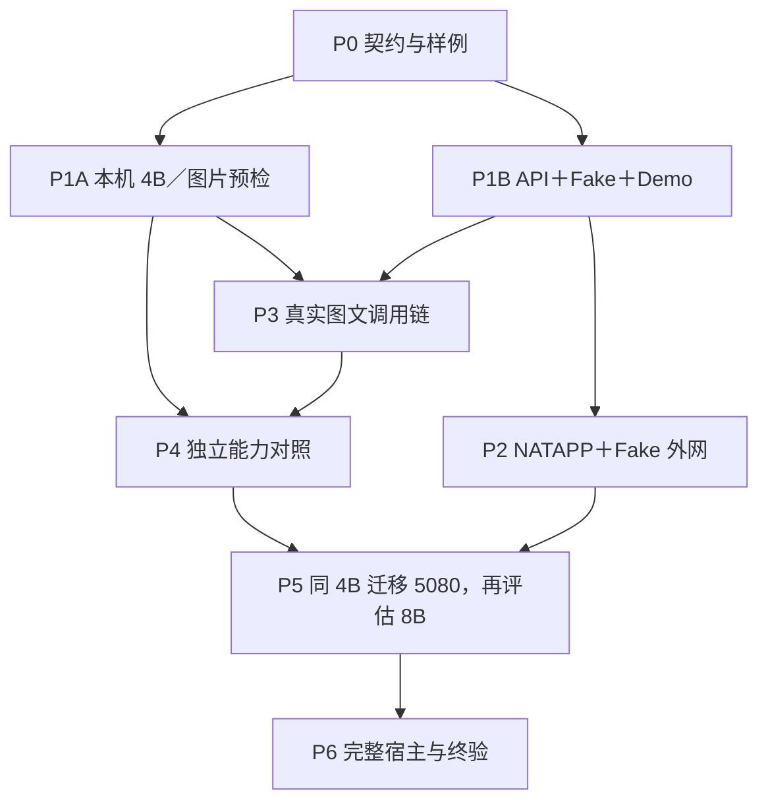

# 实施规划：专项边界、实现顺序与项目目录

更新日期：2026-10-23  
状态：v0.3，双线组织与语言独立选型；Python 为服务端优先建议，未定案；业务代码和部署尚未开始。  
本文负责工作包、依赖、目录和交付顺序；业务规则以专项为准，验收门槛统一见 [S06](专项/06-联调与验收.md)。

## 0. 按两条实现线推进，最终按客户端与服务端交付

### 0.1 实现分工

| 实现会话 | 范围 | 独立验证方式 | 进度入口 |
| --- | --- | --- | --- |
| A：客户端、服务端与公网 | S03＋S04＋S05；Demo、业务 API、认证／队列／SQLite、传输与 NATAPP，后续宿主集成 | Fake＋真实 API／数据库／外网，不等待模型质量 | [实现线 A](实现线A-客户端服务端与公网.md) |
| B：模型能力、推理部署与调用 | S01＋S02；模型、profile、上下文／prompt、联合预算、实际适配和能力实验 | 直连本机模型＋固定材料，不等待公网／正式面板 | [实现线 B](实现线B-模型能力与推理.md) |
| 主会话：总集成 | 总体需求、共用边界、依赖冲突、集成窗口、主进度和 S06 | 读取两线实际交付和证据，安排共同验证 | [项目进度](项目进度.md) |

两条线的步骤在各自会话内依次完成；S01～S06 保留为技术设计分区，不再要求六个实现会话。本轮只调整组织与文档，没有创建会话或启动实施。

### 0.2 最小共同边界先定，细节边测边改

开工时只需形成可工作的输入／输出／错误／取消及预算检查约定，不要求所有提示词、模型参数、限额和质量目标一次冻结。

| 边界 | 约定内容 | 维护方式 |
| --- | --- | --- |
| 客户端→业务 API | 已有 S04 图文 v1 草案：需求、代码、上下文、可选图片，job 状态与结果 | A 单一维护 contracts，B 提出材料需求；不各写一套字段 |
| 业务服务→生成模块 | 标准化任务和有效 profile；返回实际文本、完整／截断、计数、失败及来源信息 | 共用小型推理接口，由 A 落定义，B 实现真实版本，A 实现 Fake；Python 可用 Protocol，不要求 C# 接口程序集 |
| 入队前预算检查 | 同一份实际准备材料／profile 的可用、超限、未就绪结果；不接受后再静默删材料 | 最少预算抽象由 A 落定义；B 提供真实准备／计数实现，Fake 仅开发测试 |
| 运行与停止 | A 管理任务／执行位，B 向实际推理传播取消并提供收尾结果 | 共享错误和停止约定，真实图文取消共同验收 |

接口名称为实施建议，不预先扩建框架。准备后的图片／文字与执行时必须一致，版本和 hash 可追溯；模型端口不作为客户端的另一套业务接口。

### 0.3 分别验证，尽早做一次小集成

推荐节奏为：A 做 Fake 本机闭环与公网，B 做真实模型预检与最小调用，两线各有证据；B 最小适配可用时就接通一次本机真实请求，然后各自继续可靠性、能力与容量优化。

这次早期接通是兼容性 smoke，不直接判 G4 或最终业务通过。全部单项优化完成后才首次接线容易推迟发现字段、预算、取消和图片问题；因此保留短集成窗口，最终仍进行完整联合验收。

### 0.4 正式产品与项目数

最终是两个产品端：

1. **客户端**：现有视觉软件中的 C# 工具＋AI 面板／调用与宿主适配；通常在原软件工程内完成，不必新建独立客户端 EXE。
2. **服务端**：一个业务服务，内部包含 A 的认证／任务模块和 B 的上下文／推理模块。Ollama 与 NATAPP 是独立运行依赖，不等于需要再开发两个正式业务项目。

初期代码项目仍为服务项目＋C# Demo＋服务测试项目；Demo、评测和测试不算正式产品端。优先同一仓库、同一约定目录，不按 A／B 建两套临时工程等最后搬运合并；宿主原工程若在别处，按第 5 节接入。

“两端”不代表两份 C# 工程，也不要求同语言、同 solution。服务端可以是 Python 包，Demo 和宿主仍是 C#；两端共用 HTTP／JSON 契约，不跨网络共享进程对象或程序集。


### 0.5 服务端语言与推理引擎分别选择

**状态：语言尚未定案；当前优先建议 Python＋FastAPI。** 此前 C# 服务是工程建议，不是用户要求。本轮按用户提出的比较修正，不将 Python 自动登记为用户确认。

| 层次 | 当前建议 | 取舍依据 |
| --- | --- | --- |
| 客户端／宿主 | C#，真实宿主保持 .NET Framework 4.7.2 | 调用已有数据接口、预览／编译／应用；与服务端只交换业务 HTTP／JSON |
| 业务 API、任务与模型编排 | Python＋FastAPI＋Uvicorn、SQLite，模型通过异步 HTTP 调用 | 上下文、图片、模板与评测能共用 Python 实现，适合当前持续实验；需要锁定解释器与依赖并实际验证 Windows 托管 |
| 实际推理 | 沿用 S02 的 Windows 原生 Ollama 候选基线 | 独立进程加载权重和使用 GPU，服务端不重复加载一份模型；切换语言不要求切换引擎 |

语言比较是对本项目的工程判断：

| 语言 | 对当前项目的适用性 | 何时优先考虑 |
| --- | --- | --- |
| Python | 当前优先建议，便于模型实验和正式服务共用材料准备、适配与评测代码 | 团队能维护 Python，且模型／图片／预算策略持续迭代 |
| C# | HTTP 调 Ollama 同样可行；Windows 托管和现有 C# 开发经验可复用 | 维护者主要熟悉 C#，模型侧基本是稳定 HTTP 调用时仍合理 |
| C++ | 可用于推理引擎、特定原生扩展或有测量依据的性能热点 | 需要修改底层推理、嵌入原生库或优化已定位瓶颈；当前不建议自行编写整套 C++ 业务后台 |

Ollama 提供本地 HTTP API 和官方 Python 异步客户端；Qwen3-VL 的 Transformers 文档提供 Python processor／模板示例。因此 Python 在实验和生态接入上更方便，但 **Python processor 的计数不自动等同 Ollama 的实际输入处理**，S02／S04 的一致性校准仍必须完成。[Ollama API](https://docs.ollama.com/api/introduction)、[Python 客户端](https://github.com/ollama/ollama-python)、[Qwen3-VL processor](https://huggingface.co/docs/transformers/model_doc/qwen3_vl)

实际推理耗时主要受模型、量化、输入、引擎和 GPU 影响；在同一引擎前换成 C++ HTTP 包装不会自动加快 GPU 生成。该结论是架构判断，具体开销仍需测量。已有 C/C++ 推理引擎也可直接通过 HTTP 调用，无需自行重写。[llama.cpp 官方说明](https://github.com/ggml-org/llama.cpp)

如采用 Python，首轮仍为一个业务服务：A 负责 API／任务／存储，B 负责同一包内的 context／inference。先不增加一层“C# 业务后台→Python 模型后台”。HTTP 客户端选 HTTPX AsyncClient 或官方 Ollama AsyncClient 之一，在取消、截止时间和错误映射实测后固定，不叠加无必要的包装层。

首版建议 Uvicorn 单进程、一个持久任务消费循环、一个模型生成执行位；五人可同时提交和查询，只让生成串行。消费循环由应用 lifespan 管理，SQLite 是任务事实来源，不能把逐请求 BackgroundTasks 当成持久队列。多 Uvicorn worker 会创建多个应用进程，当前设计尚无跨进程调度，不直接增大 workers。[生命周期](https://fastapi.tiangolo.com/advanced/events/)、[BackgroundTasks](https://fastapi.tiangolo.com/tutorial/background-tasks/)、[worker 进程](https://fastapi.tiangolo.com/deployment/server-workers/)

Python／C# 的请求取消都不等于 GPU 已停止；S04 的 draining／恢复和真实取消验收不变。Python 本身可原生运行于 Windows，不因服务端换语言要求 WSL；未来引擎需要 Linux 时再单独评估。当前 Python 遵守 AGENTS.md 指定的绝对解释器，实施前检查版本与依赖，不在方案讨论中安装或改动环境。

## 1. 专项划分评审

保留 S01～S06 作为技术文档，实际由 A／B 两个实现会话推进；不按专项编号顺序串行开发，也不拆成六个服务或六套解决方案。

| 专项 | 合理的职责 | 与其他专项的接缝 | 实现落点 |
| --- | --- | --- | --- |
| S01 模型能力与上下文 | SDK／示例、图文事实、澄清与完整脚本规则、质量对照 | 定义内容；S04 传输和组装；S05 采集、编译、预览与应用 | 服务端 Context、版本化 prompts／knowledge、eval；宿主采集适配 |
| S02 模型与推理部署 | 引擎、模型和 profile、内部图文协议、资源、生命周期与迁移 | 给 S04 提供实际可用的推理能力、预算依据和取消路径 | 推理配置、启动／验证脚本、Ollama 适配器 |
| S03 公网接入 | NATAPP 入口、凭据分工、转发与恢复 | 使用 S04 已认证的 API；配合 S05 做真实跨网调用 | 连接器配置模板、部署脚本和现有 NATAPP 手册 |
| S04 服务与调度 | 唯一业务协议、认证、SQLite 任务、状态机、适配和保存 | 接收 S01 材料、调用 S02、服务 S05；不采集宿主对象、不执行脚本 | 一个服务进程和一个服务测试项目 |
| S05 客户端与宿主 | 先简易 C# Demo，后元数据／截图、真实编译、预览与显式应用 | 复用 S04 契约，执行 S01 的交互规则 | 一个 Demo；后期现有软件内的适配代码 |
| S06 联调与验收 | 测试分层、跨专项用例、门槛与证据 | 归集 S02 T、S03 N、S04 A 用例，不再复制参数或定义新 API | 自动化测试、能力评测、人工／实机报告 |

S01 主要是内容与策略，S06 是全程质量工作；二者都不是必须独立运行的服务。S05 内部明确分 Demo 和正式宿主两阶段，首轮不建立完整 UI 或通用客户端 SDK。

## 2. 本轮发现并处理的跨专项不一致

| 编号 | 原不一致 | 本轮收敛方式 | 尚需实际完成 |
| --- | --- | --- | --- |
| I01 | 主方案仍为 Coder 3B／纯文本；S01、S02 已为 Qwen3-VL | 主线同步为开发机 4B 图文，之后 5080 同基线迁移及 8B 评估 | 真实模型下载和推理 |
| I02 | S04 拒绝 images、128KiB、旧 Qwen2 字节预算 | 修订未发布 v1 草案，增加可选图片；VL 联合预算替换旧算法 | DTO／schema、图片校验、经锁定 profile 验证的预算器 |
| I03 | NATAPP＋约 3MiB 图片与客户端 15 秒提交超时冲突 | 查询仍 15 秒，提交单独建议 120 秒；模型执行仍独立计时 | 真实上下行、平台限制和上传测试 |
| I04 | S02 的独立模型测试与 S04 的取消恢复未明确分层 | 独立测 HTTP 中止，再由 S02＋S04＋S05 联调任务和下一项 | 含图取消、晚到结果和执行位恢复证据 |
| I05 | S05 当前明确 C# Demo，主线仍写 WinForms | Demo 为第一交付；完整面板与宿主接入后置 | Demo 运行形式及实际调用 |
| I06 | SDK／示例／图片、prompt 与评测材料可能混在各处 | 统一知识、prompt、业务契约与评测目录，按来源引用 | 真实 SDK、截图和预期答案准备 |

I03 是理论下界检查：3MiB 图片 Base64 后约 4MiB，在假设 2Mbps 的链路上仅传输约需 17 秒；5MiB 正文约 21 秒，均未计额外开销。这不是 NATAPP 实测带宽或延迟结论。120 秒为可调工程默认，不能代替实际上传验收。

## 3. 必须共同稳定的接口

由对应负责人维护一处定义，其他专项引用，不分别实现同名而不同义的字段。

| 契约 | 主责／配合 | 实现前最少内容 |
| --- | --- | --- |
| 业务 API v1 | S04／S01、S05、S03 | 请求／状态／结果、幂等、归属、错误、停止语义；包括可选图文输入 |
| 推理 profile | S02／S04 | 引擎／模型身份、参数、模板／处理策略、图片限制、预算器版本和可验证状态 |
| 上下文与事实来源 | S01／S05、S04 | 当前脚本、真实目录、SDK、来源版本、截图关联、缺失状态与完整交付规则 |
| 图片生命周期 | S04／S02、S05、S03 | 传输、校验、实际发送字节、hash／顺序、幂等、保存／清理、正文及上传限制 |
| 检查与应用 | S05／S01、S04 | 推理完成不等于编译通过；真实宿主检查结果、源版本核对、用户主动应用与回退 |
| 验收证据 | S06／全部专项 | 环境／profile／请求／预期／结果可追溯；Fake、模型、网络与宿主分别标识 |

业务 v1 尚无部署和消费者，不为了修订草案提前维护文本 v1／图文 v2 两套实现；直接对齐图文兼容 v1。`context.schemaVersion`、`hashVersion` 和预算器版本分别演进，不互相冒用。未来存在已发布客户端后，再执行正式兼容策略。

## 4. 推荐实现顺序与并行关系

“可并行”指工作依赖，不表示本轮已启动其他会话或代理。各工作包先交付最小闭环，再补本阶段必要的故障测试。

P／G 编号继续作为底层交付与验收追踪：A 主要推进 P0、P1B、P2、P6；B 主要推进 P1A、P4 与模型迁移；P3、P5 需要两线配合。日常只在两线进度入口记录步骤，不为每个 P 再开会话。

| 工作包 | 实现内容 | 专项配合 | 前置／独立性 | 退出门槛 |
| --- | --- | --- | --- | --- |
| P0 契约与材料 | 将 S04 草案落实为机器可读契约和请求样例，区分 Fake／真实 VL；准备小图和预期关系 | S04 主责，S01＋S02＋S05 | 不需 GPU、公网或完整 SDK；实际预算器校准后置但接口明确 | G0 |
| P1A 本机模型预检 | 按 S02 固定引擎和 4B，先文字再真实小图，记录资源、截断和取消 | S02 主责，S01 给用例 | 不依赖业务 API、Demo、NATAPP，可与 P1B 并行 | G1 |
| P1B 本机 Fake 闭环 | 一个 API＋SQLite、认证和任务；C# Demo 提交、轮询、结果、查回和停止 | S04＋S05 | 依赖 G0，不依赖真实模型；先基本闭环，再竞争／恢复测试 | G2 |
| P2 外网 Fake | NATAPP 连接已认证服务，从真实外网验证同一 Demo；测试断线与 5 用户 | S03＋S04＋S05 | 依赖 G2；可与模型预检、能力材料整理并行 | G3 |
| P3 本机真实 VL 闭环 | 接 Ollama，验证 text／images 真实映射、联合预算、存储与含图取消 | S02＋S04＋S05，S01 提供内容 | 依赖 G1、G2；不依赖公网，图文预算器未验证时仅受控模型实验 | G4 |
| P4 图文与脚本能力基线 | SDK／完整脚本任务、视觉对照、绑定／编译／业务分类；先人工反馈，再比较有界修复 | S01＋S02＋S05，S04 支持材料 | 独立模型评测可在 G1 后开始；业务链路验收需 G4 | G5 |
| P5 5080 迁移与升级 | 先迁移相同 4B／4K／同图，再分别比较 8B、8K／必要时 16K；重验公网与托管 | S02＋S03＋S04＋S05 | 开发机小用例链路已验证；不要求开发机先通过 5080 性能标准 | G6 |
| P6 完整宿主集成 | 接真实数据接口、截图预览、编译诊断、显式应用和回退，完成外网正式流程 | S05＋S01＋S04，全部联调 | Demo 能力与协议稳定；真实 SDK／宿主可用；G5 未达标则不能宣称产品可用 | G7 |



开发机 4GB 不能承载代表性图文或完整代码时，记录 G1／G5 的具体资源限制，API／Fake 和公网工作仍可推进；主会话据证据安排迁移窗口。不得静默换 2B、删图、截原脚本或改成只回 diff 来宣称原要求通过。开发机小用例通过只证明原型链路，不替代完整任务的质量或最终容量验收。

## 5. 统一项目与目录规划

以下均是拟建路径，不代表已经存在。目录按优先建议的 Python 服务端展示，语言尚未定案；不把“一个仓库”固定成“一个 .NET solution”。首轮是一个服务包、一个 C# Demo 和相应测试；S01／S02 的验证先用少量脚本。

```text
D:\github\AiServer\
  .gitignore                            合并忽略规则；不在本轮初始化 Git
  server/                              一个 Python 业务服务包（候选）
    pyproject.toml                     包定义与依赖；实施时补充依赖锁
    src/aiserver/
      app.py                           A：服务装配与生命周期
      api/                             A：DTO、认证、Jobs／health／ready
      api/images/                      A：传输格式／字节／像素校验与归属
      jobs/                            A：单消费循环、任务状态与取消
      storage/                         A：SQLite 与编号 SQL 迁移
      inference/contracts.py           A：公共推理／预算接口与结果类型
      inference/fake.py                A：模拟实现
      inference/ollama.py              B：真实推理适配
      context/                         B：prompt、材料准备与联合预算
      operations/                      A：管理、清理、备份、日志
    tests/                             A 业务与 B context／inference 测试分目录
  tools/ClientDemo/                      简易 C# 工程、入口和少量 HTTP 方法
  integration/host/                     P6 宿主桥接源码／说明；按真实宿主工程构建
  contracts/api/v1/                     schema 和稳定业务契约；不含模型原生 DTO
  contracts/examples/                   文本／图文／错误／查询／结果示例
  config/
    server.example.json                 非敏感业务模板
    inference.development.example.json  S02 参数模板
    inference.production.example.json   迁移时补充
    prompts/                            S01 版本化提示词
  knowledge/sdk/                        有版本的真实 SDK／模板资料
  knowledge/examples/                   适用条件清楚的参考案例，不作测试答案
  eval/cases/                           任务清单、图、目录、输入和预期结果
  eval/holdout/                         未作为参考答案提供的验收任务
  scripts/inference/                    启停、身份、图文 smoke／资源采样
  scripts/server/                       运行、发布、托管与管理入口
  scripts/validation/                   本机／外网协议、能力对照运行脚本
  docs/                                当前文档＋后续脱敏验证记录
    实现线A-客户端服务端与公网.md        A 会话的步骤、证据与交接
    实现线B-模型能力与推理.md            B 会话的步骤、证据与交接
  .local/
    downloads/                          大体积原始包
    apps/ollama/<固定版本>/              引擎完整目录
    ollama/models/                      模型语言与视觉组件
    locks/                              实际模型／模板／profile 锁
    server/                             db、WAL、备份等本机数据
    logs/                               本地运行日志
    inputs/                             私有截图、真实上下文与 SDK 二进制
    demo/                               凭据、请求编号及续查状态
    reports/                            不进入仓库的原始证据
```

- 保留根目录两个原始示例文件，不为目录整齐移动既有证据或破坏链接；整理案例时引用并说明来源。
- `knowledge/` 是可提供给模型的参考资料，`eval/` 的预期答案不会默认拼进该题提示词。公开／脱敏材料可跟踪；私有工程图、SDK 二进制和业务材料放 `.local` 或经授权的受控位置。
- 实际机器配置继续采用 S02 约定的 `config/inference.development.json`，另建相应 server 配置；与 example 模板分开，实际绝对路径和凭据不进入源码。实现时明确忽略真实配置，而不是仅忽略 `.local` 就认为完成。
- 不预先引入 Contracts／Domain／Application 多层程序集或通用 Agent 项目；代码量和复用需要出现后再拆。
- 若最终选 C# 服务端，替换 server 内的语言实现与构建文件；不同时维护 Python 和 C# 两套正式服务。contracts／config／knowledge／eval 与 A／B 的职责边界继续复用。
- 正式宿主若在另一代码仓库，P6 在真实宿主仓库修改，并在 integration/host 记录对应文件、版本与接入说明；不在服务中复制整套视觉软件或伪造 IMV 实现。宿主构建目标维持真实 .NET Framework 4.7.2。
- Demo 可用控制台形式（工程默认建议，运行时待落地）。宿主仍为 .NET Framework 4.7.2；不能将 .NET 10 Demo 程序集直接当宿主插件。先复用协议与少量可移植源码，真正需要共享库时再评估 .NET Standard 2.0，并在两端测试。[兼容依据](https://learn.microsoft.com/en-us/dotnet/standard/net-standard)

## 6. 仓库、运行与发布目录的关系

| 位置 | 约定 | 内容 |
| --- | --- | --- |
| 开发源码根 | `D:\github\AiServer` | 多语言源码、文档、模板与测试；构建入口各自维护 |
| 开发运行数据 | 根目录 `.local` | 引擎、模型、库、凭据和原始证据；不提交 |
| NATAPP 专用运行根 | 保留 S03 手册的 `C:\AiServer\natapp` | 连接器、真实 config.ini、日志与服务；本轮不擅自迁目录 |
| 5080 发布根 | 沿用 S02 的 `D:\AiServer`，无 D 盘时统一配置 | 发布程序、启动脚本、非敏感模板及目标机自己的 `.local` |
| 发布包 | 实现后生成的版本化包 | 编译程序、模板、脚本、依赖锁定与说明；不打包真实令牌、db、私图或模型 |

模型可单独完整离线迁移，数据库和私有配置按明确的迁移计划处理，不把整个开发目录连同凭据复制为发布包。NATAPP、Ollama、API 保持各自唯一托管入口。正式目录依赖 S02／S03 的权限和开机测试，不通过画目录树宣布部署完成。

## 7. 专项如何进入实现

1. 主会话指定工作包 P 编号，读取主方案、本文件、S06 以及涉及专项。
2. 把本包的输入、拟建文件、外部依赖、退出门槛写进实施任务；缺 SDK／公网时使用明确 Fake，不伪造真实能力。
3. P0 落实契约和样例后，S04／S05 共同维护它们；结构变更先更新唯一 schema／示例再改两端。公共契约的变更需通知主会话汇总。
4. 实现者提交代码／脚本和相应测试或实机证据，在负责专项摘要中写“实际完成”与限制，不能只返回聊天结论。
5. 主会话按 S06 的 G 编号检查证据并更新进度；不因某个专项文档已收敛就跳过集成门槛。

默认文件归属按 A／B 执行：A 维护服务装配、业务 contracts、公共内部抽象、api／jobs／storage／operations、Fake、Demo／宿主、server 配置和公网脚本；B 维护 context、Ollama 适配、inference 配置、模型脚本、prompts／knowledge／eval 及对应模块测试。服务依赖声明／锁、C# Demo 工程文件由 A 单一维护；B 需要依赖或接口变更时在交接中说明，由 A 对齐构建。选定语言后同步实际路径，不先按旧 .NET 候选创建服务 csproj。

同一测试项目分目录维护，运行配置由不同文件负责，避免两线同时重写入口和公共项目文件。各次交付应保持代码可构建，集成时重读并验证实际文件。没有必要先拆成多个运行服务或多个仓库。

首个实施任务建议选 **P0 契约与最小样例**；随后开展 P1A 和 P1B。P0 不需要先安装模型、购买隧道或完成完整软件 UI。

## 8. 测试驱动调整与进度同步

- 每线完成一小步，更新本线进度和对应专项；写实际文件、配置／接口版本、验证证据、限制和下一步，不只勾“完成”。
- 实测改变参数、prompt 或部署步骤时更新其权威位置；影响另一线的请求字段、内部接口、图片策略、预算和停止语义，另外写明影响与待配合内容。
- 接口改变同步唯一契约和样例，再改消费者；不兼容变化遵守实际发布状态下的版本规则。可调默认无需全部回到主会话重复审批，跨线冲突由主会话协调。
- 主会话按需读取两线文档和报告后更新主方案／总进度；不依赖自动感知其他会话，也不为未执行测试写通过。
- 两线各自验证后，仍需 API＋真实 VL＋公网＋最终客户端的联合验收；单项都成功不等于组合已通过。
